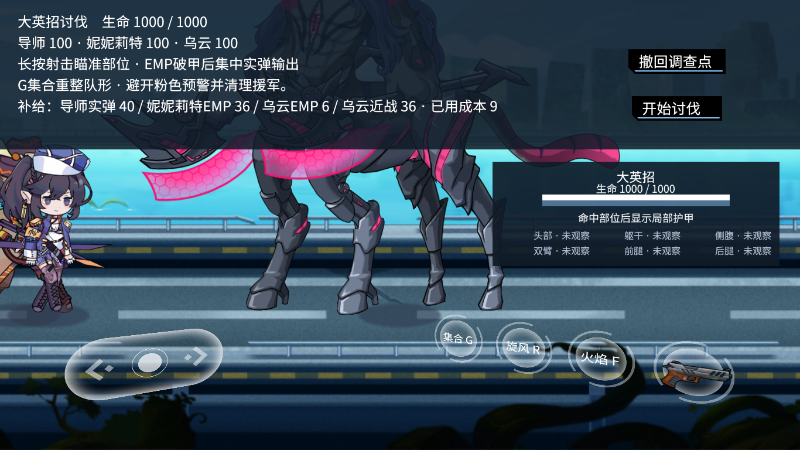
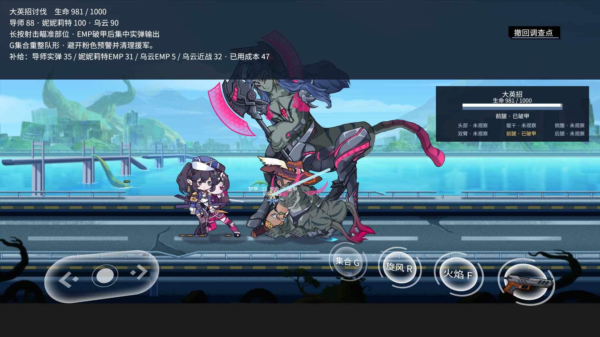

# 全内容候选包与验收记录

## 当前可见头部瞄准候选（2026-10-09）

当前冻结包为`2026-10-09-full-content-head-aim-candidate`，状态`PACKAGED_NOT_ACCEPTED`。保留完整三章、任务、角色与全部既有结局范围；1165运行资源、410 Script Lua、81 UI Lua、2780包文件。相对中断整合包仅修改`Combat.PartAim`，运行路径无增删；其余包差异为运行清单与重新签名产物，严格签名通过。

原中心/内部候选无可用射线时，补查可见轮廓边缘与合法±45°边界射线；边界命中点略移入原轮廓内，仍检查首个身体部位、地形、朝向及射程，原内部候选优先。不会追踪移动目标，也不修改Boss体型/护甲/伤害。稳定姿态70组检查旧包12组漏判、新包0组，14次实际EMP命中头部且每步只消费一次；两名学员×左右朝向×三档距离12组真实枪口矩阵，以及地面静止部位命中/发射后移动目标落空通过。源码与包内均通过，包内加载来源、2780文件保持及运行错误0核对。

早期未等朝向更新的受控测试发射落空，实际射线随后撞地形；稳定朝向后通过。旧地面测试要求固定前腿角度大于2°，新旧包均失败；选择实际可达斜射部位后新旧包均通过。全部失败保留。新包地面原任务/故障重试/结算/剧情返回与实际SQL通过：39成本/100收入/190退款，341→402，旧模型/账单保持；新包工厂四战自然胜利、原专用结算及剧情返回通过；成本111/47/103/55，收入400，余额379→463。独立SQL、旧模型/旧账与冻结加载核对通过；37次完整攻击、36次释放、1次取消释放、1次倒下记录时序核对（容差0.05秒）。

范围仅受控瞄准、真实发射与上述任务接入；非正式Boss自然稳定通关、连续OS、全部结局、完整视听或长稳验收。证据`Docs/evidence/2026-10-09/head-visible-aim`。以下记录按原包保留，旧成功不转记新包。正式存档保持，未发布或推送。

## 当前中断记录整合候选（2026-10-09）

当前冻结候选为`2026-10-09-full-content-interruption-integration-candidate`，状态`PACKAGED_NOT_ACCEPTED`。保留完整三章、任务、角色及全部既有结局范围。相对动作中断候选，仅修改缴械执行、地面部位战斗、工厂战斗和工厂部位战斗4个生产Lua；运行路径无增删，2780包文件及严格签名通过。上一轮新增动作停止通知造成缴械把中断误记为完成，原执行测试包内复现FAIL，现已适配状态；源码及新包原执行/延迟命中/消费归属/取消与实际存档重读通过。地面及工厂真实原生动作中断的日志原因已同步接入，源码及包内受控专项通过。证据`interruption-consumer-integration`。只验收相关记录边界，正式Boss、完整剧情/结局、连续OS、视听及同包长稳仍开放。

## 当前动作中断记录候选

当前冻结候选为`2026-10-09-full-content-action-interruption-candidate`，状态`PACKAGED_NOT_ACCEPTED`。完整三章、任务、角色与全部既有结局范围保持；相对救援计数候选仅修改`Training.Arena`及`Enemy.BigYingzhaoBattle`，运行路径无增删、2780包文件、严格签名通过。实际击飞复现射击步骤缺少结束通知；已在原生UnitAction停止时记录中断并清除旧攻击事件，自然完成只记录一次。尼尼莉特射击/乌云近战的真实中断、落地后自然完成：源码及包内专项通过；包内集合队列、现行施法不被集合截断通过。仅动作记录与相关边界通过，不代表Boss稳定通关或完整游戏验收。包内武器首次接触/EMP破甲、实弹与刀击计费、隐藏目标不扣费及结算后不再计费专项通过。旧测试固定前腿/步骤2的假设在新旧包均失败；改为按真实命中部位与hit.step核对，失败证据保留。证据`action-interruption-closure`。

包目录：`/Users/Jin/Workspace/Dora/LSD-builds/2026-10-09-full-content-action-interruption-candidate`。历史三章与正式Boss证据按原包归属，新包尚待任务回归、连续操作、视听及长稳。

## 当前救援动作计数候选（2026-10-09）

当前冻结包为`2026-10-09-full-content-rescue-owned-completion-candidate`，状态`PACKAGED_NOT_ACCEPTED`。保留完整三章、原任务、角色和全部既有结局；1165运行资源、410 Script Lua、81 UI Lua、2780包文件。相对示范风险提示v2包仅修改`Ground.Battle`，运行路径无增删，严格签名及精确差异核对通过。

原包观察复现4次刀击/4条封存episode，却收到8次结束通知并计数8；改为有限攻击通过原`CombatAnimation.playOnceAsync`完成后只计数一次，仍沿用原命中点与recovery。源码3次刀击/3条episode/6通知、报告3；新包4次刀击/4条episode/8通知、报告4。每次声明1秒，记录完成约0.983秒（原生帧采样容差0.05秒），真实命中信用在动作区间；自然胜利、保存故障回滚重试、原成功页、救援剧情与休息室返回通过，实际SQL费用/旧模型/旧账保持，正式档保持。仅计数修正与这段实际时序通过，不代表全部动画视觉、OS或整局验收。证据`ground-rescue-owned-completion`。

上一示范风险提示v2包25段脚本三章主路径及独立SQL/库存/来源/冻结审计全部通过：主账12笔成本1088/收入1200，300→412；参考能源分支不合并；终章15攻击/释放、10倒下记录与15句演出核对，已定位“仍有回应”及署名，冷启动45表保持。该证据按原包归属；新包地面任务已定向复验，不将旧包25段改记为新包完整试玩。正式Boss稳定通关、其余原结局、连续OS、动画视听和同包30分钟长稳仍开放。

## 上一部位示范风险提示候选（2026-10-09）

当前包25段三章公共UI脚本旅程及独立审计全部通过，主账12笔收费任务，总成本1088/收入1200，余额300→412；参考能源分支408独立保留、不合并。终章救援成本83、最后约定131（净亏31），15次攻击/释放及10次倒下记录时序核对，15句完整终章演出→已定位“仍有回应”与署名；冷启动继续45张SQL表逐行保持，无重复奖励。全部2780包文件、410 Script Lua与加载来源核对，正式档保持。地面3条刀击与结束计数6仍待观察核对。此为脚本主路径证明，不代表正式Boss稳定通关、全部原结局、动画视听、连续OS或30分钟长稳已验收。证据`demonstration-warning-full-journey`。

当前冻结包为`2026-10-09-full-content-demonstration-warning-v2-candidate`，状态`PACKAGED_NOT_ACCEPTED`。完整三章、原任务、人物和全部既有结局范围保持；1165运行资源（不含清单）、410 Script Lua、81 UI Lua及2780包文件。相对上一回顾滚动包只修改部位示范提示、选择器排列、对应头部背景和示范镜头，共4个生产Lua；无运行路径增删。

部位示范复用正式讨伐的可见风险提示，显示机体/队员正面与波技能风险、护盾外、金粉及机体告警。准备保留操作与保存说明，战斗时简化常驻文字；部位按钮随正文高度排列，镜头复用原Boss取景并以受控学员为对象，Boss模型scale保持1。第一版源码截图发现选择器遮住护盾文字，首次包头部过高影响视野，均保留中间证据；最终包1920×1080及1366×768文字/选择器边界、实际原UI走位、撤退、观察保存与返回训练通过。全部31张SQL表独立比较，29表逐行保持，仅观察追加1份与序列变化，旧观察前缀保持，运行错误0，正式档保持。截图人工检查限于提示、按钮排列与Boss/学员取景；不作为全部角色/HUD遮挡、动画、听验或连续OS证明。中点跟随、消耗、护盾、部位命中和训练采用规则保持。证据`demonstration-support-warning`。自然侧腹补练和Boss稳定通关仍开放。

## 上一旅程回顾滚动候选（2026-10-09）

当前冻结包为`2026-10-09-full-content-ending-scroll-candidate`，状态`PACKAGED_NOT_ACCEPTED`。完整三章、任务、角色和全部既有结局范围保持；1165运行资源（不含运行清单）、410 Script Lua、81 UI Lua及2780包文件。相对终章支持显示候选只修改`Ending.View`，原路径完整保留，严格签名及精确差异通过。

同一回顾滚动包已补验实际OS阅读操作：CUA滚轮到末行、继续/上一页点击归零、连续三次拖动到末行、实际返回标题与受损学院。观察夹具只复制合法完成档并执行Start，没有提交任何滚动/翻页/返回指令；原生偏移依次0→83.5→0→0→83.5。全部45张SQL表逐行保持，余额417、模型和观看记录不变；2780包文件运行后保持，运行错误0、正式档保持。末次点击触发正常完成并自动关窗，随后AX读屏noWindowsAvailable保留为工具观察错误，不是游戏运行错误。证据`ending-scroll-actual-os`。仅此阅读/导航段为真实OS，准备为脚本，不转为三章连续OS或其他原结局验收。

冷启动旅程回顾实际发现任务列表正文553.5高，底部136.5侵入页脚；复用原报告屏幕的原生ScrollArea，在固定正文区滚动，保留全部文字、字体、任务和作者名单。切页先清偏移再设置滚动内容尺寸，避免从长页进入短页时残留偏移。原包重现FAIL并留图；第一版修复切页检查FAIL保留；最终源码及新包9页、1920×1080/1366×768、长页顶部/末行与切页归零通过。新包从实际完成档冷启动回顾→结局标题→受损学院，全部45张SQL表逐行相同，模型/余额/观看记录保持、无重复奖励。正式存档不改。证据`ending-body-scroll`。

上一终章支持显示包本轮从历史合法学院防卫完成档，沿原门路/对白进入双子救援和最后的约定，两场自然胜利→原成功页→15句完整终章演出→已定位“仍有回应”回顾/署名完成。独立SQL逐项核账：救援成本83/收入100/退款146，终章成本131/收入100/退款98（净亏31），431→448→417，旧模型和任务账保持。15次完整攻击/真实释放及10次记录倒下时长核对，终章攻击/受击/倒下时序通过；本次两场采样P95/P99约16.7毫秒、无超过33.3毫秒帧，排除各场开头2秒。此成功证据属于上一支持显示包，不能转记新包完整旅程或全部结局。新包仅修改回顾显示，正式Boss稳定通关、其他原结局、完整三章连续OS、视听及长稳仍开放。

以下历史证据保留各自版本来源；原结局选择关系继续查回，完整范围保持。

## 上一终章支持显示候选（2026-10-09）

当前冻结包为`2026-10-09-full-content-final-support-cache-candidate`，状态`PACKAGED_NOT_ACCEPTED`。保留全部原章节、任务、角色和既有结局范围；1165运行资源（不含运行清单）、410 Script Lua、81 UI Lua、2780包文件。相对学员枪口校准候选仅修改`Final.Battle`的支持显示，原文件路径完整保留，严格签名及精确差异通过。

终章撤离战的维生范围改为局部图形跟随机体，仅启停换色时重画；生命文字只在显示数值变化时设置。源码和包内实际原生世界对照：恒定120帧文字setter120→0、图形清空120→0、线段绘制360→0；五组移动/生命/启停状态的世界坐标、颜色、宽度和文字一致。此为重复工作减少的证据，不冒称整局FPS或卡顿已经全部解决。

源码与包内沿合法双子救援档，经原终章对白、准备和预算，验证实际失败→取消重试→付费重试→攻击中撤退→返回研发室。两笔实际成本2/13、收入均0、退款2/216，余额417→415→402；逐消费独立SQL核账、34张原表逐行保持、旧账前缀保持，无胜利误解锁及活动任务残留。重试攻击声明3.4667秒，实际约3.45秒，保留原生帧采样差异（审核容差0.05秒），不记为全部动画视觉验收。操作为公共UI脚本，非真实OS或终章成功通关。证据`final-support-cache`保存原始对照、实际档、源码前后与审计；正式存档保持。

下一步继续原任务接入、终章成功/保存返回和全部既有结局核对；Boss真实补练与稳定通关仍开放。以下旧记录中的“当前”仅指其记录版本。

## 上一学员瞄准校准候选（2026-10-09）

当前冻结包为`2026-10-09-full-content-learner-muzzle-candidate`，状态`PACKAGED_NOT_ACCEPTED`。完整内容范围保持；1165运行资源（不含运行清单）、410 Script Lua、81 UI Lua、2780包文件。相对闭场清理候选只修改`Combat.Muzzle`、`Training.YingzhaoActions`，增加`Data/Combat/learner-muzzle-preview.json`，无原内容删除；严格签名及逐文件差异通过。

学员原先用闲置姿势估算出枪位置，静止Boss背面1300距离瞄准侧腹却命中后腿。56组原动画发射采样校准角色/角度；开发源与新包原侧腹夹具12条件通过：6个正面遮挡仍拒绝，6个背面发射真实命中侧腹。原头部等部位矩阵12条件源码回归通过。实际枪口、冻结世界目标点、弹丸首次接触和消耗规则保持；旧模型不迁移，旧对照报告不转为新包验收。

自然移动Boss补练开发源仍FAIL：8发全部发出，1发真实命中侧腹，未完成侧腹破甲；原撤退/完整观察保存和运行错误0，29张原表逐行相同，仅追加1份示范观察，钱包/旧模型/采用/任务账保持。新包默认标题检查通过，仅标题。验证证据`learner-muzzle-preview`保留旧FAIL、原生校准、源码/包结果、两份实际档、独立核对及逐文件哈希。正式存档未改。

下一步在真实移动战斗中用正常站位和时机补齐有效示范，同时按原任务矩阵推进三章战斗接入及全部既有结局核对。旧包“当前/已通过”表述仅指记录当时的版本；以下历史证据不转为新候选验收。

## 上一闭场输入清理候选（2026-10-09）

当前冻结包为`2026-10-09-full-content-cleanup-guard-candidate`，状态`PACKAGED_NOT_ACCEPTED`。原三个章节、任务、角色和全部既有结局范围保持；1164运行文件、410 Script Lua、81 UI Lua及2779包文件完整保留。相对Boss/训练UI候选仅改`Training.DisarmDemonstration`与`Factory.PatrolLevel`的闭场输入清理，严格签名及精确差异核对通过。

实际侧腹补练失败退出时发现“世界已销毁，HUD仍发送停止指令”的物理对象错误。同一原生夹具旧版复现，新源码及新包的示范/普通战斗控件清理通过，正常移动/停止保持，31张原存档表逐行相同。原侧腹八次射击未破甲的FAIL仍保留；同流程新源码退出运行错误1→0，不能记为补练成功。新包空隔离目录默认标题检查通过，仅标题；46文件证据`boss-cleanup-guard`含旧失败、新结果、实际档、源码前后和独立核对。

下一步先核对侧腹可达位置与实际命中，再采集破甲后切换目标、等待、技能和机动示范，重新对照与正式任务验证。完整三章、全部既有结局、稳定Boss胜利、连续OS、视听及生产长稳仍待当前包验收；下列旧包旅程、训练和失败证据保留各版本来源。正式存档未改，网站未发布，未提交或推送。

## 上一Boss提示与训练UI整合候选（2026-10-09）

当前冻结包为`2026-10-09-full-content-boss-training-ui-candidate`，状态`PACKAGED_NOT_ACCEPTED`。完整保留1164运行文件、410 Script Lua、81 UI Lua及2779包文件；相对首次启动修复候选仅改`Ground.BigYingzhaoLevel`与`Training.Level`，其余原文件逐字节一致，严格签名通过。

包内双分辨率Boss导师标记、原生命条、护盾外提示及随文字高度扩展的状态区通过；原公开配装、撤退专用结算和返回通过。7项消费独立核账，成本28/收入0/退款10，合法分支333→305，旧模型、采用、故事库存及旧账保持。训练全部37任务按钮/4分类、正常射击采样、成果页返回及护甲靶入口通过，24张原表逐行保持；文字更新缓存已合入。空隔离目录默认入口标题检查通过；其后的新游戏与继续补验见下。加载归属、410 Script/81 UI及运行后2779文件保持，运行错误0。游戏`Docs/evidence/2026-10-09/boss-training-ui-package`保存29文件及逐文件哈希。

**当前包默认入口与冷启动继续已补验**：执行字节未改的包内bootstrap，隔离空目录中实际OS点击“开始新旅程”，随后原开场/教程真实命中、学院漫游至训练室与虚拟训练场、6条示范及三场试战采用、首场正式任务胜利和返回均由原公共UI脚本回放完成。17项消费独立核账，成本59/收入100/退款170，余额300→341；新进程实际OS点击“继续旅程”返回学院，19张原SQL表逐行相同，身份/训练成果保持且无重复奖励。加载归属、410 Script/81 UI、2779冻结文件和零运行错误均核对，正式存档不变。证据`default-entry-cold-continue`保存原始结果、实际新档/冷启动档、截图与独立审计；只证明两次标题点击为OS操作，不称全程OS或三章/全部结局已完成。

**当前包公开部位训练→采用→正式讨伐接入已核对**：合法失败父档经原示范/学习产生15样本候选，公开双场对照、采用/取消/回滚及正式部署通过独立SQL/加载归属核验。正式产生88次采用来源决策、38次执行，121.40秒辅助机毁坏、Boss剩231.55；成本217/收入0/退款72，333→116，原专用失败结算返回，成果/旧账保持。405预算被拒且任务/钱包不变，随后使用原289配装。对照两场均失败；基础/候选破甲140/490、伤害328.05/481.55、成本213/239，候选仍有13次已知破甲部位的无效EMP，不能称稳定收益。正式未匹配28次/不可执行22次：下一步补充各部位破甲后的切换、等待、技能与机动示范，覆盖实际未匹配状态后再对照。证据`boss-public-training-deployment`保留两次失败、合法档、原始完整对照及审计。操作为公共UI脚本回放，正式通关测试仍FAIL，接入审计PASS不等于获胜；生产代码/候选包未改。

以上属于当前包定向整合验证，由脚本驱动原UI；不能替代完整三章、全部既有结局、真实连续操作、稳定Boss胜利、视听或生产长稳验收。原源码专项、实际OS失败和旧版本长测均保留原来源。正式存档不改，网站未发布，未提交或推送。下一步延续当前包新档核对后续原任务串联，并验证合法训练成果采用后的Boss距离、队伍恢复和有效射击，再完成各原结局与同版本连续游玩。

以下历史记录保留各版本归属。

## 上一首次启动修复候选（2026-10-09）

该版本冻结包为`2026-10-09-full-content-clean-title-candidate`，状态`PACKAGED_NOT_ACCEPTED`。保留1164运行文件/410 Script Lua/2779包文件，相对清障镜头标记包仅改`Save.Slots.current`的旧标记存在性检查，其他原文件逐字节保持，严格签名通过。隔离空目录和带旧标记/合法复制存档的目录均从包内默认bootstrap进入标题；首次启动日志错误0、旧档继续按钮显示、复制数据库及运行后2779文件保持，22文件证据`clean-title-package`保留修复前的日志清洁FAIL。只验标题/旧标记读取，未按继续按钮进入旅程。三章、全部既有结局、真实连续OS、视听与生产长稳仍待当前版本验收。

该首次启动修复包实际Boss尝试14.70秒导师倒下、机体82、Boss917.75；成本63/收入0/退款230，合法分支493→430。原失败结算实际返回列车、1发付费射击、18次队伍/机体接触逐条核账，旧模型/账单保持，运行错误0，410 Script/81 UI及2779冻结文件保持，505文件证据`clean-title-os-boss-regroup`。开战0.082秒短按G、0.366秒D推进真实发生；首轮导师离机体超过护盾半径而受击100→38，恢复长按G直到14.316秒才开始，未到0.65秒阈值已失败。保留错误半尺寸点击、工具拒绝D+G组合键及操作空档；本次不证明安全换位、恢复集合或稳定胜利，观察器PASS仅表示输入/核账/保存返回通过。
以下记录保留原版本归属。

## 上一清障镜头与标记候选（2026-10-09）

当前冻结包为`2026-10-09-full-content-clearance-camera-marker-candidate`，状态`PACKAGED_NOT_ACCEPTED`。保留全部1162原运行文件，新增清障镜头与导师标记两模块，共1164运行文件/410份Script Lua/2779包文件。相对追兵保护包仅改`Ground.DisarmLevel`、`Factory.PatrolLevel`，其余原内容保持；严格签名和精确差异核对通过。包内正常入口小窗口清障胜利、原专用结算返回、导师真实身体中心标记及原生命条/结算后清理通过；成本71/收入100/净收益29/退款222，余额464→493，19消费事件及原模型/旧账/故事库存SQL保持。410 Script/81 UI Lua及运行后2779文件保持，运行错误0，25文件证据`clearance-camera-marker-package`。默认标题启动、全部三章/既有结局、真实连续OS、视听与生产长稳仍待本版本验收。

以下为历史版本记录，不转记为当前包验收。

## 上一追兵用药保护候选（2026-10-09）

当前冻结包为`2026-10-09-full-content-pursuit-medicine-guard-candidate`，状态`PACKAGED_NOT_ACCEPTED`，完整保留1162原游戏文件、409份Script Lua及2777包文件。相对上一五入口包仅修改`Ruins/Pursuit.lua`与`Ruins/PursuitLevel.lua`，其余407份Script保持。严格签名、全文件核对、默认标题、包内输入/用药边界对照及原遗迹剧情→自然追兵任务→专用成功结算→谷地返回通过。独立SQL：成本32/收入100/净收益68/退款30，余额314→382，用药1份与实际库存一致，旧模型/旧账/其他库存保持，运行错误0。35文件证据`pursuit-medicine-guard-package`。正常路线先前在Enter/Align前读按钮位置的夹具失败保留；记录初值后在布局稳定时核验原屏幕边界，未修改生产结算UI。

上一五入口包58轮/1818.52秒原任务往返属于该版本基线，不转记为新包长稳。完整三章、全部既有结局、真实连续操作和视听仍待同版本验收。

以下记录保留各历史版本归属，文中“当前/尚未入包”以对应记录时点为准。

开发源后续清障状态区与镜头专项已通过原生大/小窗任务及核账，但尚未汇入本冻结包；其证据不转记为包内验收。见[进度](progress.md)。

## 上一五场输入保护候选（2026-10-09）

当前冻结为`2026-10-09-full-content-battle-input-candidate`，保持完整三章与全部既有结局范围、`PACKAGED_NOT_ACCEPTED`。相对结算滚动包仅五份Level接入额外技能的公共失焦/隐藏/后台保护及状态文字缓存；1162原文件、409 Script、2777包文件与签名已核对。原生旧/新对照和开发源地面/能源正常路线通过；新包定向复验与一次Start/单存档/原结算返回的30分钟长稳继续验证。原版本标题、三章路径及Boss胜利不转记为新包验收；当前证据与缺口见[进度](progress.md)和[接入矩阵](battle-integration-matrix.md)。

## 历史成功结算滚动修复候选（2026-10-09）

新结算滚动包首次正式Boss实际OS复验失败：55.46秒机毁，Boss剩74，20发付费实弹，成本132/收入0/退款161；合法分支252＋公开回收41−132＝161，旧模型/旧账和原失败返回保持，35次队伍/机体接触逐条归因，运行错误0。423文件 `settlement-scroll-os-boss`。实际CUA打开原失败战报、滚动读到乌云近战末项余量1/返还1、关闭返回结算再返回列车；滚动截图属于本线程CUA工具记录，没有补造引擎截图或滚动遥测。最后两次拳击时机体仍位于Boss正面约317单位，HP28→10→0；原危急提示已显示。与旧胜利采用相同的站桩输入批次，但时点/姿态不同，不构成难度单变量对照，更不能证明稳定通关。下一步核对危急时整队换位，保留护甲、Boss尺寸、价格和合法采用模型。

当前冻结候选为 `2026-10-09-full-content-settlement-scroll-candidate`，仍 `PACKAGED_NOT_ACCEPTED`。完整1162原游戏文件、409剧情/战斗Lua和2777包文件；相对报告快照候选仅三份UI差异：ResultDetails、Settlement.xml及原生生成Lua。严格签名、隔离新目录默认标题入口、包内三分辨率实际Boss胜利报告重放与八组原结算回归通过，加载隔离和运行后全部包文件保持；正式存档哈希保持。28文件证据 `settlement-scroll-package`。默认启动只验标题；新空目录缺少存档marker的原始诊断保留，没有运行时堆栈。旧包25段三章脚本主路径/一次实际Boss胜利继续作为未改战斗逻辑的基线，**不转记为本包完整旅程或真实Boss验收**。全部既有结局、同版本实际连续游玩、视听与生产长稳继续开放。

## 上一屋顶报告快照候选（2026-10-09）

开发源原成功结算长战报滚动修复通过：实际Boss胜利数据重放时，旧Horizontal成员布局把2310高文字的滚动范围重置为843，原生复现FAIL；修复保留实际内容高度、顶部边距及缩放后的滚动偏移。三分辨率2560×1536/1920×1080/1366×768末行可达，代表顶部/底部截图人工核对；原成功、失败和虚拟演练八组回归通过，XML原生编译与生成Lua逐字节一致。58文件证据 `boss-victory-report-scroll` 保留首轮测试误读外层零尺寸及第一次修复遗漏偏移的过程。仅修改UI.ResultDetails、UI.Settlement.xml及生成Lua；没有写DB或修改战斗/经济。**尚未入当前冻结包**，同包25段与Boss实际胜利仍属修复前候选，不能追认其长战报显示通过。

同包正式Boss首次实际OS胜利及独立审计通过：65.33秒、24发付费实弹，成本141/收入100/退款152/净亏41；合法分支158＋公开回收135＋100−141＝252，不并入三章主账417。辅助机28，导师100/妮妮莉特95.20/乌云60.99；32次队伍与机体接触逐条归因，旧模型/账单保持，原成功结算返回列车，运行错误0。423文件证据 `report-snapshot-continuous-os-boss`。准备路线与配装为脚本，开始/战斗/返回为CUA实际输入；1306采样、436按键完整。导师实际命中前腿17/后腿6/侧腹1次、生命伤害290.6，未观测头部；未自动采用部位模型。最长12.35秒未持有A/D/J/G的采样区间仍保留，不声称无空档连续操作、稳定胜率或完整新档旅程。

当前冻结 `2026-10-09-full-content-report-snapshot-candidate`：冻结时2777包文件、1162原运行文件及409游戏Lua与当时源码一致；相对输入恢复包仅修改 `Factory/RoofBattle.lua`。严格签名、包内加载隔离、原屋顶入口/付费撤退/结算后拒绝输入专项及完整实际SQL报告核验通过，成本5/退款224/余额295。423文件证据 `report-snapshot-package` 保留审计初次把生成清单计入原文件、第二次未允许包内引擎库的检查错误及修正。当前包自身25段三章脚本主路径及独立SQL/冻结包审计通过：33实际档、14胜/12账单，主账300＋1200−1083＝417，终章冷启动45表保持，屋顶整份报告一致。证据 `report-snapshot-full-journey`；只覆盖已定位结局的脚本路径。正式Boss已有一次实际OS胜利；全部既有结局、稳定可复现胜利、三章连续OS和当前包生产长稳仍待验，保持 `PACKAGED_NOT_ACCEPTED`；旧包报告审计失败不改为通过。

同包第一轮实际Boss操作60.92秒辅助机被摧毁，Boss607.6；10发实际实弹/成本113/退款180。父档41＋公开回收252−113＝180，旧模型、账单和保存返回保持；40次队伍/机体接触逐条匹配原攻击，8次机体接触含连续拳击，运行错误0。423文件 `report-snapshot-balanced-os-boss`。配装通过原UI选100/10/2/36，预算仍293；准备路线由脚本完成，开始/战斗/返回为实际CUA输入。射击向下约21–30度，未达成瞄准上半身；不作稳定胜利或完整真实旅程证明。

第二轮同包实际操作改为开局换位及向上释放，11发弹道实际向上约15–30度；97.49秒妮妮莉特倒下，Boss456.35、机体5、金粉0。实际成本115/退款178，分支180＋公开回收113−115＝178；61次队伍/机体接触核对、旧模型和保存返回保持，运行错误0。423文件 `report-snapshot-upward-os-boss`。前两次恢复只有乌云记录到位，第三次因维生场停机结束；头部未观测，躯干/手臂护甲仍完整。未完成正式Boss胜利，不能把更长存活或更低Boss生命当作稳定改善证明。

下一步依据实际攻击时点检查整队换位：分别核对导师跨越Boss、两名学员集合路径和机体中点位置，检查恢复期间受击/动作阻塞是否妨碍到位；同时核对向上预览能否正常选中头部或已破甲腿部。先复现具体阻断，再修改公共战斗模块；保持Boss尺寸、护甲、价格及合法训练采用流程。

## 当前输入与恢复整合候选（2026-10-09）

路径：`/Users/Jin/Workspace/Dora/LSD-builds/2026-10-09-full-content-input-recovery-candidate`。完整三章、原任务/角色及全部既有结局范围保持，狐狸不训练；2777包文件、409 Script及1162运行文件保留。严格签名、默认应用标题及截图检查通过，空隔离目录首启缺少 `lsd-current-save.txt` 的既有日志仍记录，不称默认启动零日志错误。

相对上一战斗反馈包只改八份生产Lua：`Academy/DefenseBattle`、`Academy/DefenseLevel`、`Rescue/Level`、`Final/Level`、`Factory/PatrolBattle`、`Factory/PatrolLevel`、`Combat/GatherGesture`、`Combat/StatusView`。汇入零生命用药保护、章节/共用技能输入保护、实际倒下成员说明、重复长按恢复连续性和同文字缓存。原Boss尺寸、攻击时长、50%后退、成本、采用模型与完整内容保持。

六项包内专项通过：实际倒下说明、共用输入保护、恢复长按、自然集合期限、状态文字生命周期、三章药品八组。各项运行错误0，实际加载模块全部在新包/配套Lib内，2777文件前后哈希保持，专项执行时源码1162运行文件与新包一致。481文件证据 `input-recovery-package` 包含原报告/夹具、截图、实际药品档、409源码、旧/新manifest及独立审计。

该包25段三章脚本主路径已结束，实际账本300＋1200−1093＝407、结局冷启动45表保持；但屋顶结算报告stop保存2223/显示2224，终段独立审计失败，611文件证据 `input-recovery-full-journey` 保留缺陷。源码已完成计数快照修复及旧FAIL→新PASS/实际SQL对照（441文件），尚未入包；不能把源码修复追认为本包通过。438文件同包第三章失败/重试/返回补验通过。旧包37.10分钟诊断结果仅作基线；真实连续操作、正式Boss通关、全部结局、视听与稳定性仍待验，状态 `PACKAGED_NOT_ACCEPTED`。

## 上一战斗反馈整合候选（2026-10-09）

路径：`/Users/Jin/Workspace/Dora/LSD-builds/2026-10-09-full-content-battle-feedback-candidate`。保留完整三章、任务、角色及全部既有结局范围，狐狸不训练。2777包文件、409游戏Script、1162原游戏文件；严格签名及默认应用标题入口通过，标题启动前后全部2777文件保持。隔离证据：`/private/tmp/lsd-battle-feedback-default-bootstrap-20261009`。

相对上一决策生命周期包改动6份生产Lua：`Combat/Formation`、`Enemy/BigYingzhaoBattle`、`Factory/PatrolGuard`、`Factory/PatrolLevel`、`Ground/BigYingzhaoLevel`、`Ground/SupportView`。集合实际状态记录与有限到期反馈、恢复威胁换侧、收招/边界提示、释放/取消记录及护盾几何缓存已入包。攻击时长、50%后退、资源规则和完整内容范围保持。

七项包内专项通过，证据`battle-feedback-package`；同包三章脚本主路径回归已完成；真实连续战斗/正式Boss通关、全部结局及长稳尚未完成。仍为`PACKAGED_NOT_ACCEPTED`，下文保留各旧包历史结果，不能跨版本沿用验收。

本包25段三章脚本主路径及独立审计已完成：33份实际档、14场胜利/12笔收费账单，300＋1200−1074＝426；材料战获胜仍净亏149，能源参考分支不合账。工厂23次攻击时长完整，22次释放及1次实际DEFEATED取消均有原始记录；该证据只覆盖工厂释放/取消。终章冷启动45表完全保持，妮6/乌18采用模型及中段12类训练、旧账/保存重试核验，狐狸不训练。2777包文件及409原/包/归档Lua保持；证据`battle-feedback-full-journey`。覆盖已定位“仍有回应”的脚本主路径，正式Boss真实通关、其他既有结局、连续OS游玩及本包长稳仍未通过。

## 上一决策生命周期候选（2026-10-09）

当时冻结为`2026-10-09-full-content-decision-lifetime-candidate`，保留2777包文件、409游戏Script、1162原游戏文件和全部旧路径。相对失败原因包仅改两份生产Lua：`Training/Arena.lua`在下一条决策不可用时结束旧的前进/后退；`UI/AimHint.lua`缓存相同提示文字。原动作时长、50%后退、模型、战斗/资源规则及全部三章/既有结局范围保持。

源码原生对照和包内专项通过：两名学员双向移动旧版继续/新版停止，完整射击不被截断；实际Boss集合wrapper在缺EMP时仍拥有手动移动直至到位，模型不变。18文件源码证据`unavailable-movement-lifetime`保留首次夹具结算接口错误及修正后的通过记录。21文件`decision-lifetime-package`核对严格签名、包2777文件、409源/加载隔离及两项包内专项；AimHint恒定文字120帧设置120→0、四阶段切换5帧各5→1，不作为整局FPS证明。

本包自身25段新档三章脚本主路径已全部通过，并独立核验33实际档、14胜/12付费账单、逐消费/库存/退款、旧模型/账单与父档；主账300＋1200−1090＝410，终章冷启动45表逐行保持，妮6/乌18采用模型保持，狐狸不训练。612文件证据`decision-lifetime-full-journey`核对2777包文件/409原、冻结及归档Lua和实际加载路径。工厂23次攻击时长完整、22次释放点有记录，最后一发缺释放/取消原因，已明确列为未验收并保留首次审计失败（`decision-lifetime-release-evidence-gap`）；不补造时间点。只覆盖已定位“仍有回应”的公共UI脚本主路径，不作为其他原结局、正常Boss胜利、连续OS游玩、视听或长稳证明，仍PACKAGED_NOT_ACCEPTED。

以下记录分别属于此前冻结包或专项，不自动转为新候选通过。

## 失败原因展示候选：三章脚本主路径通过，整体待验（2026-10-09）

最新候选为`2026-10-09-full-content-failure-reason-candidate`，保留2777包文件/409游戏Script/1162原游戏文件与全部旧路径；相对追兵结算包唯一生产差异是`UI/ResultDetails.lua`直接展示实际失败原因。严格签名与逐文件核对通过，包内1920×1080、1366×768原因/费用/战报开关专项通过，12文件证据`failure-reason-package`。自身25段新档三章脚本主路径及7组独立核验已全部通过：33实际档、14胜/12付费账单，主账300＋1200－1087＝413，终章冷启动45表逐行保持，妮6/乌18采用模型不变，狐狸不训练。612文件证据`failure-reason-full-journey`核对实际父档、消费/库存/退款、旧账/模型和冻结包归属。能源同父档成本94/42且参考分支不合账；材料战获胜仍净亏148。只覆盖已定位“仍有回应”的公共UI脚本主路径；真实连续操作、其他既有结局、Boss稳定性、视听及同版本长稳继续开放，状态保持PACKAGED_NOT_ACCEPTED。

以下已完成旅程与专项保留原版本归属。

## 当前候选自身新档回归（2026-10-09）

上一冻结`2026-10-08-full-content-pursuit-result-candidate`已完成自身25段新档三章脚本主路径，33份实际存档、14场胜利、12笔付费账单独立核验；主账**300＋1200－1104＝396**，终章冷启动全部45表逐行保持。2777包文件、409游戏Lua与实际加载来源保持一致。612文件证据`pursuit-result-full-journey`覆盖原开场、公开妮6/乌18训练、三章任务和已定位“仍有回应”；能源参考支线不合并，狐狸不训练。公共UI脚本操作，不能代替全程真实输入、其他既有结局、Boss稳定性或同版本长稳验收。

以下合法父档支线与历史候选分别保留版本及账本归属。

## 当前追兵结算包：第三章到已定位结局（2026-10-08）

同一冻结`2026-10-08-full-content-pursuit-result-candidate`，从本包低资源工厂完成档388继续，经原Start和实际场景门路进入第三章。通讯16句、信道异常6句、学院防卫、重创8句、玉到来、双子救援、最后的约定、背叛15句完整演出及“仍有回应”/署名页全部通过。运行对白沿当前chapter-three工作稿，不将工作稿冒称恢复出的历史原对白。

| 实际任务 | 成本 / 收入 / 退款 | 完成后余额 |
| --- | --- | --- |
| 学院防卫 c0-m07 | 135 / 100 / 94 | 353 |
| 双子救援 c0-m08 | 83 / 100 / 146 | 370 |
| 最后的约定 c0-m09 | 127 / 100 / 102 | 343 |

三场使用正常生命、原AI与公开预算/HUD，不注入生命、资源、模型、剧情解锁或胜利；失败旧账、妮6/乌18采用模型和历史episode逐行/前缀保持。学院固定伤亡、双子待救援及随后救出、乌云已离场且不可出战等状态随实际剧情保存。战斗胜利不免除费用：防卫净亏35、最终战净亏27。

随后另启原生进程复制这份343结局档，原Start恢复旅程记录→结局标题→受损研发室探索；全部46张SQLite表逐行保持，无重复奖励、模型或剧情变更。此前工厂冷启动为45表；终章增加结局观看表后实际为46表，按实际数据库核对。

三组独立审计均通过2777包文件哈希、409游戏Lua归属与加载隔离、实际SQL报告/库存/退款/父档保持及严格运行错误0。证据：游戏`Docs/evidence/2026-10-08/pursuit-result-chapter-three`、`pursuit-result-ending`、`pursuit-result-ending-resume`，各11文件及manifest。与此前工厂段同一实际父子链：**202＋回收113＋七场收入700－成本672＝343**。

边界：公共UI/门路由脚本驱动，工厂起点来自旧候选正常获得的合法指挥室档；不是本包新档三章全旅程或全程真实键鼠证明。仅覆盖已定位“仍有回应”，其他既有结局、Boss真实稳定性、完整视听和当前包长稳仍待验；状态保持PACKAGED_NOT_ACCEPTED，正式lsd.db不改。

## 真实撤离通关与成功页按钮修复（2026-10-08）

最新冻结候选为`2026-10-08-full-content-pursuit-result-candidate`，2777包文件/409游戏Lua/1162原游戏文件及全部原路径保持，相对预算说明候选仅修改`Script/Ruins/PursuitLevel.lua`。整体状态仍PACKAGED_NOT_ACCEPTED。

- 上一预算包真实连续输入34.47秒成功，导师27、四伙伴100安全，三光路全部通过；实弹命中1/火光命中2、完整烟雾5/火光2，实际成本50/收入100/退款12/净50，487→537，原成功结算实际继续到OuterHeaven。11文件证据`budget-advice-os-smoke-route`。此成功页实际发现继续按钮右边裁切。
- 修复仅移除成功控制器的错误局部`againButton.x=0`；其父节点靠右对齐，保留原专用结算按钮位置可避免裁切。旧包正常AI获胜后原生边界复现FAIL（1920宽时右缘2022.26），源码/新包两分辨率1920×1080与1366×768实际按钮边界、截图及原剧情继续通过。33文件证据`pursuit-success-layout`，保留旧失败与前后源码、实际账本/存档、唯一生产差异和严格签名核验。
- 新包真实输入再次34.43秒获胜，导师20、四伙伴100安全，三光路全部通过；实弹命中1/火光命中2，完整烟雾5/火光2，阻断攻击1/弹体4，成本50/收入100/退款12/净50，487→537。按钮完整可见，实际点击到原OuterHeaven；11文件证据`pursuit-result-os-route`，2777哈希/加载隔离/实际SQL/旧模型、剧情与旧账保持独立核验，严格运行错误0。
- 新包默认空隔离目录标题ready及运行后2777哈希保持通过，5文件证据`pursuit-result-default-title`，只覆盖标题；首启缺lsd-current-save.txt日志保留，不声称默认启动零日志错误。

两次真实操作均由脚本准备合法已成功父档与公开62预算，随后实际键鼠操作战斗与结果页，combatScripted=false；分别复制存档，不能合并账本、当作同一新档全旅程、默认App整局或多结局通过。药品实际消费0。当前单场正常撤离的真实输入/成功结算/原剧情返回已证明，失败及退出历史继续保留。下一项转向Boss真实机体保护/有效输出、其他任务技能可达和低资源恢复，同版本三章、全部原结局、视听与长稳继续开放。

`2026-10-08-full-content-heavy-recovery-candidate`：2777文件/409游戏Lua/schema13，保留上一恢复整合包全部路径，唯一5 Lua内容变化为完整攻击后的期限保护、重招停顿/可见提示和完整援军复盘。严格签名、全文件及1162游戏源逐份匹配通过；默认原bootstrap原标题图像通过并检查，未点击、不作OS证明。空目录缺已选存档记录的日志保留。状态PACKAGED_NOT_ACCEPTED/runtimeVerified=false。

源码正式106.23秒正常胜利、三人存活/机体58，190消耗/100收入/215退款、489→399净亏90；原模型/旧账/实际报告/episode/返回独立SQL核验，8名退场援军与41次全队命中完全关联，运行错误0。该证据不移作完整包或稳定收益验收。新包25段完整三章脚本复验session93218、raw `/private/tmp/lsd-heavy-recovery-journey-20261008`运行中，全部既有结局、真实连续操作、包内稳定Boss、视听/IME、焦点恢复和最新长稳仍须完成。证据`package-heavy-recovery`及`summon-provenance-formal-boss`。

以下为上一恢复整合包及更早阶段记录，结果保持原版本归属。

# 完整内容候选包

## 当前恢复与战斗接入整合候选（2026-10-08）

`2026-10-08-full-content-recovery-integration-candidate`：2777文件/409游戏Lua/schema13，上一boss-cadence包全部2776文件路径保留，唯一新增路径为Training.YingzhaoCoordinationFeatures.lua。包含来源归因、边界/结算修复、恢复集合原地模型决策及桌面输入UI，配套新-O3运行时来源SHA236ec6361bc0585f3bd60955154ec0dda09376a97fb62ef152d8983ae76cc003。打包时1162游戏文件逐份匹配工程；后续敌人恢复期限单Lua修复尚未纳入本冻结包（前后原生AI/波技能/小英招10例通过，期限修复源正式复验129.10秒仍败，新增4秒/2.2秒大招停顿与可见提示为另4 Lua开发源，正式复验130.78秒仍机毁/Boss87.55/489→294、提示双分辨率画面通过，尚待自然胜利及正式验收），严格签名及2777逐文件校验通过，默认原bootstrap标题/按钮/图像通过并检查截图；未实际点击，不充作输入验收。

同包新档25段完整三章脚本旅程已全部通过，执行会话64015已正常结束；原始job位于`/private/tmp/lsd-recovery-integration-journey-20261008`。25份主档及8份途中档共33实际数据库已归档独立核验，14胜/12正式账单，收入1200/消耗1105，300＋1200−1105＝395；原已定位终章/署名及继续探索、受损学院恢复通过，终章冷启动45表逐行不变。证据`recovery-integration-journey/completed-chain.json`、`completion-independent-audit.json`，615文件清单核验；osInput=false，脚本旅程完成不等于整体可玩验收。

开场/教程、原学院妮妮莉特6样本示范/三场比较/采用与首任务59/100、原标题继续19表保持通过；地面救援39/100→402，调查/列车和合作不虚构收费。乌云18样本公开示范/比较/采用通过，两场能源对照来自同一402父档，成本94与42、收入各100；主线仅沿42分支至460，不合并另一分支奖励。只证明该次操作节省52，不证明最优策略或训练稳定收益。证据`opening-independent-audit.json`、`first-chapter-independent-audit.json`、`energy-independent-audit.json`。

阿岩引路、李叶娜合作/对打、邮件/医疗、花妖材料、治疗/过夜和遗迹撤离贯通；材料获胜但249/100、净亏149→311，治疗/原补给无额外现金，遗迹32/100→379。谷地五活动奖励各一次，过日、狐狸同行/完整行走循环、指挥返回接续通过，狐狸无新增训练；原战斗模型与账单保持。证据`middle-independent-audit.json`、`valley-independent-audit.json`。

工厂四战122/47/109/55共333、收入400，379→446；四份原剧情检查点报告与Mission报告一致，三处掩体/零警报、六次升层至七层、原开门/屋顶返回通过，次巡逻无乌云补给，巡逻/屋顶23段敌人攻击完整时长核验。学院防卫三阶段/六敌/12攻击和六次倒下时长核验，137/100→409；双子救援83/100→426、最后约定131/100→395，原终章与观看记录保持。时长采用0.05秒容差；费用是本次实际报告，不继承旧包326/135/127。见`late-independent-audit.json`。

全部25份主档实际消费事件、承担者/执行者、剩余存量、预留/整备、退款及钱包一致，见`resource-events-independent-audit.json`。同一创建身份、实际父档图与两个参考分支隔离核验，见`lineage-independent-audit.json`。全部2777包文件与409原源/冻结源/归档源逐项匹配，逐段实际加载模块均来自包内，见`freeze-independent-audit.json`。本链不包含可选大英招自然胜利或全部原结局，也不替代真实连续操作或同进程长稳。本轮能源460隔离档经公开清障实际获胜，成本71/收入100→489，原任务/账单及六张训练/目标表保持，无活动尝试，Boss入口原先锁定/取消无扣费与胜利解锁核验通过；证据`recovery-package-public-clearance/independent-audit.json`。同包Boss原配装405试战已失败：62.33秒辅助机被摧毁、Boss757.4，导师7发，207/234位置采样仍移动；实际83消耗/322退款/收入0，489→406，原报告/六张训练与目标表/旧账及409源独立核验，运行错误0，证据`recovery-package-public-output-boss`。只使用本轮基本6/18样本采用模型，不继承191探索模型，不注入HP/资源/解锁；未证明自然胜利或携弹量不足，独立支线不计入主账395。

状态**PACKAGED_NOT_ACCEPTED**。窗口恢复后的实际FocusGained/新输入、Boss可完成性、其他原结局、听验/IME及完整同版本交付仍开放；新引擎与输入修复未验收，不推荐发布。证据游戏`Docs/evidence/2026-10-08/recovery-integration-candidate`，默认标题启动与新包文件审计归属本包；旧包的真实输入、旅程及长测不继承为本包结果。

## 上一地波节奏与整队提示候选（2026-10-08）

`2026-10-08-full-content-boss-cadence-candidate`：2776文件/408游戏Lua，manifest SHA256 `687082960c88316196a662b70f2b1b0490409635ffd9afc3203c1b6ac2379c77`。相对wave-warning包仅四份游戏Lua变化（BigYingzhao、BigYingzhaoRules、BigYingzhaoLevel、YingzhaoTiming）；其他变化为游戏清单和签名，全部原文件路径及素材保留。严格签名/逐文件哈希通过，408 Lua逐份匹配37分钟长测快照。长测是开发入口的检查点分支回归，不能当作本包默认新旅程或25段完整链验收。

本包实际CUA输入复测通过：从真实赚得341检查点副本经原继续逻辑到备战室，D保持2.1167秒/572.92位移、A保持2.0001秒/540.84位移；采样证实实际键盘状态、移动速度与松开后idle/速度0。19张实际存档表逐行不变，2776包文件和源码保持，运行错误0。仅验证学院持续移动，标题继续由引擎按钮事件触发；战斗持续瞄准、失焦/暂停、实际听验/IME、自然Boss、全部结局与同包完整旅程仍开放，状态PACKAGED_NOT_ACCEPTED。证据游戏`Docs/evidence/2026-10-08/boss-cadence-package/`。

首次输入实跑已证明双向移动，但观察夹具在退出回调读取已清理实体而产生一条运行错误；原结果、实际档与精确测试源码保留在`os-input-first-shutdown-fault`，不能当作无错通过。修复仅在外部Test观察夹具添加生命周期检查并清理节点，产品包未修改；`os-input-fixed`严格复测通过。

真实默认入口追加验证（同一进程83505、隔离存档）：原姓名/性别选择后，OP自然播放至教程相遇；通过原印章选项及对白，摇杆左侧短点击触发躲避/武器教学，手枪按钮和J键实际触发射击，后续点击击败教程敌人并进入基地引路对白，画面显示弹壳。进程正常退出0。证据为游戏`Docs/evidence/2026-10-08/package-library-bootstrap/manual-tutorial-audit.json`及实际存档/画面；A/D短按与摇杆右拖尚未留下明确持续位移证据，长按瞄准、教程出口、音频/IME和全游戏验收仍开放。该人工测试没有发Lua事件或注入玩法状态。

默认入口依赖回归追加：仅隔离可写目录、执行冻结包原bootstrap，不补外部搜索路径，随后加载新旅程依赖Data.Config；旧reaction-review包可重复得到Config模块缺失，新library-bootstrap包通过，双方2776文件保持、原生退出0。证据`package-library-bootstrap/default-dependency-comparison.json`，回归脚本`check_default_dependency.py`。该检查仅覆盖入口依赖，不代替真实教程操作或完整旅程。

## 当前机体波路径提示候选（2026-10-08）

`2026-10-08-full-content-wave-warning-candidate`：2776文件/408游戏Lua，manifest SHA256 `024afb740d2cdbf474edd36ee5fa194985966367355197138974a03143b0774e`。相对library-bootstrap包仅Ground.BigYingzhaoLevel一份游戏Lua变动，新增机体在可见波前/前摇覆盖范围内的预警；全部资源/文件路径与默认bootstrap保持，匹配运行时来源、严格签名与2776逐文件核对通过。自身默认标题及Data.Config依赖回归通过，不补外部Lib路径，前后2776文件保持。源码26项提示范围/可见性/优先级、公开Boss实际1920×1080与1366×768显示已验证；冻结包自身26项专项已通过（包内模块来源/2776文件保持），完整旅程继续复验，完整同包三章/全部结局/真实操作/音频/IME/长稳尚未通过，状态PACKAGED_NOT_ACCEPTED。证据游戏`Docs/evidence/2026-10-08/machine-wave-lead/`。旧包实际教程与25段脚本结果保持各自归属。

本包25段完整脚本旅程已终态完成，runner84314及原生子进程已退出，执行会话返回0。33份实际存档归档，冻结408 Lua/2776文件和加载来源逐段核对；独立审计14场胜利/12份收费账单，300＋1200−1092＝408，无回收收入。终章冷启动45张表逐行不变；救援83/100→435、最后的约定127/100→408，15次攻击完整结束。两场性能样本无超过33ms帧，仅覆盖其战斗采样，不代表全游戏长稳。证据`wave-warning-journey/completion-audit.json`、`ending-audit.json`及各专项。默认入口、自然Boss胜利、全部原结局、真实连续输入/听验/IME和30分钟同进程全游戏稳定性仍需分别验收。状态PACKAGED_NOT_ACCEPTED。

## 上一默认入口引擎库修复候选（2026-10-08）

`2026-10-08-full-content-library-bootstrap-candidate`：2776包文件/408游戏Lua，清单SHA256 `7eb0302b9a5e1c3b92e0eb34542c939529b0f7731aa09659258dedda1a4c0e99`。真实鼠标点击上一包“开始新旅程”后，`Data.Config`无法加载引擎`Config`模块，停在黑屏；包入口现显式加入自身`Script/Lib`搜索路径。重新生成/签名，旧包不改；1161游戏资源与游戏清单文件全部保持，改变项仅默认bootstrap、二进制签名和CodeResources。

隔离存档的真实入口对照通过：执行不改动的默认bootstrap，鼠标进入原开场和姓名流程；英文键入、中文粘贴、回车提交及实际Config姓名`Tester试玩甲`保存通过。中文直接typeText未成功、Cmd+A未全选，不能据此声称完整IME通过；首次空目录仍有缺失选择记录的文件日志，已保留。2776文件前后核对保持，没有Config启动堆栈错误。证据游戏`Docs/evidence/2026-10-08/package-library-bootstrap/`。入口隔离包装只设置临时可写目录并观察，不注入剧情/战斗输入或存档标记。

新包尚未完成三章全链、全部结局、Boss自然通关、持续输入/真实听验与30分钟同进程稳定性，状态PACKAGED_NOT_ACCEPTED。旧reaction-review包脚本证据保持原归属，不能绕过本次默认入口故障作为新包验收。

## 上一受击恢复与生命复盘候选（2026-10-08）

`2026-10-08-full-content-reaction-review-candidate`：2776包文件/1161游戏文件/408游戏Lua，清单SHA256 `68fd747dbfab4bc63554d6af47ac02a33ac7a3f919d6c1f55c194e5fdca813cd`。纳入集合清待施法、结算等待完整受击恢复、生命复盘、护盾/机体风险提示、范围观察与正式基础回退。相对406移动恢复包新增2份Script、改变12份Script，其余美术/声音/数据等资源无删改，匹配原验证运行时，严格签名通过。

本包自己的默认App标题启动通过，标题截图已查看，2776文件前后不变、严格运行错误0。包内冷启动合法完成的408接续旅程，通过回顾/标题/受损学院继续：45表逐行不变、钱包406、原模型保持；包内408 Lua与当前源工厂/第三章接续回归完全匹配。完整新档25段同包脚本链及独立审计已完成：33实际档、14胜/12收费账单，300＋1200−1092＝408，无回收收入，终章冷启动45表保持；408冻结源/2776文件和实际加载来源逐段核对、严格运行错误0。证据`reaction-review-journey/completion-audit.json`。但后续真实默认新旅程点击暴露缺少引擎Lib路径、Config模块加载失败，不能据脚本链认定包可玩；修复另冻于上述新候选。自然Boss、全部原结局、真实持续输入/听验和同进程30分钟长稳继续开放，状态PACKAGED_NOT_ACCEPTED。证据游戏`Docs/evidence/2026-10-08/reaction-review-package/`。

该旧包25/25段、33份实际存档已完整归档。原教程、学院示范/采用、首任务及冷启动、调查、列车、地面救援、合作/乌云训练与阿岩/李叶娜接续通过。首两场收费战成本59＋39＝98、收入200，余额402；冷启动19表及数据库校验值保持，乌云18条HUD示范/三场对照/保存重试与采用回读通过、妮妮模型不变。能源两分支来自同一实际战前存档、模型与293预算，均获胜，成本94与42、余额408与460；实际SQL、逐事件消费、存量与退款独立核账一致。主旅程只接续42分支，不叠加另一分支奖励。此对照证明操作成本差异，不证明学习改善或最优策略，OS输入仍未验证。证据`reaction-review-journey/index.json`、`first-four-audit.json`、`wuyun-training-audit.json`和`energy-efficiency-audit.json`。合作后续/医疗两段实际存档的模型、经济表保持和一次性节点/解锁独立核验通过；故障触发器已移除。材料任务获胜但成本249/收入100、净亏149，余额460→311；伤势/混乱解除、辅助机选择、原成功战报与一次性材料/任务解锁保存一致，模型保持。独立证据`medical-story-audit.json`、`materials-result-audit.json`。治疗/过夜恢复及林老师补给接续通过：实际钱包311和任务/模型表不变，无额外现金；三人各两件原补给及一次性解锁核验通过，证据`post-materials-recovery-audit.json`。遗迹撤离及桃源谷苏醒/五活动/过日接续通过：遗迹成本32/收入100、311→379，四人撤离、完整烟雾/火光、战报及一次真实药品消耗独立核验；谷地接续不重复扣费/奖励，证据`ruins-valley-audit.json`。狐狸同行及指挥集结接续通过，前后13张训练/战术/钱包表完全保持，证据`fox-no-training-audit.json`；新包工厂四战独立核账通过：成本326/收入400、379→453，四份战报/剧情检查点一致、原模型不变，无回收收入；第三章防卫三阶段/六敌/10完整攻击与学院受损名单保存核验通过，成本135/收入100、453→418。证据`factory-four-bills-audit.json`、`chapter-three-audit.json`。救援成本83/收入100、418→435，最后的约定127/100、435→408；15次攻击完整结束、已定位终章/署名及45表冷启动通过。证据`ending-audit.json`、`completion-audit.json`。

## 上一移动恢复候选（2026-10-08）

`2026-10-08-full-content-moving-recovery-candidate`：2774文件/406游戏Lua，清单SHA256 `1a1f03e8fb7a9675bc57a98131debfd0d322d58d9de6a49e37d21113c47f05d3`。相对reach-q-boundary包仅一份游戏Lua改变，资源无增删，匹配同一运行时来源并完成签名。自身默认标题及全部2774文件前后核对通过，标题截图已查看；包内移动恢复专项通过，导师152.17/目的地146.67像素、时限不变，实际回血/取消/收费22及原模型保持。25段三章同包脚本复验及独立核账已通过：33份实际存档、14场胜利/12份收费账单，300＋1200−1110＝390，无回收收入；终章冷启动45表、狐狸同行13表不变，406冻结源/2774包文件逐段一致，严格运行错误0。证据moving-recovery-journey/completion-audit.json。当前尚未证明全部原结局、自然Boss胜利、真实持续输入、完整视听或30分钟同进程稳定性，状态PACKAGED_NOT_ACCEPTED。

开发源码公开正式Boss复验仍失败：63.77秒乌云倒下、Boss718.3，成本121/340→219；实际失败账单/episode通过，不证明通关或稳定改善。完整验收仍开放。证据游戏`Docs/evidence/2026-10-08/moving-recovery-package/`与`moving-recovery/formal-failure-audit.json`。以下早期包记录保持原归属。

## 上一候选：范围观察与Q奖励边界（2026-10-08）

`2026-10-08-full-content-reach-q-boundary-candidate`已冻结：2774文件、406游戏Lua，manifest SHA256 `232bb31de10a19afb5606a1d831990e3033ffc0579d5fe973c1c13899755d01a`。相对2773/405包新增近战范围观察模块，纳入护甲快照、最近示范入口和Q实际奖励边界修正；没有删除或改动美术/声音资源，匹配运行时元数据，严格签名与逐文件核对通过。原包保持不变。

本包自己的默认App标题启动通过，截图已检查，2774文件前后不变，严格运行错误0，没有外部Test入口，仅证明标题。25段同包新档三章脚本链正在运行，证据 `/private/tmp/lsd-reach-q-boundary-full-journey-20261008/chain.json`；未提前记为通过。Boss自然胜利、全部原结局、真实OS输入/听验及同进程30分钟长稳仍开放，状态PACKAGED_NOT_ACCEPTED。源码专项不自动算包内专项。

已归档首四段：开场/原教程/示范采用/首任务、原标题冷启动继续、资料调查、列车接续通过。独立实际数据库核账为300+100−55=345；冷启动前后19张表逐行一致、无重复奖励。包内模块来源与2774文件前后保持分别核对，严格运行错误0。证据游戏 `Docs/evidence/2026-10-08/reach-q-boundary-journey/index.json`、`first-task-cold-audit.json`。仅证明已完成分段，全链继续运行，实际消费不套用旧包成本。

地面救援及合作训练接续也已通过，当前6/25段完成归档。实际地面任务成本39/收入100，两场正式任务累计94/200，余额406，回收收入0；合作训练保持该余额。乌云训练采用及第二章能源任务仍运行中；没有将旧包账本余额套入本包。分段实际数据库、SQL和逐事件价格/消费/退款/存量独立核账见reach-q-boundary-journey各段ledger-audit.json。

乌云18条真实HUD示范的C4.5学习、三次对照、公开采用、保存故障重试/模型切换及完整近战攻击点/结束时间复验通过；能源正式任务也已完成两个同源分支。相同实际前置档、模型、293预算，成本94与42均获胜，余额412与464；学习/采用记录保持，当前主旅程接续464分支，不将另一分支收入叠加。独立逐事件消费/存量/退款与实际SQL核账通过，严格运行错误0，406源码/2774文件匹配；这证明该配置下两种操作的成本差异，不证明最优策略、学习改善或OS输入。随后阿岩引路和李叶娜合作/对打接续通过，模型与余额464保持；当前11/25段、14份实际存档已归档。证据reach-q-boundary-journey/energy-efficiency-audit.json及index.json。

合作后续、医疗和材料路线也已通过，当前23/25段、31份实际存档归档。材料战斗实际获胜但成本129/收入100，净收益−29，余额464→435；毒藤/混乱解除、伤势、辅助机、原成功页、一次性材料/任务解锁与故障保存重试保持。实际战报和账单逐项一致，两学员模型不变，未把亏损改成失败。独立核账见reach-q-boundary-journey/materials-result-audit.json。费用是本次实际消耗，不从旧包264成本或296余额推算，也不据单次差异宣称难度或性能改善。

冻结406源码、资源比较、清单与默认入口记录在游戏 `Docs/evidence/2026-10-08/reach-q-boundary-package/`。只读前台复核仍为loginwindow、事件发送0，因此持续系统输入继续保留为未验证；未向锁屏发送游戏输入。

## 上一候选：实际核账、训练奖励与身体部位刀击

`2026-10-07-full-content-support-reward-melee-candidate`已生成：2773文件、405游戏Lua，manifest SHA256 `f157b8027a0feed6284d4f4642892eec737dbb6d8dc505a51239a7f58f89589f`。相对2772/404包新增YingzhaoSupportAccounting、修改9游戏Lua和runtime-manifest，无资源删除，运行时元数据一致，严格签名检查通过。完整三章与全部既有结局交付范围保持，狐狸不训练。

自身默认App入口标题通过：未使用外部测试入口，2773文件前后逐项保持、严格运行错误0；没有真实持续输入，且仅验证标题。匹配405源码的成本报告、奖励回放/保存/冷读、身体刀击范围和完整援军近战回归各有专项证据；尚未完成本包正式组件、25段主链、自然Boss、全部原结局、视听、OS输入或同进程30分钟长稳。状态为**PACKAGED_NOT_ACCEPTED**，不继承旧包通过结果。

证据：游戏 `Docs/evidence/2026-10-07/support-reward-melee-package/`，含清单、资源审计、冻结405源码及默认入口运行记录；近战专项见 `melee-body-reach/flushed-boundaries-native/`。旧包和失败记录保持原版本归属。

2773/405包冻结后的开发源码曾到406游戏Lua，包含护甲观察快照、最近示范学习、身体范围观察与Q奖励取样边界修正。旧字段/模型兼容、实际示范/比较回读、Q保存/冷读及奖励篡改反例有源码证据；Boss仍未自然通关。上述变更不在2773/405冻结包内，现已另行冻结到2774/406新包，仍须完成同版本验收，不能更改旧包清单或继承其结论。证据游戏 `Docs/evidence/2026-10-08/melee-reach-observation/`。

## 上一候选：辅助机观察与逐角色集合交还

`2026-10-07-full-content-support-observation-candidate`已生成：2772文件、404游戏Lua、manifest SHA256 `41830a59490e75a160566acda9c1efda69ae9ffd12650b5b3bcd89d31351b2a8`。相对恢复集合基线新增SupportFeatures模块、修改4游戏Lua和runtime-manifest，无资源删除；Mach-O签名前代码前缀和运行时元数据一致，签名重新生成后严格验证通过。原包保持。

该包自身默认App入口标题启动通过，2772文件前后保持、严格运行错误0，仅证明标题。404源码的Q/旧档投影冷读、C4.5实际示范建模执行和正式旧模型集合/恢复/取消/结算回归通过；不能把源码结果视为包内结果。包内正式专项通过：实际费用25、173→148，集合提前交还/长按真实回血/取消/原失败结算/完整episode回读/返回及基础与采用模型不变，404源/2772文件前后保持、实际模块来源app、严格运行错误0；尚未完成本包三章完整链、自然Boss、全部结局、OS/视听或30分钟长稳。证据游戏support-feature-v10/package。下文2771/403完整25段记录为恢复集合基线。

更新：2026-10-07。**恢复集合历史基线为 `2026-10-07-full-content-recovery-gather-candidate`（2771文件/403游戏Lua）**，保留完整三章与全部既有结局交付范围。相对集合控制包仅新增GatherGesture、修改五份游戏Lua与资源清单，无资源删除。长按原G/技能按钮进入有限恢复队形，短按仍集合/取消；实际回血沿用120范围与3/秒规则，金粉/伤害/护甲保持原机制。

新包默认App标题、包内自然受伤→长按→靠拢/实际回血→取消→自然失败结算专项通过；实际费用19、173→154，模型不变，完整报告/episode/列车返回核对通过，实际模块来自app，2771文件复核保持，严格运行错误0。普通取消协议回归通过（费用39、173→134）；新包25段主链及独立核账通过；自然Boss胜利、全部结局、真实操作、视听与长稳仍待验收。证据：游戏 `Docs/evidence/2026-10-07/gather-recovery-gap/package/`。

当前新包25段/33份实际档已完整归档并独立审计：300+1200−1104=396，14场胜利/12份收费账单，冷启动45表不变、狐狸13表不变；403源/2771包文件与实际加载来源逐段一致、严格错误0。新包自然Boss复验失败：104.57秒机毁、Boss713.95，费用158、340→182；失败记录在recovery-gather-natural-boss。仍未证明全部结局、真实输入、视听或长稳。证据游戏recovery-gather-frozen-journey。

上一完整脚本基线是集合控制包2770文件/402游戏Lua：25段三章链及独立核账通过，33份实际档、14胜/12账单、300+1200−1097=403，冷启动45表不变、狐狸13表不变。该余额403与新包403游戏Lua是不同数据，旧包主链结论不转移到新包。

> **历史测试来源更正（2026-10-06）**：此前`run_combat_qa.py --package-root`的测试入口会重新加入开发目录，游戏模块可能优先加载开发源码。旧“包内脚本”结果保留为匹配包内引擎与当时开发目录的运行证据，不能独立证明该app的资源版本或不依赖工作区运行。打包清单、签名及无外部Test入口的原标题独立启动仍各自有效。现已拒绝外部运行资源搜索路径、记录实际模块来源并运行后复核整包；只有新报告`packageIsolation.verified=true`且模块来源指向app才作为独立包内证据。最终完整章节需用修正工具重新验收，不沿用旧表述。

早期已验证第三章至结局的历史候选目录：`/Users/Jin/Workspace/Dora/LSD-builds/2026-10-06-full-content-candidate/`。包含`LingShuQiYuan.app`、游玩说明、逐文件校验、图集与音频审计；当前游戏的三个章节及已接入内容全部随包保存，不裁剪章节。尚未定位的其他结局见[结局路径清单](ending-paths.md)，不能宣称全部分支验收完成。

## 生命HUD候选（上一版）

`/Users/Jin/Workspace/Dora/LSD-builds/2026-10-06-full-content-health-only-candidate/`已生成，包含双子/保护场固定HUD、实际伤害反馈，以及复用状态条的仅HP选项。运行资源1142文件、279655480字节；完整app2757文件，本机临时签名检查通过。包内救援回归PASS（`/private/tmp/lsd-package-rescue-health-feedback-20261006`）：核验2757文件，原路径实际护送、命中反馈、结算通过，余额364，运行前后代码未变。外部脚本入口/驱动，未验证本包默认入口完整三章。上一个版本的完整第三章至结局证据仍归属上一个包，不能自动移作这个包的全流程验收。

中间`full-content-health-hud-candidate`仅为固定HUD审阅快照，早于仅HP底轨修正；不要把它当成最新候选。

## 制作与入口

使用`Tools/package_game0_macos.py`，只接受与已有构建清单哈希一致的macOS运行时，只能输出到工程外新目录。先用stage_game0复制运行依赖，再嵌入匹配Dora.app，游戏从原Save.Title开始；代码与资源无需从开发工作区读取。包不含Test、Docs、Tools及QA存档，无符号链接到工程。游戏与引擎源目录不覆盖，正式存档不导入。

app自带独立LingShuQiYuan存档子目录。仅包装入口设定独立位置，游戏原标题的创建、继续和旅程选择保持原逻辑。开发烟测可通过独立环境路径指定隔离目录，不在正式目录运行测试。

本次运行时是arm64、最低macOS **26.6**，当前本机26.6.2；不得宣称支持更早系统或Intel Mac。app已重新作本机临时签名并通过codesign完整性检查，未上传、发布或完成发行签名流程。

## 初版候选证据

| 检查 | 结果 | 边界 |
| --- | --- | --- |
| 游戏资源暂存 | 1142文件、279653040字节 | 完整复制当前运行目录；不代表全部剧情通关 |
| app清单 | 2757文件，含引擎与逐文件哈希 | 本机候选，不是最终发行验收 |
| 依赖闭包 | app内没有符号链接，2757文件哈希复核一致 | 不依赖开发工作区的外部链接 |
| 图集静态审计 | 90图集、93页、22clip、399矩形、11模型，PASS | 引用/尺寸/边界检查，未代替运行视觉审阅 |
| 音频完整解码 | 15文件，PASS | 尚未实际听验、响度/接缝或生命周期长稳验收 |
| 独立原生启动 | PASS；native-title-smoke.json | 从/private/tmp运行app自身入口，标题/封面/新建和旅程选择按钮正常；只证明标题启动层 |
| 连续旅程 | 开发版本同档工厂段及进程级继续PASS；候选包内第三章通讯→防卫→双子救援→最终撤离→终章/回顾/署名PASS | 包内引擎/资源独立，使用外部脚本启动和驱动；不是默认入口完整三章真实试玩 |

候选包内第三章至署名与进程级继续证据见[逐场矩阵](battle-integration-matrix.md)。余额333、任务/钱包/剧情/观看记录未变化，返回受损研发室通过。此结果来自赚得的工厂旅程存档，未证明包内新建第一章或所有结局。

## 生命HUD候选的新档与继续验证

`full-content-health-only-candidate`包内新档开场至第一场正式任务PASS：`/private/tmp/lsd-package-fresh-opening-academy-fixed-20261006`。原标题新建和中文姓名粘贴/确认使用实际系统输入；原开场、教学实战、学院门路、六条示范、三场比较全胜、采用和首任务由脚本驱动原UI。全程270.9秒，不预置进度、模型、生命或钱包。妮妮莉特采用C4.5六样本、特征版本3；正式任务两波均使用该模型，实际成本59、奖励100、余额341，正常结算返回。

新进程原标题实际点击继续PASS：`/private/tmp/lsd-package-fresh-opening-academy-resume-20261006`。中文姓名、角色、教学完成、六样本模型、资料室线索、唯一首任务报告及余额341恢复；不重复教学或奖励。两次核验均使用隔离QA存档和外部测试入口，2757文件校验及代码未变通过。它证明当前新档第一段和继续，不代表默认入口三章真实输入完整通关。

同一新档的资料调查段PASS：`/private/tmp/lsd-package-fresh-investigation-20261006`。从赚得的首任务存档复制到新隔离QA目录，沿原学院通道完成研发室、第一封邮件、资料室档案、站台说明并返回通道；档案保存故障后原UI重试与回看不重复记录通过，模型恢复、余额341和无活动账本保持。全段由脚本驱动原UI，并非实际持续键鼠输入。列车交谈段也已PASS：`/private/tmp/lsd-package-fresh-train-current-20261006`。同一新档经学院、站台和实际登车入口进入原车厢，李叶娜同行、交谈、第二封邮件、保存故障回滚与原按钮重试、邮件页恢复及返回站台通过；余额保持341，脚本驱动，外部入口，代码未变。地面调查与第一章收尾PASS：`/private/tmp/lsd-package-fresh-ground-current-20261006`。从赚得的列车段档案进入原编队/地面入口，沿路采集、辅助机维生、原预算229、守住退路、乌云救援、原结算及休息室收尾贯通；当前六样本模型命中8次、无基础AI兜底，导师命中1次，乌云命中4次、完整恢复8次。实际成本39、奖励100、退回190、余额341→402；模型未被任务覆盖，保存故障回滚/重试与重复结算检查通过。仍为原UI脚本旅程，单次结果不代表难度平衡已完成。第二章合作和能源计划PASS：`/private/tmp/lsd-package-fresh-cooperation-current-20261006`。同一旅程经原休息室入口解锁夜光镜与调查计划，保存故障重试、回看及地图选择通过，原妮妮莉特模型和余额402不变。乌云公开训练PASS：`/private/tmp/lsd-package-fresh-wuyun-current-20261006`。经原训练室切换角色，实际HUD采集18条近战/射击/接近示范，候选和基础各三场全胜；候选使用近战6次、射击10次、接近1次，无基础AI兜底。六次近战有效帧约0.4秒、动作约1秒后回prepare；采用保存故障回滚/原按钮重试、两份模型独立重载及原入口返回通过。采用模型为乌云C4.5十八样本、特征版本3；妮妮莉特存储字节和余额402不变。随后能源正式部署与回收PASS：`/private/tmp/lsd-package-fresh-energy-current-20261006`。双学员公开编队、实际城市路线/夜光镜、原预算293、三敌人同场战斗、奖励保存故障回滚/重试、继续调查和能源箱原剧情通过；两份模型均命中、无基础AI兜底，存储未被任务改写。成本94、收入100、退回199，余额402→408，辅助机状态延续。

此轮62.2秒，持续集合指令使学员各仅自主攻击/命中1次，导师耗完40发、命中18次，焰火4次/寒风8次命中、风火协同0次。这是能通关但指挥低效的测试操作，不能标记为经济平衡或学习收益完成。下一步保持同模型/同补给，对比阶段性集合及合理射击距离，保留本轮账单作为对照；不得改伤害、生命、钱包或自动采用新模型来掩盖低效。

本次画面审阅发现训练主菜单一次展示35个操作，包括大英招/缴械等专项，挤占试战画面。需保留全部入口并按基础训练/专项训练/记录整理导航，检查1366×768布局；生命HUD旧包未修此体验问题；本轮导航新包及验证见下节。

直接自动输入中文曾只送达QA，改用原输入框粘贴后中文保存通过；真实中文IME组合输入仍待人工验收。另一轮测试在已完成示范与采用后因测试等待函数缺默认时限而中止；修正测试后重跑整段通过，未修改游戏存档或战斗数值以获得通过。

## 剩余验收

标题独立启动已通过。继续完成包内新建/继续流程；冻结包版本并在该包中真实输入走完三章及已存在各结局路径；检查音频、窗口尺寸、失焦/暂停、长稳、存档故障恢复和署名。尚未达到门槛前只称候选包，已知阻断必须修复后重打包，不在用户正式存档上制造测试条件。

[当前进度](progress.md) · [完整可玩版方案](mvp-playable-plan.md)

## 训练导航修正候选

训练导航候选目录：`/Users/Jin/Workspace/Dora/LSD-builds/2026-10-06-full-content-training-navigation-candidate/`。保留35个原训练入口及原回调，常用成果操作与返回持续可见，其他入口分为基础训练、场景对练、部位战术、缴械战术四页。原内容未删除，隐藏页不接受点击；按窗口宽高缩放。运行文件1142、279657621字节，完整app2757文件，本机临时签名检查通过。

源代码和包内导航回归均PASS：`/private/tmp/lsd-training-categories-fixed-20261006`、`/private/tmp/lsd-package-training-categories-20261006`。1366×768与1920×1080实际像素缓冲下四页可见按钮全部在窗口内，最多20个（含四页导航）；示范翻页不丢、已采用模型不变、样本不足保护和原护甲靶入口可达，钱包不变。已审阅1366×768四页截图，选中页有独立标记。首次回归测试错误地等待一条示范生成候选而超时，已修正测试预期并复跑；游戏的六样本/两动作门槛保留。

本包乌云完整示范/比较/采用回归PASS：`/private/tmp/lsd-package-navigation-wuyun-20261006`。十八条真实示范、三场比较、采用保存失败/重试、独立角色切换重载、动作时机和原训练室返回通过，余额402和妮妮莉特存储保持不变。资源逐文件对比确认新旧包仅训练页和runtime清单发生变化。能源指挥效率对照PASS：`/private/tmp/lsd-package-energy-efficiency-20261006`。复制与上一94成本试验完全相同的已赚得训练档，使用同两份模型和293配置，仅改指挥时序/射击距离，成本42、收入100、净收益58、余额402→460；任务8.4秒，两学员各命中5次、导师4次，无基础AI兜底，原预算、保存故障重试、结算和能源剧情通过。这是单次脚本对照，不代表学习模型改变或整体平衡通过，风火增幅/掩体命中仍为0。

游玩说明已补集合与射击距离提示，并按场景解释E/L快捷键。说明文件在app外；app资源及签名不变。旧包完整章节证据不能直接挪作新包整体验收。仍须声音、持续真实输入、其他结局、长稳和完整三章通关。

## 导航候选的新档第二章后续

同一新档来源链继续阿岩学院引路PASS：`/private/tmp/lsd-package-fresh-ayan-current-20261006`。从能源回收合法档启动，沿原学院通道进入训练室，三段原对白完整播放（11/9/14行），姓名插值、初遇保存失败回滚/原按钮重试、引路角色实际行走及错误路线修正通过；远程初遇/日记越过见面门槛被拒，导师训练仍可进入，导游界面未泄漏到虚拟训练场。两学员存储和余额460不变。

李叶娜合作/对打及认同剧情PASS：`/private/tmp/lsd-package-fresh-liyena-current-20261006`。原训练室入口和准备按钮进入两场实际战斗；合作15.1秒、导师9次/李叶娜8次命中、18个施放完整结束；对打22.3秒、导师20次/李叶娜7次命中，21个施放完整结束，8个因受击/倒下等原因中断并保留时间记录。已完成动作核对实际有效帧及完整时长，不把合法受击中断当成完整播放。准备前不自行作战、合作解锁失败回滚/原按钮重试、挑战4行及认同5行、原返回通过。

这是模拟训练，未套正式任务消费：余额460、两份原训练模型、原能源奖励1份保持，活动任务清空。均为包内原UI脚本驱动，代码未变与2757文件校验通过；未代替持续真实键鼠、全部结局、声音或长稳验收。随后第三封邮件/阿岩记忆段PASS：`/private/tmp/lsd-package-fresh-aftertrial-current-20261006`。从同源合法两场训练档沿原学院通道推进，未读邮件不能转发、转发前不能领取茶点、首次记忆必须与角色现场交谈；原邮件阅读/明确转发、茶点交接、片段/分享、人物资料回看和步行到休息室通过。邮件转发与记忆片段保存故障回滚/原按钮重试，奖励各一次，原隐藏叙事没有提前揭示。余额460、两份模型、能源奖励1份保持。医疗邀请已取得，下一段继续原医疗与材料调查。

## 医疗会面与材料任务入口修复

导航候选新档医疗会面/请求/准备PASS：`/private/tmp/lsd-package-fresh-medical-current-20261006`。原医疗两位演员、会面35行、请求3行、准备15行及回看完整；现场首次会面门槛、任务前置、姓名插值、两个保存故障回滚/原按钮重试、伙伴唯一性与奖励唯一性通过。余额460、两份模型和能源奖励1份不变。

材料任务首次新档回归失败：`/private/tmp/lsd-package-fresh-materials-current-20261006`。实际画面确认尚未观察歌声时打开正式补给页，现场被冻结；此时下一次观察事件不会触发。原任务仍在确认出战时拒绝未完成遭遇前置，所以不是剧情或扣费越权；但需要先取消补给，入口提示与现场操作不清晰，旧流程测试也因此超时。

已在Factory.Expedition准备入口增加既有factory-encounter检查：未观察时提示先观察歌声，不开预算或冻结现场；完成原遭遇后继续复用原正式预算。源代码连续新档回归PASS：`/private/tmp/lsd-fresh-materials-entry-fixed-20261006`；新包回归PASS：`/private/tmp/lsd-package-fresh-materials-fixed-20261006`。两轮均经原学院、站台、列车、机动辅助机选择、有限探索补给、夜光镜及沼泽现场进入遭遇，原预算293、三花妖实战、解控、伤势、保存失败重试、成功专页、材料与医疗通知通过。采用的妮妮莉特六样本/乌云十八样本特征版本3模型实际参与，无基础AI兜底，任务不改模型。源代码轮65.6秒、成本290/收入100/净亏190/余额270；包内轮48.4秒、成本266/收入100/净亏166/余额294。两次分别来自同一医疗档的隔离副本，不能累计账单，也不能称经济平衡完成。脚本根据累计混乱次数重复唱歌，有多次清除0目标，尚未代表合理玩家指挥或推荐配置。

当前最新候选：`/Users/Jin/Workspace/Dora/LSD-builds/2026-10-06-full-content-materials-entry-candidate/`。运行文件1142、279657868字节、完整app2757文件，本机临时签名检查通过；保留训练导航及完整三章内容，增加上述既有前置检查。新包此段逐文件复核和代码未变通过，其他版本的旧证据不代替本包整体验收。后续治疗/过夜及遗迹沿包内赚得余额294的存档继续，仍为原UI脚本与隔离QA存档。

## 材料入口候选的治疗与遗迹出发

包内连续治疗/过夜/遗迹出发PASS：`/private/tmp/lsd-package-fresh-recovery-current-20261006`。复制上一节新包材料获胜后实际伤势档，经原Start与学院通道进入休息室：18行治疗完整，两位医生原comp动作完整结束并步行离场；未过夜时妮妮莉特生命保持90，明确过夜2行后队伍恢复100。调查通信7行、原子保存失败回滚/重试、六份补给、准备7行、站台讨论10行及回看不重复领取通过。两份模型和余额294保持，无活动账本。使用隔离QA档与原UI脚本，未写入正式存档，未代替真实键鼠试玩。下一段遗迹探索与引开追兵正在验证。首次运行`/private/tmp/lsd-package-fresh-ruins-current-20261006`已到正式预算110后的追兵战，但旧脚本只按下武器、未松开发射，等待命中超时；当前教程复用接口是按下瞄准/松开发射，故仅修正测试事件并从同一合法治疗档重跑，不改变战斗规则、钱包或剧情进度。

追兵段修正发射事件后的整段回归`/private/tmp/lsd-package-fresh-ruins-current-release-20261006`仍FAIL：导师在x≈8325生命降为0，未到11200出口；该轮正式预算110，从余额294合法预留。遗迹原双子41行、盾挡对峙、护送、日记与阿岩回收先行完成，但不能由此标记完整遗迹返程通过。原脚本在出发前依次射击/火光/烟雾、随后仅持续向右；当前正在同一起点核对先烟雾掩护、途中按实际危险使用第二份道具及已有调查治疗水的操作。不得调生命/伤害、注入奖励或隐藏这次失败来取得通关。

掩护时机对照`/private/tmp/lsd-package-fresh-ruins-current-cover-20261006`仍FAIL：28.98秒，四人均撤至安全点且HP100，导师x≈9921/HP0，两份烟雾和两份火光耗尽、治疗水消耗1份。正式失败账单成本32、退款78、收入0、余额294→262；未标记胜利解锁。与其他尝试各从同一合法治疗档复制，不累计分支账单。下一轮通过原配装页将导师实弹40→4、烟雾/火光各2→4，预算110→66；比较撤离任务的补给用途，不更改规则或强制通过。

原配装按钮调整4实弹/4烟雾/4火光的回归`/private/tmp/lsd-package-fresh-ruins-current-loadout-20261006`仍FAIL：36.1秒、四名伙伴均安全、导师x≈10110/HP0；四烟雾与四火光完整播放且火光命中4，烟雾阻断6次攻击，导师射击命中1、治疗水1份。失败成本60/收入0/退回6/余额234。说明单纯增加投掷物并未建立可靠通关路径，不把预算66误写成推荐配置。当前三种实际指挥/配装尝试均未通过导师撤离；接下来优先查战斗时序、追兵射击与转向/半速后退的组合，建立正常有限资源逃脱路径并验失败重试，再沿合法胜果进入谷地。之前旧版本局部追兵胜利不能覆盖当前新档的失败。

现场截图另发现追兵普通阶段补给文字末行超出背景，列入HUD布局修正；尚未修改当前候选的游戏源码。全部本轮尝试都保留原剧情与战斗，未新增替代章节或结局。

## 追兵烟雾追踪与HUD修正（源码验证中）

短场诊断从上一节实际失败档复制，钱包234、既有模型与剧情保持，治疗水已用尽；经原正式预算62开始再次追兵战，不注入进度/生命/资源。修复前`/private/tmp/lsd-pursuit-earned-moving-20261006`仍失败、成本44、导师x≈9372。发现追踪只检查导师是否在烟雾内，而射击按两者之间的烟雾遮挡判断；导师出云后，追兵会穿过仍遮蔽攻击线的云恢复追赶。现将移动追踪复用已有lineObscured；不改800转向范围、50%后退、敌人伤害、动作有效帧、道具价格或剧情。

修正后同源短场`/private/tmp/lsd-pursuit-earned-smoke-tracking-20261006`PASS：31.28秒、导师HP27、四伙伴HP100且安全、全部三段路线/出口、原成功专页与唯一解锁通过；预算62，实际1发/3烟雾/2火光、成本38、收入100、净收益62、钱包234→296，不用治疗。角色在云外而烟雾仍挡住敌方视线时累计观测351次停止追踪，两尺寸实际运行文字高度195.5/161、背景237.5/203，通过按文字测量增高背景，修复末行溢出。上述是合法失败档的公开预算/短场诊断，不是完整章节入口验收；两次单局不证明整体难度平衡。完整医疗档→遗迹探索/返程正在源代码回归，当前旧候选尚不含烟雾/HUD修复。

同配置短场原结算撤离/重试PASS：`/private/tmp/lsd-pursuit-earned-withdraw-retry-20261006`。合法失败档钱包234、治疗水0；原撤离按钮实际aborted→专门MissionFail，成本2/余额232，无胜利解锁。重复结算不重扣，原重试按钮打开预算但不立即预留，取消保持232；再次确认62预算进入战斗，原策略掩护31.25秒获胜、成本38/净收益62/余额294、导师27/四人100。两份训练模型保持，正式活动账本清空，两个分辨率及云外遮蔽追踪断言通过。此证据证明正常失败后可重试，不依赖重新发调查治疗水。原4烟雾/4火光原地密集施放策略在追踪修复后仍未撤离导师（x≈10682/成本60），该失败保留；完整路线正在使用公开配装4实弹/6烟雾/2火光和经上述短场验证的推进/掩护时序复跑，不静默回填胜利标记。

追兵HUD与配装说明已明确显示既有的射击/火光命中、烟雾、四人撤离及三段光路出口要求；提示烟雾需要隔在双方之间、给后半段留掩护，火光只打断命中目标，不承诺任意配置通关。烟雾AI与动态背景仍是本轮源码变更，旧app不冒充已包含修复。

完整合法医疗档→遗迹→谷地源代码PASS：`/private/tmp/lsd-fresh-ruins-cover-route-20261006`。沿原Start/学院门路/站台/列车/编队/夜光镜/双子41行与挡击/实体护送/阿岩找到7行、日记7行、回收8行、追兵遭遇5行进入正式预算62；双子与回收保存故障回滚/原按钮重试，模型和六份前置补给原样保持至战前。实战推进/掩护28.23秒获胜、导师64/四人100，实际1发/2烟雾/2火光/治疗水1份，成本32/收入100/净收益68/余额294→362；原成功专页、三段线路/右出口、唯一胜果、账本清空、模型不改与原继续按钮进入OuterHeaven通过。源代码及外部原UI脚本，未代替包内回归或真实连续键鼠试玩。新候选另目录制作，不覆盖材料入口旧包。

## 当前追兵烟雾/HUD修正候选与独立资源验证

最新目录：`/Users/Jin/Workspace/Dora/LSD-builds/2026-10-06-full-content-pursuit-cover-candidate/`。完整三章内容与原资源保留，运行资源1142文件/279658718字节、app2757文件，本机临时签名通过。游戏改动为追踪复用烟雾视线遮蔽、HUD按实际文字高度扩展背景、既有掩护目标与配装提示明确显示。外部游玩说明同步，不把构建成功当成发行验收。

修正工具后包内原撤离/取消预算/重试/胜利PASS：`/private/tmp/lsd-package-pursuit-isolated-retry-20261006`。从合法失败档复制、治疗水0，通过原UI撤离成本2/余额232，取消无预留、重复不重扣；原重试实际获胜成本38/收入100/余额294、导师27/四人100；1366×768和1920×1080实际战斗布局与遮蔽追踪检查通过。已审阅1366×768实际截图，文字末行与体力条在背景内。`package-isolation.json`记录拒绝五个开发目录搜索项，Ruins.Pursuit/PursuitLevel、Combat.Movement、Economy.Preparation、UI.Settlement/MissionFail实际来源均在app的Resources/LSD，全部解析模块来源及搜索路径已核对；2757个包文件运行后重新校验通过。没有以工作区源码或旧未隔离结果替代此通过。

本证据仍为外部原UI脚本，不是默认入口全程真实输入；独立资源条件下完整原遗迹路线正在重跑，后续谷地和三章继续验证。

独立资源条件下完整遗迹→谷地包内PASS：`/private/tmp/lsd-package-fresh-ruins-isolated-20261006`。同一合法医疗源档经全部原路线、演出/对白、保存故障重试、原预算/实战/专用结算和继续按钮进入谷地，结果与源码轮一致：28.23秒、导师64、四人100、成本32/收入100/余额362。实际解析147个模块文件均来源于app，开发目录五项被拒，2757文件运行后复核一致，活动账本清空、两模型不改；报告标记packageIsolation.verified=true。这里只证明这一段和外部原UI脚本，不将早期未隔离的第一章/第三章结果移作本包全程验收。后续谷地从本轮合法包内胜果继续。

独立资源条件下谷地到达/苏醒PASS：`/private/tmp/lsd-package-fresh-valley-isolated-20261006`。从上段真实胜果复制隔离档，原Start恢复OuterHeaven、原32行对白和完整给水/骑乘/喂食演出，回顾不重播实体动作、奖励一次，逃脱学员没有误出现在谷地。钱包362、两份模型保持、无活动账本；83个实际模块来源均在app Resources，2757文件运行后复核一致。该段仍是外部原UI脚本、不是连续真实键鼠或声音听验；五项谷地活动正沿这一合法结果继续。

独立包五项山谷活动PASS：`/private/tmp/lsd-package-fresh-valley-activities-isolated-20261006`。沿上段合法存档通过钓鱼的实际时机、三块田地播种/浇水/生长/收获、三处摘桃观察、两次赶鸡与三题静心学习；答错无奖励，最终奖励保存故障回滚后原按钮重试。五份奖励唯一、活动动作完整、万薇莉实际跟随，原场景重载后状态和奖励保持；这次重载不称为原标题冷继续。钱包362与两份训练模型保持，包内模块来源及2757文件运行后复核通过，仍为外部原UI脚本。

独立包山谷休息与狐狸到达PASS：`/private/tmp/lsd-package-fresh-valley-days-isolated-20261006`。沿五项活动合法胜果经原Start、实体吊床、完整睡醒和原过日展示，保存故障不提前解锁，原重试成功；原后续24行与怪物/大狐狸/万薇莉说话者保持。狐狸实际移动超过450到达，独立修正Spine、idle速度1/recovery0.2，回顾不重复休息或到达，fox-route-offered唯一；钱包362、两模型保持，实际来源与2757包文件运行后复核通过。尚未以此声称狐狸全动作视觉验收，正在接原同行段。

独立包狐狸同行到作战室PASS：`/private/tmp/lsd-package-fresh-fox-trail-isolated-20261006`。从上段合法谷地胜果物理接近出发，经原Factory路线、等待导师的狐狸、完整走路循环约1/0.85秒（移动配置240保持）、第二段5至10秒同行、实际完整喂食与万薇莉到达、原夜光镜三秒调查、开放空间与原OperationRoom。出发/食物/调查保存故障均回滚后原按钮重试，原22行及跨房间四段回顾不重复消费；仅原故事食物消耗1，医疗补给不改、钱包362、两模型保持。实际来源与2757文件运行后复核通过，仍是脚本事件而非连续真实键鼠。狐狸不接训练；正从合法同行结果继续作战集结。

独立包作战集结PASS：`/private/tmp/lsd-package-fresh-command-isolated-20261006`。沿狐狸同行合法档原Start恢复OperationRoom，九名原角色及狐狸实体、物理接近中心、原28行与原说话者；报告前不给分工，十人职责随故事原子保存，故障不留部分职责，原重试成功。原手机四组职责、第12页回顾、原编队打开/返回通过；模型、医疗、食物和任务表均不改，钱包362。模块来源及2757文件运行后复核通过。下一段工厂正式战斗经原预算按钮恢复默认武器配置后开始，不把追兵四发手枪配置当作工厂推荐。

独立包狐狸中段续行与节奏PASS：`/private/tmp/lsd-package-fresh-fox-motion-isolated-20261006`。复制本轮同行真实喂食后的中段留档，原Start恢复walk2/原坐标与万薇莉；同行形态为独立Q版，右行朝向/动画速度0.85/配置移动240及原导路速度200保持，完整fmove与idle循环、idle无漂移、食物不重复通过。实际截图`Test/fresh-fox-motion-current-walk.tga`和`...-idle.tga`已审阅，角色与HUD可见；两张静帧不替代全周期关节/遮挡视觉验收。此分支不改变继续工厂的主旅程存档。

独立包合法旅程工厂全段PASS：`/private/tmp/lsd-package-fresh-factory-isolated-20261006`。沿本轮作战集结合法档原Start、集合公开入口、夜光镜定位、首波巡逻、实体守卫遮蔽物潜入、研发控制/原12行审问、留守乌云后的第二波巡逻、控制舱一至七层/原29行、两段屋顶攀爬/原11行、正式决斗/原5行、控制舱离开至作战室贯通。首场原配装“恢复默认”恢复导师40实弹，实际四场成本122/47/101/55，总325，收入400，钱包362→437，无回收收入，正式预算/专用结果页/返回和两份采用模型不变均通过。149个实际模块来源app Resources，2757文件运行后复核一致。该证据是正常玩法命令与原UI事件脚本，不是实际键鼠连按，不将胜利一局当成整体收益校准。第三章正在沿此合法胜果继续。

独立包第三章防卫→学院损失PASS：`/private/tmp/lsd-package-fresh-chapter-three-isolated-20261006`。本轮工厂合法档437物资经原Start/16行重新上线、学院实体门路/6行网络警告、公开防卫入口与预算229，实际42.95秒三阶段战斗完成。导师46生命，妮妮莉特六示范采用模型19命中/100生命，完整战斗证明通过；成本135/收入100/余额402，原专用结算继续后才进入原8行学院损失与真实伤亡记录，固定剧情没有改成失败触发。两份采用模型保持、实际模块来源与2757文件后复核通过。继续同档玉/佛陀、双子救援和最后撤离；不把这段脚本事件称为全三章真实操作。

独立包同档双子救援→最终撤离→原终章/署名PASS：`/private/tmp/lsd-package-fresh-ending-isolated-20261006`。从防卫/学院损失合法档经实体学院门路、玉到来12行、原救援预算/护送、玉的距离8行、原最终简报/预算/三段撤离、原背叛15行及完整证明、旅程回顾/署名/原标题贯通；导师和妮妮莉特沿已采用模型实际交战，两份模型不改。救援35.53秒、成本83/收入100，最终44.77秒、成本131/收入100，钱包402→419→388；正式账本清空、原成功专页与唯一终章记录通过。145个实际模块来源与2757包文件后复核一致。

上述两场实际玩法帧时间采样分别1964/2567帧，均p95≈16.667ms、>33ms为0，最大16.681/16.696ms；排除开战前两秒，不拍照干扰采样。核对引擎Application实时时钟delta及Director调度来源，未以逻辑固定步长冒充实际帧间隔。这里只证明本机匹配运行时的两场短段，不能代替启动/切场耗时、其他设备、真实持续输入和30分钟长稳。当前独立包脚本证据从本轮合法医疗档经遗迹/谷地/狐狸/工厂至已定位终章连通；第一章早期旧隔离缺口仍待新工具复跑，其他已有结局位置、真实玩家全旅程与双子缺少骨骼动作仍未验收，目标不关闭。

独立包终章冷进程恢复PASS：`/private/tmp/lsd-package-fresh-ending-resume-isolated-20261006`。复制本轮合法完成档388物资，另开进程由原Start进入Ending记录；最终所用模型与辅助机型匹配正式战报，十四条实际任务胜果和真实角色记录读回。关闭记录到原标题，再由原探索按钮回受损RDRoom，学院损毁与乌云已离场保留；任务/解锁/钱包/故事/演出/结局观看和两份训练表前后完全一致，无重复奖励。实际来源与2757文件后复核通过；这是新进程中的原UI事件，不是OS鼠标冷继续。不能借它关闭全新档真实旅程、其他结局或最终发行验收。

独立资源包全新建角→教学→学院训练→首任务PASS：`/private/tmp/lsd-package-fresh-opening-isolated-20261006`。本轮重新从全新隔离目录由原Save.Title开始，实际CUA鼠标点击新旅程、中文粘贴“旅程QA”并Return；原开场完整播放、性别选择/后续对白和行走战斗由原UI事件脚本补充。教学19次实际发射击杀→实体出口/学院门路→六条真实动作示范→三场原比较全胜→原采用保存→正式c0-m01预算与两波胜利→返回作战室贯通，钱包341，Ni六样本特征3。实际135个模块来源于app Resources，五个开发路径被拒，2757文件后复核通过；这次修补了旧未隔离首段证据的不足，仍不称为全程真实键鼠或中文IME组合输入。

独立资源包新档进程级原标题继续PASS：`/private/tmp/lsd-package-fresh-opening-resume-isolated-20261006`。复制上述实际首段胜果、另开进程，CUA实际鼠标点击原“继续旅程”，恢复PreparationRoom、姓名/女主身份/教学完成、六样本采用及钱包341；c0-m01唯一胜果与原成本保持，无重复教学或奖励，来源/2757文件后复核通过。此副本作为冷继续验证，不替换主线后续调查的原首段胜果。

真实持续按键另项需授权：cua_repl明确不提供长按，并限制未获用户具体授权时改用CGEvent等其他输入技术。本轮已请求仅对隔离游戏窗口使用macOS CGEvent按下/松开，回答前不执行；当前仍以真实CUA点击/粘贴与脚本持续移动分别登记，不把系统具备输入权限当作用户已同意。

## 2026-10-07：新档第一章与长稳补验

本轮新建旅程的调查、列车及返程战已按顺序通过独立包资源检查：`/private/tmp/lsd-package-fresh-investigation-isolated-20261006`、`/private/tmp/lsd-package-fresh-train-isolated-20261006`、`/private/tmp/lsd-package-fresh-ground-isolated-20261006`。公开学院门路、研究/邮件/档案、站台上车、列车冲突、原返程战、乌云实体救援及休息室剧情保持；保存故障后由原按钮重试，奖励唯一。返程战18.09秒，妮妮莉特六样本实际八次命中、无基础策略回退，乌云原支援动作完整六次；成本39/收入100/余额341→402，原结算和第一章记录通过。135/89/86/155为新建、调查、列车、返程各段实际模块数；各段解析来源均为app Resources，2757包文件后复核一致。

后续应从此第一章真实胜果继续第二章。此前医疗后至终章的独立包证据来自另一条合法旅程，不能拼接成当前新档全流程通过。这些测试仍主要是原UI事件和公开玩法命令，只有新建/姓名/冷继续部分使用了真实CUA输入。

独立包训练室↔虚拟训练场长稳PASS：`/private/tmp/lsd-package-training-soak-isolated-20261007`，1801.04秒/29轮公开示范、三场候选及三场基准比较、采用、返回，来源为本轮新建首任务合法胜果副本。已关闭arena残留0，对象824–825、LuaRefs115/CallRefs201，钱包341不变；实际模块来源在app Resources，五个开发路径被拒、2757文件运行后复核一致。Lua堆1242.151→1259.751KB，增长17.5996KB；独立只读诊断`/private/tmp/lsd-training-soak-footprint-20261007-v1`测得29个cycle记录占7.418KB，余约10.182KB仍未解释，不能因此宣布整个游戏无泄漏。两端均80模块、唯一registry变化为弱值表4的最大整数键2118→3347，条目仍115；该关联不等于证明剩余增长全部来自弱表。仅覆盖训练和场景生命周期，不替代全三章战斗、全音频听验或OS持续输入。新双子素材尚未安装，此通过不能移作后续新包的全量验收。

## 双子反应与完整时长候选（2026-10-07，当前）

目录：`/Users/Jin/Workspace/Dora/LSD-builds/2026-10-07-full-content-twin-duration-candidate/`。完整三章及原已接入剧情保留；原双子骨架新增hurt/fall/down/standUp，保留原idle/idle1/fmove与四个IK约束、图集及纹理。护送战接入受击暂停物理移动、重击倒地/起身、致命保持倒地及结算等待，完成事件只记录，转轨另要求完整播放时长。运行1142文件/279684919字节、app2757文件，本机临时签名核验通过。

源码正式救援胜利与自然致命失败均已有合法第三章分支证据，分别余额402→417、402→400；不是同一新档全三章或新包独立运行证明。新的四控制用例时长防护PASS。新包隔离正式救援胜利PASS（`/private/tmp/lsd-package-rescue-reactions-isolated-20261007-duration`），36.97秒、成本85/收入100、余额417；妹妹真实倒地/起身/受击均达到完整时长，护盾全吸收、实体停步、正确结算/返回、模型保持通过。run报告`packageIsolation.verified=true`，116个实际模块均来自包内，2757文件运行后复核、源码不变通过。包内自然失败PASS（`/private/tmp/lsd-package-rescue-reaction-failure-isolated-20261007-duration`），28.78秒、真实致命倒地、MissionFail/成本2/余额400/无剧情解锁/返回重配装正常；完整转轨时长最小余量约0.018ms，114个实际模块包内、2757文件后核对。两者皆外部脚本驱动和合法分支存档，不代替真实OS全旅程；此前追兵候选的整段结果和30分钟训练测试不自动计入新包。其他结局、全同档主线、持续OS输入、视听最终验收及全游戏战斗长稳仍开放。

同日`2026-10-07-full-content-twin-reactions-candidate`是未加入硬性时长防护的中间包，未验收，不作为当前候选。源文件、派生可编辑工程及备份位置见[阶段记录](progress-log-2026-10-05.md)。

本轮第一章合法新档在该新包接续第二章合作/能源计划与乌云训练也PASS：`/private/tmp/lsd-package-fresh-cooperation-isolated-20261007`（86模块）、`/private/tmp/lsd-package-fresh-wuyun-isolated-20261007`（73模块）。乌云实际18条示范、候选/基准各三场并采用，妮妮莉特模型保持、钱包402；每个报告均资源隔离确认与2757文件后核对。第一章曾在上一包运行，最终冻结版本全新通关门槛仍未满足；合法接续与脚本事件范围明确保留。

当前新包第二章接续新增通过：能源低效率/效率两种合法分支（成本94对42，用时62.40秒对8.51秒，最终主旅程采用效率战果460物资），随后阿岩、李叶娜合作与对打、战后邮件、医疗、材料花妖战、治疗/过夜/翌日消息。材料战真实成本287/收入100、余额273，成功亏损与原材料/剧情接续保持；两采用模型不变，当前合法父档`fresh-recovery-current-1791306333.db`。各阶段实际模块均app内、2757文件后复核、资源隔离验证通过，详见[阶段记录](progress-log-2026-10-05.md)。新档第一章使用上一包、第二章使用此包，最终同冻结版本全新通关仍开放；另一条医疗后旅程的旧终章证据继续单列。

当前新包本轮新建旅程已合法接续遗迹/追兵→山谷活动/狐狸同行→集结/完整工厂四战→第三章防卫/救援/最终撤离→原已定位终章/署名/原标题及另进程继续。工厂341→421、防卫→386、救援→403、最终→376，14真实胜果与模型/辅助机/学院损失/人物保持，冷启动全表核对不重复发奖；各阶段实际模块包内/资源隔离及2757文件后复核通过，详见[阶段记录](progress-log-2026-10-05.md)。救援与最终短段实帧p95≈16.667ms、>33ms为0，不作整个游戏长稳结论。第一章用上一包、后二章用当前包，全程UI脚本驱动，故同冻结版全新真实操作、其余已有结局、声音听验和当前包全游戏长稳仍未完成。

## 2026-10-07 受击瞄准限制候选

`/Users/Jin/Workspace/Dora/LSD-builds/2026-10-07-full-content-aim-reaction-candidate/LingShuQiYuan.app`：只修Ground.Mentor瞄准canStart遗漏的Combat.Displacement.blocked限制，与实际射击动作available一致；保留完整三章资源、Boss原比例与HP/AP/伤害/击退及采用模型，不以修改生命强行通关。运行资源1142文件/279684950字节，app2757文件，临时签名，arm64/macOS26.6+，未验收发行。

`/private/tmp/lsd-package-big-yingzhao-aim-reaction-guard-20261007`专项PASS：从当前清障497实际胜果副本，学院/列车/城市调查点公开按钮、默认293预算进入真实Boss。自然受击且已经落地时191次检查均不能开启瞄准，反应结束后21次长按/松开恢复；27个射击动作、26次实弹消费与命中。58.94秒最终仍失败、Boss剩666，成本146/收入0/余额351，正确失败页、episode与账本关闭，返回列车，两模型未改。naturalWin=false；专项通过只证明受击入口/恢复/结算，不是自然通关。156模块实际包内来源与2757文件后复核通过。

前一双子时长包的新档三章至一个结局及冷启动证据仍归属前一版本，不自动转移到本包。当前包全三章、其他结局、最终视听/实际输入与全游戏30分钟仍未验收。

普通射击/缴械回归`/private/tmp/lsd-package-fresh-disarm-aim-reaction-regression-20261007`亦PASS：同一合法能源分支公开路线/默认补给、中英招自然胜利、正确成功页与列车返回；实际模块来源及2757文件后复核通过。新限制未阻断正常瞄准/开枪。仍不转移此前三章包证据为本包全程验收。

## 2026-10-07 大英招已观察部位面板

最新候选`/Users/Jin/Workspace/Dora/LSD-builds/2026-10-07-full-content-boss-parts-readable-candidate/LingShuQiYuan.app`，1142运行资源/279686646字节、app2757文件，仍为临时签名/未发行验收；包含受击瞄准限制与此前双子完整反应。

`/private/tmp/lsd-package-big-yingzhao-parts-readable-20261007`专项PASS：合法清障497分支原公开入口/默认293预算/实际Boss交战，六部位初始未知，6993次观察字段核对均与真实hit事件最后apAfter一致；前腿实际70→35→0，持续金色已破甲，未命中头部仍未知。156模块实际包内来源及2757文件后校验通过；受击限制仍158次正确拒绝，恢复后28次松开。1366×768/1920×1080初始与1920实战原生截图已审阅，深色底板、固定右侧位置、部位标记清晰，不占摇杆/技能区域。

该局72.51秒仍失败，乌云0/妮妮36/导师36，Boss698.75，实际36发消费、35命中，成本194/收入0/余额303，正确失败页、episode、关闭账本、列车返回和两模型保持。naturalWin=false；本项只验证观察反馈/布局/既有控制与结算，不能称通关或平衡完成。

首版透明面板`/private/tmp/lsd-package-big-yingzhao-parts-view-20261007`数据核对6319次通过，但截图文字叠在明亮场景上、位置依附UI根坐标，已修深色背景和正式控制层的像素定位；首版/无尺寸更新版仅历史快照。新截图也显示顶部大面积说明会遮住Boss部分动作，继续修整实际视野与预警撤离，不缩小原模型或取消攻击来通过测试。

部位面板原生画面：开战前1366×768保持全部未知；实际交战1920×1080在前腿破甲后持续显示金色标记。截图来源上述命名QA分支，仍为原UI脚本驱动，不能替代OS完整操作验收。

共享状态显示回归：`/private/tmp/lsd-package-materials-status-regression-20261007`新可读布局包从已赚得医疗档沿完整沼泽材料公开路线，实际花妖战/原护甲生命反馈/藤蔓解控/病毒/人物伤势/通知及保存故障重试PASS，182模块实际包内来源与2757文件后复核通过；普通单部位状态使用原模式，没有开启大英招观察列表。独立回归分支不移作本包三章连续验收。

## 2026-10-07 集合到位恢复与实战紧凑说明

最新候选`/Users/Jin/Workspace/Dora/LSD-builds/2026-10-07-full-content-boss-regroup-trace-candidate/LingShuQiYuan.app`：集合学员到位后恢复原模型，不再固定空等三秒；移动采集将实际玩家集合与模型来源区分。大英招战前保留完整提示，实战顶部255→125高，角色生命/操作提示和实际余量/成本保持，右侧生命/部位面板不变。1142资源/279687341字节、app2757文件，临时签名/未发行验收；此前regroup快照未跑正式验收。

`/private/tmp/lsd-package-big-yingzhao-regroup-20261007`专项PASS：合法清障497分支公开入口/默认293预算；初始G冻结计划，乌云1.55秒/妮妮1.75秒到位，实际episode中模型动作分别在集合后1.70秒fmove、1.90秒shoot开始，均早于三秒截止且origin=model。六部位观察、真实破甲、受击瞄准限制、原失败页/episode/账本/列车返回继续通过，156模块来源及2757文件后校验通过；1920实战截图已审阅，顶部缩短后斧头和前摇露出更多，仍有顶部边缘覆盖最高姿态，不称所有尺寸所有动作视野完成。

该局38.92秒仍败，乌云0/妮妮24/导师30，Boss869.8，成本126/零收入/余额371，naturalWin=false。集合恢复修正不代表通关收益提升；原模型较早接近敌人也可能增加承伤，不能恢复空等bug来降低难度。下一对照改用可见技能预警提前集合、导师先保持1100以上射击距离，去掉低HP时无条件反复集合；仍只发原HUD操作，不改生命/模型/护甲/攻击。

## 2026-10-07 贴边集合落点与回归

当前最新候选`/Users/Jin/Workspace/Dora/LSD-builds/2026-10-07-full-content-boss-regroup-safe-edge-candidate/LingShuQiYuan.app`：大英招集合以可见Boss为主要威胁，空间不足时压缩导师身后落点并提示调整站位，保持到位恢复模型和紧凑实战顶部。1142资源/279688118字节，app2757文件，临时签名/未发行验收。

`/private/tmp/lsd-package-big-yingzhao-safe-edge-regression-20261007`专项PASS：初始G实际到位、两角色约1.70/1.90秒恢复model动作，严格早于首次三秒截止；733次活动集合观察、实际贴边压缩间距5.33（乌云230.33/妮妮225）、“退路窄，请调整站位”原生显示及截图审阅通过。实际部位命中/破甲、受击瞄准、原失败页/episode/账本/列车返回通过，156模块/2757文件后复核。

该局41.17秒仍败、导师0/妮妮52/乌云24、Boss944.8、成本168/收入0/余额329，naturalWin=false；压缩落点不是整场安全保证，也无法保证角色不重叠。截图显示极窄退路时三人仍叠在一起，继续核对实际出场的固定纵向层：此前三层原生测试显式设置order，只能证明换层后枪口/受击正确，不能单凭该测试称所有正式出场已固定错层。

`/private/tmp/lsd-package-formation-default-regression-20261007`原有FormationNative专项PASS：默认模式仍使用原180间距/贴边前方备用点、两人实际间隔182；击飞时不覆盖速度，落地后集合成功。13模块来源/2757文件后核验。该测试使用隔离训练实体与位移夹具，不是正式任务或主线通关。

两次严格自然通关尝试visible-retreat与safe-edge仍FAIL，均在失败前完成资源隔离/后校验，保持失败状态而不跳过审计。工具改进不追溯覆盖历史未经校验报告。

## 2026-10-07 正式出场固定纵向道路

新候选`/Users/Jin/Workspace/Dora/LSD-builds/2026-10-07-full-content-party-lanes-candidate/LingShuQiYuan.app`：共享Arena正式生成角色时固定导师−1、妮妮0、乌云+1道路，保留场景纵向偏移、清除三条道路旧横向偏移；敌人仍使用原0层。大英招动作规划的近似枪口坐标通过角色到场景转换，纳入实际道路偏移；不改移动速度、Boss比例或模型。1142资源/279688620字节、app2757文件，临时签名/未发行验收。

`/private/tmp/lsd-package-big-yingzhao-party-lanes-20261007`专项PASS：合法清障497分支沿公开入口进入默认293预算Boss战；正式三人道路分别Y=+25/0/−25、X全0。3702次层级/父道路检查、901次自然受击/击飞检查、11次导师真实发射与可见枪口位置核对通过；到位恢复模型、2188次部位实际观察、破甲、受击瞄准限制、失败专页/episode/关闭账本/列车返回通过。实际包内模块来源及2757文件后审计通过。

该局41.34秒自然失败，Boss960.55、导师0/妮妮36/乌云24，成本143/零收入/余额354，naturalWin=false；固定错层只改善站位一致性，不能称Boss平衡完成。1920贴边截图已审阅，极窄退路时两名学员仍有部分重叠，顶部最高Boss姿态和下缘影子仍需整体视觉验收。共享入口改动的普通战斗/训练回归正在继续，旧包的三章通关证据不转移为本包验收。

新包共享集合回归：`/private/tmp/lsd-package-formation-party-lanes-20261007`FormationNative专项PASS，13模块包内来源/2757文件后复核通过；原默认间距、受击期间不覆盖速度与落地集合保持。夹具证据仅覆盖集合控制，不替代正式训练和主线通关。

共享正式花妖回归：`/private/tmp/lsd-package-materials-party-lanes-20261007`PASS，从合法医疗460分支沿公开工厂/沼泽材料路线完成花妖、伤势、通知及保存故障重试。战斗62.30秒、成本286/收入100/余额274，原护甲/生命与专用结果/返回保持；182模块来源和2757文件后审计通过。该独立分支不覆盖原主旅程376，也不构成新包三章连续验收。

新包瞄准可达性夹具：`/private/tmp/lsd-package-yingzhao-reachability-party-lanes-20261007`PASS，六站位/两召唤物位置共84次优化与精确射线对照，真实地形遮挡/隐藏Boss/可见召唤物、旧特征投影保持通过；包内来源与2757文件后审计通过。测试使用隔离虚拟战斗及静止位置夹具，不是玩家训练收益或Boss通关证明。

## 2026-10-07 学员实际枪口与道路坐标接入

继续核对发现上一轮仅导师真实枪口被独立检查；大英招学员prepareStudentShot、共享Arena无专用瞄准路径和工厂默认射击仍使用未含道路偏移的owner坐标，Ground/Factory的预瞄也遗漏道路坐标。新增共享Combat.Muzzle：预览把角色局部近似枪口转换到场景，正式发射读取Spine武器插槽实际枪口；病毒转向后也重新读取实际枪口。保留已提交角度、真实攻击点、计费与首个接触规则，不追踪补偿目标。

新候选`/Users/Jin/Workspace/Dora/LSD-builds/2026-10-07-full-content-visible-muzzle-candidate/LingShuQiYuan.app`，1143资源/279688887字节、app2758文件，临时签名/未发行验收。旧2757文件包的通关/回归结果不能替代本包。

首轮`/private/tmp/lsd-package-big-yingzhao-visible-muzzle-20261007`专项PASS，导师14、妮妮22、乌云6次发射，3873层级检查/919自然受击检查，原部位观察/集合恢复/失败页/账本/返回保持；157模块实际包内来源及2758文件后审计通过。学员测试首轮使用共用枪口读取，独立原生插槽坐标复核正在运行；普通战斗回归待齐。该局43.25秒仍自然失败，Boss920.05、成本162/收入0/余额335，naturalWin=false，不构成通关平衡改善证明。

独立枪口复核`/private/tmp/lsd-package-big-yingzhao-visible-muzzle-independent-20261007`PASS：测试直接读取原生Spine武器插槽转换坐标，不调用Combat.Muzzle作预期值。导师15/妮妮22/乌云5发、3567层级/656自然受击检查通过，157模块来源及2758文件后审计通过；39.84秒自然失败，Boss876.55、成本161/收入0/余额336。两局失败均保留，不把伤害差异解释为收益证明。

新枪口包正式清障回归`/private/tmp/lsd-package-disarm-visible-muzzle-20261007`PASS：同链能源460合法分支、公开入口/默认293预算，原夺枪/归还、完整拳击/倒下、正式胜利/保存/返回和模型保持；成本63/收入100/余额497。141模块实际包内来源及2758文件后审计通过。该分支独立于主旅程，不替代本包完整三章验收。

新枪口包花妖回归`/private/tmp/lsd-package-materials-visible-muzzle-20261007`FAIL：真实任务120秒行动超时，未获得材料胜利；资源隔离/2758文件后审计已执行。旧道路包花妖胜利不转移到此包。正在保留失败部位/战报/画面并定位射击接入退化，当前新包不能作为可玩版交付。

同包材料诊断复跑`/private/tmp/lsd-package-materials-visible-muzzle-diagnostic-20261007`PASS：未更改生产包、人物/敌人生命、模型或控制方式；原公开路线/轻点开枪操作本次63.52秒获胜，成本288/收入100/余额272，伤势/净化/通知与保存故障重试通过；183模块来源及2758文件后审计通过。前一次120秒超时FAIL仍保留。因此不能将首败单独判定为确定的代码坐标退化，也不能用第二局胜利宣布稳定平衡完成。诊断测试增加失败战报/部位/画面留存，在本次胜局未触发。

当前结论：正式三人枪口/道路一致性已有独立核对；清障/材料任务流程具备新包证据。材料轻点策略一胜一败，需继续正确瞄准、资源配置与可复现完成路径；大英招仍未通关。最终同包三章/多结局、真实持续输入和视听长稳未齐，新候选尚不能作为验收完成版。

## 2026-10-07 当前配装实弹伤害上限

新候选`/Users/Jin/Workspace/Dora/LSD-builds/2026-10-07-full-content-damage-budget-candidate/LingShuQiYuan.app`（1144资源/279689705字节、app2759文件、临时签名/未发行验收）。大英招配装说明现在按当前实弹数量展示全部命中已破甲头部时的理论上限，低于Boss生命时说明需队友输出或增加弹药；始终提示脱靶/援军成本，不自动修改数量、不阻止高风险配置。Boss生命/头部倍率集中为共享规则，战斗与提示读同一值；没有降低生命或增加伤害。

`/private/tmp/lsd-package-damage-budget-advice-20261007`原生专项PASS：正式/虚拟说明打开、40发900→45发1012.5实时更新、减至0、未编入成员排除、预算/数量不自动变化、滚动返回及清理通过；实际包内来源与2759文件后审计通过。2560×1440原生滚动底部画面已审阅，说明可读；本专项不替代全尺寸游戏验收或Boss通关。

材料主动转身瞄准`/private/tmp/lsd-package-materials-aimed-distance-turn-20261007`自然失败（包来源/2759文件后审计通过）：原HUD歌谣解除3次蛊惑、后退5320→4615、短暂向右转身后完成5次按住/释放；其中4次角度约−27度、velocityY约+1100的弹丸被真实地形阻挡，1次约+3.2度命中Boss。成本145/零收入，导师/乌云倒下，妮妮36。没有修改生命、弹药、模型或射击提交规则；正确触发输入不是可复现通关证明。下一步核对预览地形遮挡与实际发射窗口、拉距后队友掩护，不静默改为保证命中或自动通关。

单包新档首段`/private/tmp/lsd-single-package-opening-scripted-20261007`PASS：原标题新建/姓名与性别选择/完整开场/教程19次实际发射与自然击败/物理出口、学院漫游进训练室、原HUD五次射击一次等待、候选三场3/3胜利与真实采用保存，随后首场正式任务两波获胜/原预算与结果页/学院返回。妮妮C4.5六样本，成本59/收入100/余额300→341。136模块实际包内来源与2759文件后审计通过，资料室真实解锁；openingTitleAndNameOS=false/osInput=false，全部为原界面事件回放。

当前新链DB：`/private/tmp/lsd-combat-qa-cwrvx74a/save/lsd-fresh-opening-academy-qa-1791312898/lsd-journey-1791312898-1.db`。后续从此合法新档复制续走，留存每段源文件和账单；不注入后续进度。冻结包内源码/资源暂不修改，真实持续输入、其余结局与最终视听仍开放。

同包开场冷启动`/private/tmp/lsd-single-package-opening-resume-scripted-20261007`PASS：复制新赚得旅程、原标题继续事件，教程不重复、身份/妮妮六样本采用模型/资料室解锁/账单/余额341保持，包来源/2759文件后审计通过。调查`/private/tmp/lsd-single-package-investigation-20261007`PASS：同一首段源档沿学院原场景与剧情进入车站，不注入前置；后续将从该调查档续走。

已启动同包串行主链：`/private/tmp/lsd-single-package-main-chain-20261007/chain.json`，列车→地面→合作→乌云训练→能源（原策略分支与效率分支，主链采用后者）→阿言/璃夜娜→医疗/材料→遗迹→山谷/狐狸→工厂→第三章→已定位终章/冷启动。每段复制前一真实完成档并独立校验包内来源/2759文件；任一失败立即停止后续，不跳过失败用旧档接续。源码/包在链运行期间保持冻结。该链osInput=false，不替代真实键鼠/其余结局/最终视听与30分钟全游戏长稳。

材料合法回收重试`/private/tmp/lsd-single-package-materials-earned-retry-preserved-story-20261007`自然FAIL，包内来源/2759文件后审计通过：仅复制主链167失败档，原回收UI依次完成三件归箱，+60/+60/+6合计126，将钱包补到293；已完成发现前置保持。随后4次按住瞄准/2次释放（其余被状态取消），真实接触仍有小花/病毒转向分散，Boss躯干AP40仍在，全部补给耗尽120秒超时，第二笔成本293/零收入，最终余额0。原任务失败记录与两笔损失保留；没有修改HP、模型、伤害或钱包。

新失败档`/private/tmp/lsd-combat-qa-wbfjd10x/save/fresh-materials-current-1791314456.db`（准确位置以原报告database字段为准），后续需从该真实零余额状态合法恢复并验证接敌/目标选择，不回滚到460或用旧胜局完成主链。完整三章同包链仍停止于材料战，后续章节未验证。

### 2026-10-07 失败战报详情候选

`/Users/Jin/Workspace/Dora/LSD-builds/2026-10-07-full-content-report-panel-candidate`，2759文件。失败页改为显式“查看战报”入口，完整信息在已有滚动详情窗口内显示，保留原失败专页及账单/操作。1366/1920专项截图、合法滚动首尾、返回清理及结果按钮事件通过，证据`/private/tmp/lsd-failure-result-panel-legal-scroll-20261007`；运行后包文件复核通过，osInput=false。该包尚未重走完整主线，不继承旧包整体验收结论。仅下移文字的中间候选与越界滚动测试不作为交付验证。

### 2026-10-07：零物资恢复与材料战自然获胜

新增清场反馈：Boss倒下后HUD显示最近残敌生命、方向及距离；报告保存实际存活敌人并在失败战报列出。配装说明明确EMP只削甲、召唤怪需要生命伤害、吟唱暂缓乌云攻击。未修改生命、比例、碰撞、模型目标或超时条件。

2759文件新候选`2026-10-07-full-content-flower-cleanup-candidate`接续上一余额0失败档，原回收获得293，原配装调整为导师实弹60/妮妮EMP24/乌云EMP6/乌云近战40（预算289）。材料战61.9526秒自然获胜；实际用49实弹/24妮妮EMP/6乌云EMP/32近战，成本259，收入100，净收益-159，返还30，结余134。真实藤蔓伤、歌谣解除、队伍存活、保存故障回滚/重试、实体材料采集/通知医师、模型不变与解锁唯一通过。保留此前两次失败损耗。

证据`/private/tmp/lsd-materials-zero-recovery-cleanup-20261007`；来源隔离与包后2759文件复核通过，osInput=false。新合法胜档`/private/tmp/lsd-combat-qa-g0uijt99/save/fresh-materials-current-1791315284.db`，父源为上一零余额失败档。本次单次成功不等于稳定通关，前缀为旧候选，不能称同冻结包全三章通过。清场提示最终画面/持续输入仍待核验。

胜利后补充QA残敌移动，仅在方向切换时发送按下/松开，并释放Boss倒下时尚按住的瞄准，避免反复松开中断射击；该测试补充未计入本次运行证据。治疗续测直接读取本次胜档，禁止改接旧460/376档。

### 2026-10-07：工厂四战贯通及失败战报接口修复

`/private/tmp/lsd-earned-factory-low-wallet-20261007` PASS，来源为本轮202物资汇报档，仍使用`full-content-flower-cleanup-candidate`。四场真实战斗成本依次121/47/101/55，总成本324/收入400；预算不足被拦截，原回收两次补入91+21=112，余额202+112+400-324=390。完整隐蔽路线、制服/审问、乌云留守且后续不计其补给、七层/金属门、阶梯与屋顶、原对白和成功结算/返回均通过，采用模型不变。来源审计扩到11段PASS/FAIL真实接续，两版本边界保留；包后2759文件核验。

约251秒的一进程工厂运行采样250个RSS值，峰值435840KB、结束397616KB，无崩溃；资源阶段不同，不据此判定无泄漏，也不替代30分钟全游戏稳定性或帧时间验收。

随后发现上一版失败战报改为延迟弹窗后移除了reportLabel/reportArea，但Mission.Level仍在结算创建与重配装错误中访问它们，会阻断通用失败/撤离结算。修复为保留同一真实详情窗口及其标签/滚动区，关闭时隐藏并挂回原失败页；反复展开不重建或丢失更新。Mission.Level通过setReportText更新错误内容，并用实际contentSize重置滚动区。原专用失败美术/成功页保留。

最新冻结包`2026-10-07-full-content-result-contract-candidate`，2759文件；前两战报中间候选只保留作历史证据，不用于交付。`/private/tmp/lsd-result-contract-layout-20261007` PASS：1366/1920、完整战报首尾、重复展开保留错误内容、返回与清理。`/private/tmp/lsd-result-contract-retry-20261007` PASS：合法开场QA档的预算取消/确认、撤离专页、隔离QA schema读取故障后的重新配装重试、不同新任务尝试、重复点击不重复扣费；该支线不替代主链390存档。两项包内来源与2759文件后核验通过，osInput=false。

本轮战斗和输入由脚本驱动原场景/战斗控制及UI事件，不能称真实键鼠操作。CUA窗口控制再次30秒超时。最新包尚未从主链390重新验证第三章或完整三章，不继承旧候选的整体验收结论。下一步从工厂完成档接入第三章，并补当前冻结版本的正式失败页回归。

### 2026-10-07：第三章、已定位终章及默认App入口

最新`full-content-result-contract-candidate`接续工厂390合法档：`/private/tmp/lsd-earned-chapter-three-20261007` PASS，学院防卫成本135/收入100，余额355，胜利后接续原学院损毁/人物名册；`/private/tmp/lsd-earned-ending-20261007` PASS，双子救援成本83/收入100/余额372，最终撤离成本131/收入100/余额341，原终章15句与完整演出证明、回顾/署名、模型不变均通过。`/private/tmp/lsd-earned-ending-resume-20261007` PASS，冷启动继续余额341、不重复任务奖励、回顾/重看与受损学院状态保持。

救援1958帧、撤离2551帧的节点调度dt采样（排除开场2秒，无截图）p99约16.667毫秒，超过33毫秒为0；不是全程加载、声音、持续真实输入或30分钟长稳验收。引擎Director将Application.deltaTime传入节点调度，Application以当前/上一时间计算dt；未改引擎。

来源审计`/private/tmp/lsd-earned-continuation-lineage-20261007.json`扩到14段、三候选版本，各段实际模块与包后2759文件核验通过。保留材料战两次失败及零余额恢复，主旅程余额341；不是同一冻结包从头全通。

默认App入口检查`/private/tmp/lsd-default-bootstrap-result-contract-20261007` PASS：直接运行打包二进制及包内默认Script/init.lua，外部测试入口未加载，隔离新存档目录进入原标题，核对资源和Test/Docs排除，截图复核；前后2759文件一致。该检查titleOnly=true/osInput=false，只证明默认标题启动，不证明整局操作。包仍是未整体验收候选，未发布、未改正式存档。

下一步核验同一冻结包从新档完整旅程（包含新的材料战合法配置和完整失败页）、可选Boss自然通关与其他既有结局入口、最终同场视听/真实输入和全游戏长稳。保留三章与多结局范围，不能因一条终章可达便关闭全部目标。

## 2026-10-07：最新冻结包25段全新脚本旅程通过

`full-content-result-contract-candidate`：`/private/tmp/lsd-frozen-full-journey-20261007/chain.json`终态PASS_SCRIPTED_JOURNEY、25/25、余额412。每段实际模块仅在包内LSD/Lib，源码快照不变、包后2759文件核验。独立`wallet-audit.json`读取全部25个实际SQLite，逐事件消耗/整备费/未用退款/净收入/钱包一致、无活动消费、旧账单继承不变；模型只在开场采用和乌云训练时改变。能源对照与效率分别从同源402起步，成本94/42，不合并分支钱包。材料预算289、56.119秒胜利、成本242/收入100/余额318；工厂四战325/400/余额461、无回收；防卫135/100→426、救援83/100→443、最终131/100→412。三章原路径、已定位终章/回顾/署名及独立冷启动继续通过。

本链osInput=false、每段独立进程，不能当作同一进程30分钟或OS连续试玩。其他已有结局、可选Boss自然通关、最终视听和完整长稳仍缺；App默认入口目前只验证原标题。候选未发布，清单验收状态不升为完成。历史跨包旅程与材料两败保留，最新单包结论见[新链记录](single-package-journey-2026-10-07.md)。

## 2026-10-07：可选战斗辅助机接入候选（待验收）

源码核对发现Ground.DisarmLevel/BigYingzhaoLevel只继承辅助机角色HP，没有接入机体/维生/能源更新。新增Ground.BattleSupport复用实际出征负载、原三机动画和有限金粉规则：ready/settling暂停消耗；playing按真实位置维生；机体为真实敌方目标且不可击飞；摧毁失败、结束不补满，HUD/报告展示实际资源。两场可选战斗接入，Patrol结算跳过机体的角色动画；原普通工厂无此adapter。

Boss生命记录新格式2分离治疗/环境伤害/敌方承伤，合并连续维生变化以保持1500事件上限；旧格式1兼容，机器受击不冒充乌云受击，Q损失仍按实际承伤计算，治疗不当负伤害。首候选`full-content-ground-support-candidate`的两次QA保存被INVALID_BOSS_VITALS阻止：实际治疗/机体摧毁已发生，账单未提交，两个活动任务副本保留，不当作已结算败局。诊断实际序列误差仅浮点，最大8.7e-14；修正格式2容差1e-6，旧v1冷读、实际v2序列及篡改0.001治疗拒绝通过。该纯Lua验证只核对格式，不代替原生保存。

`full-content-ground-support-vitals-candidate`共2760文件，原生复验`/private/tmp/lsd-ground-support-vitals-fixed-20261007`已结束，结果见下文。来源为已结算旧候选343失败档，通过原UI60实弹/36妮妮EMP/6乌云EMP/40近战、预算337；近距可按原G集合。本次与两次保存故障复现分别为同源隔离QA，不合并钱包，不宣称此前故障已补交。25段三章PASS仍属于上一结算接口候选，不迁移到本包；新的胜败/机体/生命轨迹保存、旧模型兼容、清障、最终视听及整体验收待完成。

原生修复复验终态：`/private/tmp/lsd-ground-support-vitals-fixed-20261007`自然FAIL（辅助机摧毁），但原失败页/episode保存与冷读/返回列车已完成；源为上一已结算343档，成本122/收入0/余额221，失败账单真实保留。branch-audit只读SQLite核对无活动消费、旧账单及两模型不变，2760文件后复核。辅助机同一对象、ready不耗能通过；维生实际治疗、机体实际受击至0、角色未复活；生命格式2不再阻断保存。新候选可选战斗自然通关、清障及机体保护/视觉/旧模型组合和整链回归尚未通过。

### 辅助机站位与显示回归

集合提前返回原先绕过场地边界限制，长时间击退/集合可使学员及跟随机离开场地。Formation.step现先执行原场地左右边界，只清除向外速度，保留向内与纵向运动。`full-content-ground-support-bounds-candidate`的公开清障回归`/private/tmp/lsd-ground-support-disarm-regression-20261007`PASS：从能源效率支线合法460档出发，预算293，实际成本69/收入100/余额491；保存、返回、原模型与2760文件后核验通过。辅助机同对象、战前0.6秒不耗能，实际金粉80.8497→73.2824，机体100；没有补满。此为独立支线，不合并主链412。

实际截图还发现部署机体遮住队友、增加能源行后顶部文字越出底板。新`full-content-ground-support-layout-candidate`将原机体/效果置于人物后方，并为带辅助机的战斗信息区增加40像素；原模型尺寸和统一操作UI保持。此包2760文件，首次部署崩溃，已由下述图层初始化候选取代；不能继承上一清障PASS或旧25段主链验收。

显示候选首轮`/private/tmp/lsd-ground-support-layout-boss-retry-20261007`在部署阶段原生崩溃（Array.add遍历中新增子节点），尚未进入战斗、未产生终态结算；包来源后审计也未完成，不能当自然失败或后续父档。堆栈与PlatformWorld排序源码确认：已加入世界后改order导致渲染排序时懒创建新层。修复为SupportView.create接受可选图层参数，在addTo前设置order，默认探索/工厂值不变。新`full-content-ground-support-layer-init-candidate`重新验证，不改引擎，仍从上一合法221失败档重试。

图层初始化修复候选已正常进入正式战斗，`/private/tmp/lsd-boss-support-layer-init-ready-20261007.png`原生2560×1440截图确认辅助机在人物后方、能源/补给文字位于信息底板内，开始按钮与原摇杆/技能控件显示正常。预算不足被原UI拦截，原回收流程收入72（221→293），随后预算289；此时整场终态仍待结果，不将这张截图当完整视听验收。

图层初始化候选大英招终态`/private/tmp/lsd-ground-support-layer-init-boss-retry-20261007`：原生正常结束，自然FAIL（机体摧毁），约99.715秒、导师35次射击、Boss余705.8。原回收72、预算289，实际35实弹/24妮妮EMP/6乌云EMP/16近战，成本215/零收入/退款74，221+72-215=78。失败专页、episode保存/冷读、返回列车通过；`branch-audit.json`只读核对实际SQLite，继承账单/两模型不变、无活动消费、2760文件后核验通过。辅助机耗能73.0411、余额金粉19.9589、实际治疗246.0008，机体0；三人采样位置200–3640，机体更新与物理边界同帧次序仍需留意，不称全程严格边界测试。输出机会与存活有改善，但单策略对比未控制全部变量，不能据此归因或宣称平衡完成。

下一步同包清障回归、复核辅助机保护与输出机会，再针对明确阻断修复。脚本控制仍osInput=false；本候选未重走25段三章，不迁移旧包整体验收。

同图层初始化候选清障复验`/private/tmp/lsd-ground-support-layer-init-disarm-source-fixed-20261007`PASS：原公开入口/取消/锁定Boss/正式战斗/保存返回，实际7实弹/5妮妮EMP/5乌云EMP/0近战，成本63/收入100/退款230，460→497。实际机体100、金粉73.9787/累计耗能19.0213；只读账本审计、两模型/旧账单不变、无活动消费及2760文件后核验通过。前一次调用填错父证据路径，启动测试即prior为空失败，未进入场景；该调用单独保留，不计入正式战斗或余额。清障与大英招现在有同包胜败/存档证据，尚不等于三章整链重验或完整作品完成。

## 2026-10-07：援军机体受击边界修复候选

继续核对发现SmallYingzhao.impact未将目标immovable与onForcedMovement传给共享击退模块；大英招召唤援军沿同一实现，辅助机被踢/扑后会误进入人物反应状态。现保持原扣血/攻击点/时长，完整传递目标能力，不改变HP/伤害/Boss尺寸或角色移动速度。新`full-content-support-summon-reaction-candidate`2760文件。

`/private/tmp/lsd-support-summon-reaction-native-20261007`原生专项PASS：十个踢/扑/躲避/打断/背后/不可移动用例，另验自动接敌、离场取消与完整死亡。两个不可移动目标保持真实扣血、无位移/控制锁/人物反应；普通人物仍产生位移和对应回调，全部未中断攻击完整播放。这是显式受控场景，不是正式任务自然通关或OS输入；实际召唤链专项亦已通过，见下文；本包不继承旧清障或三章PASS。

上一正式Boss保存数据复核：导师35发，15次命中已破前腿、7次命中带甲手臂、1次带甲躯干，其余命中召唤体；测试手动释放意图主要是前腿/召唤体。场景在准备与弹丸到达期间移动，瞄准意图不保证最终部位命中。接下来核对真实稳定射击窗口、援军清理/辅助机保护与玩家可复现策略，不降低Boss生命或注入命中。

`/private/tmp/lsd-support-commanded-summon-reaction-20261007`原生实际召唤链PASS：正反两方向召唤/实际扑击、召唤上限与空位补充、完整死亡/脱离移除、打断不召唤、墙阻挡和指挥者死亡清理；第三场不可移动目标仍受到实际召唤扑击伤害，位置未改变且无击退状态/记录。两专项包内模块、源码不变与2760文件后核验通过。下一项为新包从原医疗完成合法档进入遗迹撤离，核对相邻正式剧情/胜利/保存路径；其结果见下文。遗迹敌人为山魈，不将其当成小英招击退代码覆盖。

新包遗迹撤离`/private/tmp/lsd-support-summon-ruins-regression-20261007`PASS：合法医疗完成318档出发，原双子41句/护盾真实弹丸阻挡/完整倒地/护送/阿言日记/数据流与故障回滚重试/四人实体撤离，成本32/收入100/退款30→386；原两模型与补给保持，奖励唯一。只读SQLite独立审计、包内来源及2760文件后核验通过。范围为本包相邻主线任务，不当三章全链，也不当山魈任务覆盖小英招实现；实际召唤由上述专项验证。中英招拳击确实继承SmallYingzhao.impact，新包正式清障另行回归已完成，见下文。

真实输入门槛现有直接证据：窗口工具cua.getApp('Dora')本轮返回Mac已锁屏，自动解锁失败；已请求用户手动解锁。不自动绕过锁屏、不将原UI脚本当OS输入。尚可继续隔离原生回归和文档工作，整体验收仍未完成。

`/private/tmp/lsd-support-reaction-disarm-regression-20261007`同包正式清障PASS：原能源效率460合法支线/公开入口/取消与锁定/真实战斗/同辅助机/战前无耗能/胜利保存/列车返回；成本63、收入100、退款230→497。只读SQLite核对无活动消费、原两模型与全部旧账单不变；源码与2760文件后复核通过。这条支线不合并遗迹386或主链412。新候选已有动作/实际召唤/正式清障和遗迹证据，大英招完整通关、真实输入与整链仍未完成。

## 2026-10-07：最终撤离结算报告兼容修复

援军受击候选新链23段至防卫通过，余额423；终章段双子救援成本83/收入100→440，最终撤离成本127/收入100→413，均真实胜利并已提交账单。随后PatrolLevel按新可选战斗auxiliary.gold/spent/machineHP读取，而Final报告分为auxiliary.hp及support.gold/spent，string.format收到nil导致结算页未生成；测试看到过早发布的result状态后也读取空界面。链终态FAIL，冷启动尾段未运行。`fresh-ending-current/checkpoint-audit.json`只读核对两笔已保存胜果、无活动消费、继承账单及模型不变、2760文件后审计；失败报告与实际413档归档到游戏证据目录，不计完整链通过。

新Factory.Support.resultText明确兼容机体/维生分开与合并的两种报告，不改存档结构、不以0伪造缺失字段；查看撤离记录复用同字段显示。PatrolLevel仅在界面与按钮生成后进入result/save-error；动态底板高度比较包含辅助机40像素增量，避免每帧重新绘制。新包2760文件。

`/private/tmp/lsd-final-report-earned-checkpoint-20261007`PASS：复制上述实际413获胜档，原Start进入研发室，查看原撤离记录及真实维生字段，再走原终章15句/完整演出证明/回顾/署名；没有重打、任务表与钱包不重计、两模型不变。冷启动继续PASS：45张实际SQLite表全部不变，余额413、模型/账单/奖励保持。记录与QA存档已归档到游戏Docs/evidence/2026-10-07/final-support-report-fix。本次为跨版本合法恢复，不冒称新包完整三章；实际战斗后的结算生成已回归通过；最新冻结全链正在验证。

### 修复后的实际战斗回归与新冻结链

`/private/tmp/lsd-final-report-real-battle-regression-20261007` PASS：从援军包合法第三章防卫423档建立独立回归分支，实际救援83/100→440、最终撤离131/100→409，原成功结算页、返回研发室、终章15句/演出证明/回顾/署名通过。包内模块、2760文件后核验和源码不变通过；独立读取实际SQLite核对消费事件、整备、退款、继承账单与模型一致。此409分支与先前恢复后的413旅程分别保留，不合并钱包。两场短段帧样本无超过33ms记录，排除开头2秒且不含截图，不作全游戏稳定性结论。

修复专项、45表不变的冷启动审计及五份QA存档快照归档到`LSD/Docs/evidence/2026-10-07/final-support-report-fix`。最新包完整25段新档链已启动：`/private/tmp/lsd-final-report-frozen-full-journey-20261007/chain.json`；任一段失败停止，不接旧档跳过。本次仍为原UI脚本驱动，不计OS输入或完整作品通过。

### 2026-10-07：完整结算修复链通过与下一采用部署候选

`full-content-final-support-report-candidate`（2760文件）25/25段脚本链全部通过，三章至已定位结局/署名及冷启动，余额398；完整逐事件审计一致，25份实际QA存档归档于`LSD/Docs/evidence/2026-10-07/final-support-report-frozen-journey/`。正式输入、其他已有结局、Boss自然胜利和全游戏长稳仍开放。

随后接入大英招训练成果的显式采用、正式部署及回滚，生成`2026-10-07-full-content-yingzhao-adoption-candidate`（2764文件）。这是新版本，不继承上一版全链通过结论。“部位成果”入口在1366×768、1920×1080的原生脚本回归通过，原35入口保留、样本/基础模型不变、审查返回通过；实际截图已检查文字与按钮显示正常，证据归档于`LSD/Docs/evidence/2026-10-07/yingzhao-adoption-entry/`。首次测试旧20按钮上限漏计新增入口，专项页上限按新增1项调整为21，其余页仍20；所有按钮边界检查保留。C4.5来源对照/采用事务、冷启动和正式讨伐短时部署/撤退已通过，证据见`LSD/Docs/evidence/2026-10-07/yingzhao-adoption-c45/`；Q历史依赖、双角色和实际采用面板仍待验证，Boss自然胜利未通过。

### 2026-10-07：成果审查修复候选

`2026-10-07-full-content-yingzhao-adoption-review-candidate`（2764文件）修复“采用成功后误提示需重新对照”。实际包对比仅`Training.YingzhaoAdoptionPanel.lua`与生成的运行清单变化；原生公开C4.5对照、取消、保存失败重试、采用刷新、回滚及返回通过，两尺寸已采用页检查正常。初版失败报告保留。双角色正式部署/单独回滚及Q公开确认页均通过；该包25段新档链已启动于`/private/tmp/lsd-yingzhao-review-frozen-full-journey-20261007/`，当前通过4/25段、余额341，已完成前缀逐事件核账/归档通过，尚无全链通过结论，全内容输入/视听/长稳等仍开放。原结算修复2760文件版25段通过仍为独立版本证据。

## 2026-10-07 当前成果审查修复候选的静态独立包核对

2764文件逐项字节数/哈希与包清单一致，未多带开发Test/Docs/Tools；bootstrap及游戏清单哈希一致，签名严格验证通过。arm64运行时只链接macOS系统库/框架，包内符号链接均未越出应用目录，运行脚本未包含本机工程/临时目录路径。最低系统版本沿用运行时的26.6；不擅自降低声明。证据：`LSD/Docs/evidence/2026-10-07/yingzhao-review-package-static-portability/result.json`。此为只读静态检查，未另起游戏进程，不代表全新环境、默认启动或完整游玩验收。

## 2026-10-07 正式Boss状态面板修复候选

最新`2026-10-07-full-content-yingzhao-status-parent-candidate`仍为2764文件。前一成果审查修复版25段/392及默认标题启动证据保留；后续可选Boss实战失败，日志发现异步采用读取后状态面板重复挂载，旧短时部署PASS不支持正式界面验收。已修为保留反馈生命周期的节点转移，新增父节点断言与运行错误日志拒绝。游戏源码仅BigYingzhaoLevel与前包不同、资源/战斗数值不改；新包C4.5正式回归正在运行，不能直接继承前包整链PASS。详见[敌人专项](enemy-boss-iteration.md)。

### 2026-10-07：当前point-muzzle候选的正式操作复核

当前2764文件point-muzzle包：部位动作真实枪口/固定目标点专项、公开新规则比较与采用、旧规则采用档保留通过。正常配装的三轮正式实战均失败，最新换侧/集合操作已完成，但62.256秒导师倒下，成本65、收入0、340→275；失败结算/账本/返回、运行错误0、源码不变及2764文件后核验通过，证据`yingzhao-flank-regroup-natural-failure/`。这是实际失败证据，不能将换侧成功或部位专项视为Boss通关。此包完整三章25段/399新档链及默认标题启动已通过；其余既有结局、真实输入、视听和长稳仍待验收；前一审查包25段/392保留为独立版本记录。

### 2026-10-07：手动预览校准开发候选

新增独立2765文件`2026-10-07-full-content-manual-preview-checked-candidate`，保留完整内容。角色/角度预览起点已接，正面女导师静态头部及枪口误差有局部通过，背面近距扫角仍失败，自动部位原专项通过。未做新包全三章/自然Boss/默认启动/完整视觉及长稳验收，不能继承point-muzzle包25段/399为新候选PASS。初版manual-preview包未运行原生QA，已由运行前保护修正后的独立checked包接续；不可作为可交付完成版。详见[Boss专项](enemy-boss-iteration.md)。

### 2026-10-07：共享精瞄候选

最新开发候选`2026-10-07-full-content-precision-aim-candidate`含2766文件及匹配引擎，保留完整三章内容。首秒快速扫角、随后持续按住进入精瞄，由教程与正式战斗共享。男女导师各四组静态头部专项通过，原背面窄窗口已有正常手动操作命中；正式动态女导师头部2次实弹命中，但自然Boss仍因辅助机摧毁失败；默认启动/教程与完整主链、真实输入/视听/长稳仍需该包验证。尚未交付或发布。

### 2026-10-07：精瞄提示布局候选与原教程专项

最新独立`2026-10-07-full-content-precision-hint-layout-candidate`（2767文件）保留全内容。复用统一HUD，提示挂在根节点，避开技能区透视旋转并约束窗口边界；教程和正式战斗显示轻点/瞄准/精瞄/暂时不可射击状态。原新档通过标题、姓名、女角色选择与完整开场进入原教程，1920×1080及1366×768精瞄、取消零发和快松一次kinetic/attack通过。两尺寸截图已检查提示完整；源码未变及包后2767文件核验通过。证据`LSD/Docs/evidence/2026-10-07/tutorial-precision-hint/`保留两次测试FAIL及修正后的PASS、实际新档只读复制与六张截图。早期引导FAIL是测试漏掉延迟移动监听；快松计数FAIL是测试监听被原动作slot:set覆盖，两者不作为游戏失效结论。

本项为教程专项，osInput=false；正式Boss提示/真实输入、默认启动、全三章和其他结局、视听与长稳仍需该版本验收。未运行的最初hint包及旧checked包不冒称新包通过；未发布或交付完成版。

### 2026-10-07：当前辅助机状态候选

最新`2026-10-07-full-content-support-status-candidate`（2767文件）只在生产共用PatrolLevel中明确辅助机生命/100、金粉和维生场运行/停机文案，保留全部内容与Boss原尺寸。实际正式失败258余额档复制后，从原城市菜单、普通数量按钮配装进入讨伐，准备/开战两尺寸实际读数与原提示、撤退失败页/核账/返回通过，成本13、258→245；源码不变、运行错误0及包后2767文件复核通过。原始报告、实际档案和四张截图见`LSD/Docs/evidence/2026-10-07/yingzhao-support-status/`。

截图只覆盖运行状态，停机视觉仍需验证；1366×768时Boss头部超出画面，是后续镜头取景缺口，不通过缩小模型解决。此前提示布局候选的v5正常操作完成换侧，但60.35秒导师倒下，Boss863.2/辅助机14/金粉0，成本82、340→258，自然通关仍未通过。新包未做全三章/全部结局、默认启动、真实输入或长稳验收，不能交付为完成版。

## 2026-10-07：原尺寸Boss取景、面板与退出清理

当前冻结包`2026-10-07-full-content-boss-sky-anchor-candidate`为2768文件，完整保留三章与已有结局内容。正式废城Boss镜头按原模型实时部位包围范围和HUD可用高度取景，模型scale=1、物理体300×500不变；普通巡逻和虚拟训练继续原镜头。护甲面板移入状态区，成本单独换行，保留原摇杆/技能/精瞄实现。只延展原远景天空bk，以原导出下缘589为锚点；建筑、云层和地面原布局保留。1366精瞄截图已人工检查：头部完整、天空不再露黑边、护甲面板不压身体；下方技能按钮仍可能遮挡腿部，不能据此宣布最终视觉完成。

真实合法失败档258余额复制，经原城市菜单和配装按钮进入正式Boss，1920×1080/1366×768准备和开战、精瞄提示、受击取消后重新长按与主动取消通过；取消未耗导师实弹。正常撤退使用失败专页、实际费用18/收入0、258→240、返回通过。另一个独立复制分支在实际援军jump播放中退出应用，严格运行日志错误0、进程正常结束；该分支不结算，不能当作撤退/账本验收。两次均使用同一最新冻结包，包后2768文件、源码不变和模块隔离核验通过；osInput=false，不代表真实按键/完整自然胜利或全三章回归。

修复两处退出错误：PhysicsWorld清空物理后，小英招Cleanup停止动作不能再设置velocityX；EntityPool已清空后，援军retire允许实体为空。运行验证器现同时识别带runtime error标记的原生异常和带Lua堆栈的error。旧`active-summon-shutdown`报告曾误报PASS，原日志含entity=nil，应判FAIL；原报告保留并记录复审，不覆盖历史。更严格规则复审旧point-muzzle全链25日志仍为零错误，只证明该旧版本记录。

证据：`LSD/Docs/evidence/2026-10-07/yingzhao-camera-framing/`归档10次尝试、真实隔离存档只读副本与dump哈希、冻结包源文件、原日志和截图。`index.json`区分原报告与有效判断；`runtime-log-reaudit.json`保留误报追溯。早期取景包面板遮挡、初次天空拉伸黑边、布局/精瞄测试失败均保留，不转为视觉PASS。最终`sky-anchor-aim`与`sky-anchor-summon-shutdown`分别为精瞄/撤退和活动援军退出证据。

下一步保持完整内容范围，先核对实际失败中的有效输出、破甲后跟进、队伍跨度、援军/维生保护；不反复用同一失败策略耗资源。收口后冻结完整包做三章主链和合法结局分支，再完成真实输入、视听与30分钟全游戏稳定性验收。最新候选尚未证明自然Boss胜利、停机状态画面、默认App启动、全部结局或全链可交付。

## 2026-10-07：有限实体护盾接入与事件关联

最新完整内容候选为`2026-10-07-full-content-shield-event-link-candidate`，2769文件，保留三章、已有结局、Boss原scale=1/1000HP/180秒及全部攻击时间轴。`Ground.PhysicalShield`接入`Ground.BattleSupport`实际队员/机体受击回调，吸收敌方近战与冲击波，环境侵蚀与病毒友伤不自动免除。完整吸收不触发击退；部分吸收按剩余伤害比例保留击退/击飞，超出范围或断能仍正常受伤。

当前数值是开发校准参数，非原稿给定值：护盾机共享容量80，装备机/悬浮机50；机体附近横向240、竖向260范围；每吸收1伤消耗0.04金粉，最后一次吸收后等待4秒，以6容量/秒恢复，容量始终有上限。三人和机体共享一份容量，不各发一份满盾；耗尽金粉/机体摧毁停用。防护状态随同一个维生负载跨场景携带，不在场景创建时补满。原shield动作、显形与新增护盾边线复用原辅助机/防护场，状态区展示剩余容量。型号容量差异尚须补到编队说明；范围表现、停机提示、实际平衡与各场景仍需打磨。

第9版战斗观察新增shieldState/shieldCharge与原始位置、容量、金粉、机体生命；旧1–8版字段顺序和投影保留。防护记录有版本标识、事件编号、入射伤害、吸收/剩余量、实际HP前后、容量/金粉前后及时间。战报校验独立重算防护与实际生命变化，不把护盾挡伤当成角色自行闪避。虚拟训练当前仍无辅助机，记录absent；旧模型原样部署且继续提示正式环境差异。本项不宣称已完成虚拟护盾训练、能源奖励归因或自然训练收益，下一步须补齐对应训练环境与成本重算。

验证边界：纯规则12例通过，共享容量/部分吸收、恢复延迟、无能源/机体摧毁、范围外、跨场景携带、三型号、环境伤害不吸收及伪造拒绝已覆盖。最终包原生受控波浪完整吸收三人+机体共64伤，统一耗2.56金粉且无位移；另一个明确设置5容量的控制试验保留真实剩余伤害/击退，完整归档与伪造拒绝通过。两个是控制试验，不是自然任务胜利。

从真实合法失败258余额档复制，经原菜单/配装、两尺寸状态/取景/精瞄取消及额外24秒普通实战后撤退，最终失败专页、episode、账本和返回通过，成本28/收入0、258→230；存档实际保存37条防护事件及9条生命事件编号关联。该场没有同一击部分吸收（partialImpacts=0），不据此宣称正式部分吸收覆盖；此前强制要求该覆盖的测试保持FAIL。最终包旧观察、生命与Q学习回归通过，严格日志均零运行错误，包后2769文件与源码不变核验通过；真实持续输入、音频、全三章/全部结局和长稳未验收。

两次自然Boss尝试使用前一schema9包，分别约81.92秒/Boss398.2和62.48秒/Boss596.95失败；结算被INVALID_PHYSICAL_SHIELD拒绝，账本未提交，不声明费用/返回通过。第二次保存完整未提交episode，定位到25条真实HP事件与防护事件的独立实时时钟差（示例1.9–5.0微秒），超过旧1微秒比较门槛。现由同一受击事件编号与时间戳贯穿拦截/扣血，保持HP/能量守恒检查；控制部分吸收与正式延时存档已验证修复。最终event-link包尚未完成完整自然Boss战，不能将前包较多输出当作它的通关或平衡结论。

证据：`LSD/Docs/evidence/2026-10-07/physical-shield/`保留首轮、schema9、时钟诊断、控制全/部分吸收、正式延时、失败覆盖与旧观察夹具漏启动错误；冻结源、原日志、测试SHA和实际隔离存档只读dump哈希分别归档。旧观察报告曾写PASS但严格日志有started=nil，实际判FAIL；修正夹具正常start后通过，不修改游戏时间机制迁就测试。

## 2026-10-07：公开对照控件与实际旧Q成果兼容

当前完整候选为 `2026-10-07-full-content-comparison-controls-candidate`，2769文件，macOS arm64，最低26.6；保留三章和全部既有结局。停止控件使用稳定节点标签，避免依赖临时Lua字段。公开Q双轮对照的停止/同护盾环境/金粉成本重算/保存重试及真实历史v1Q存档冷读/继续/新建保留专项通过，严格日志零运行错误，包后2769文件核对和源码不变；实际隔离存档及冻结源码归档于 `Docs/evidence/2026-10-07/virtual-shield-training/`。两轮Q策略均败，不能宣称自然Boss胜利或训练收益改善。同包C4.5公开双轮对照的停止/同护盾/金粉重算与保存重试也通过（此前冻结测试模型），两轮同样失败；不证明新的护盾示范学习收益。

本包尚未完成默认App启动、正式Boss自然胜利、最新全三章/全部结局、真实持续输入、音频听验及全游戏长稳；旧point-muzzle的25段链证明不转移到本包。历史护盾包的控制吸收等结果按原包保留。

## 2026-10-07：旧采用档重新对照候选

最新完整候选 `2026-10-07-full-content-stale-recomparison-candidate`（2769文件）允许规则变更后的已确认历史模型用于当前虚拟对照，正式部署仍要求新规则审查与明确采用，其他档案/基础模型错误仍拒绝。真实旧point-muzzle档的公开重评、取消确认、再次采用和旧档/钱包/队友保留通过；原档及新采用检查点已归档。

同包正式Boss自然v7重试失败，约85.62秒、Boss539.95；两名学员均经本包公开对照/确认后实际部署。完整episode、失败专页、实际费用151/收入0、340→189与返回通过；它证明本包完整失败战的归档与经济闭环，不是胜利/平衡验收。严格运行错误0，包后2769文件及源码保持一致。证据见游戏 `Docs/evidence/2026-10-07/stale-recomparison/`。下一步修正边缘换侧操作并重试自然胜利，随后本包完整三章/结局与真实输入、视听长稳复核；旧包全链结论仍不迁移。

## 2026-10-07：生命维持场存活队伍候选

当前完整候选为 `2026-10-07-full-content-living-support-candidate`，2769文件、arm64、最低macOS26.6。只按存活队员计算生命维持场中心/跨度，角色索引、固定锚点、倒下不复活及原正式失败规则保持；生命规则第2版，Boss对照v4。纯规则、受控原生波浪倒下后的辅助机跟随/能耗、实际v3采用档冷读与保留通过，均零运行错误/包后2769文件；受控夹具额外开放控制器，不能算正式倒下后继续作战。

前一重评包v8右向换侧成功但Boss仍未打赢，费用119、340→221的失败结算及存档通过；该报告与两次夹具FAIL均保留。新包公开重评/取消确认/明确再次采用已通过并归档；25段同包新档链已经全部通过，证据目录 `/private/tmp/lsd-living-support-frozen-journey-20261007`。已归档25段报告及33份实际存档副本，逐份文件/SQL转储哈希一致，401份冻结Lua源归档；独立核对实际发射事件、库存、预留/退款及任务战报账本一致。实际主档为300初始+1200收入−956成本=544，无回收收入，14项胜利/12收费账单，冷启动前后45张表不变。能源同源分支成本94→42，材料125/100成功净亏25，工厂310/400；不沿用旧包材料251或最终余额399。归档与核账脚本见游戏 `Docs/evidence/2026-10-07/living-support-frozen-journey/`。默认App自身标题启动也通过（仅标题），零运行错误、2769文件前后核验一致，日志/截图见 `living-support-default-bootstrap/`。本包公开路线Boss v9仍失败：4处实际补给/战前金粉81.17，99.46秒机体摧毁、Boss836.95；失败结算/实际episode/返回通过，费用120、340→220，零运行错误。13次头部预览释放仅2次实际头部命中。700–1000站距/idle窗口v10验证也失败：约102.67秒机体摧毁、Boss914.65；4次头部预览/3次实际头部命中，费用150、340→190，失败结算/返回及零运行错误通过，匹配夹具与实际失败档归档于 `living-support/public-route-natural-v10-failed/`。仍需正式Boss自然胜利、全三章真实连续操作、全部既有结局、听验与全游戏长稳。同包原生全员有限护盾吸收/无受击位移及归档伪造拒绝回归通过。证据见 `Docs/evidence/2026-10-07/living-support/`，历史完整链不转移。

最新公开路线v11仍失败：116.21秒机体摧毁、Boss836.2、费用167、余额173；头部预览4/4实际命中，但整体输出仍不足，14次学员EMP接触没有改变Boss AP/HP。失败结算、实际episode/存档与返回通过，零运行错误，2769文件/401冻结Lua及加载来源复核通过；不构成自然胜利或训练收益证明。详见[敌人专项](enemy-boss-iteration.md)与游戏 `Docs/evidence/2026-10-07/living-support/public-route-natural-v11-failed/`。

源码后续新增破甲后EMP无效命中/耗材复盘及正式Boss贡献战报，实际失败档冷读、两尺寸/返回与历史公开对照回归通过；存档文件保持一致。尚未打包该显示变更，当前2769文件生命维持冻结包仍保持原版本；新源码不继承其25段全链结论。证据为游戏 `Docs/evidence/2026-10-07/emp-effect-feedback/`。

## 2026-10-07：完整战报反馈候选

最新为 `2026-10-07-full-content-emp-feedback-candidate`，2769文件、arm64、最低macOS26.6；完整现有内容保留。相对生命维持冻结包仅两处游戏Lua（正式Boss报告接入、贡献复盘EMP诊断）及runtime-manifest改变，素材/其余代码相同。包内实际v11失败档冷读、11/3无效命中与44/12耗材核对、两尺寸/返回通过；App自身标题启动/2769文件前后核验通过（仅标题）；实际采用档正式部署6秒→撤退→失败专页战报展开/返回、真实账本/episode通过，成本19、173→154，采用/基础模型不变。全部严格零运行错误，实际档案与匹配夹具、401份冻结Lua源和清单归档于游戏 `Docs/evidence/2026-10-07/emp-feedback-package/`。

本包25段原新档脚本旅程及独立核验通过，33份实际存档、401源与逐事件账本复核通过：14胜/12收费账单，300+1200−1092=408，无回收收入；冷启动45表逐行一致。证据为游戏 `Docs/evidence/2026-10-07/emp-feedback-frozen-journey/completion-audit.json`。默认App检查仍仅标题，正式撤退仍仅短组件回归，均不代表自然Boss胜利。全部既有结局、真实持续操作、视听与全游戏长稳仍开放。

## 2026-10-07：集合后退动作候选

`2026-10-07-full-content-regroup-locomotion-candidate`，2769文件、arm64、macOS26.6起。相对反馈冻结包，游戏资源仅五份Lua（Movement/Formation与三个集合调用入口）及runtime-manifest改变，其余完全相同；保留全部现有三章/素材。修正集合近敌后退朝向、bmove半速及停止恢复，四组源码原生回归已通过，但没有转移旧包全链结论。401冻结源和清单见游戏 `Docs/evidence/2026-10-07/battle-regroup-locomotion/package/`；默认App原标题启动在独立隔离目录通过，前后2769文件哈希与严格零运行错误通过，完整主链见下方独立结果，全游戏验收仍待完成。

包内受控集合专项已通过：五种真实动作方向/速度、到位停止、击飞保护与落地恢复，严格运行错误0、2769文件与加载来源一致；使用外部测试夹具，不代表正常入口整场战斗或完整主旅程通过。证据见 `battle-regroup-locomotion/package/controlled/`。

包内正式Boss组件24秒集合/撤退回归PASS：8次真实集合指令、155个后退采样/207个动作采样，方向与±120/240速度吻合；实际成本13、余额173→160，原失败专页展开/返回、episode与账本吻合，21张训练/采用相关表不变。证据 `battle-regroup-locomotion/package/formal-withdraw/`。该验证从真实采用档进入正式战斗组件，不是完整学院路线或自然胜利。新包25段新档主链现已完成并独立核验。

该集合候选现已独立完成25段新档脚本主链：33份实际档、401冻结Lua、14胜/12账单，300+1200−1077=423，无回收收入，终章冷启动45表逐行不变；严格零运行错误、父档/包内来源/逐文件复核通过。原始及独立核验见 `regroup-frozen-journey/completion-audit.json`。全部既有结局、自然Boss胜利、真实操作/视听/长稳仍未完成；旧包数据不混用。

## 长战报结算候选（2026-10-07）

`2026-10-07-full-content-report-settlement-candidate`保留2769文件、完整现有三章/资源、arm64与最低macOS26.6。相对集合动作冻结包仅Script/Mission/Service.lua、Script/Economy/Store.lua及runtime-manifest改变。完整战报上限1MiB，追加经济结果后仍校验大小，超限拒绝发生在事务提交前。包内实际失败档回归通过：65080字节战报追加经济后65859字节和1008815字节episode完整保存，215费用/58退款、67→125；重复结算与追加后超限回滚通过，保护表不变。正常任务奖励回滚/恢复专项通过。默认App自身标题启动通过，前后2769文件核验，严格零运行错误；仅为标题证明。

包清单SHA256：cd10453ad1ce0c2152ade3d9bb69e9c85c2fffacc627a19797d0464bbf604807。匹配夹具/实际档/401冻结Lua/清单保存在游戏Docs/evidence/2026-10-07/mission-report-settlement-fix/package。新包25段新档串行旅程已完成并独立核验：33份实际档、14胜/12账单，300+1200−1101=399，无回收补款，终章冷启动45表不变。证据位于游戏Docs/evidence/2026-10-07/report-settlement-frozen-journey；不复用旧包全链验收结论。它仍是脚本驱动原UI，不替代真实持续输入、其他既有结局、Boss自然胜利、最终视听或同进程30分钟稳定性。

## 当前团队反馈候选（2026-10-07）

路径：`/Users/Jin/Workspace/Dora/LSD-builds/2026-10-07-full-content-team-feedback-candidate`。2770文件、402游戏Lua，包清单SHA256：58c71079e0378106a0113d5809ee6d25fb63d480ee398d3079ac45f3e4825696。新增BigYingzhaoFlightEvidence，修改Formation、BigYingzhaoBattle/Evidence/Magic/Projectiles、BigYingzhaoLevel、LifeSupport与YingzhaoContributions；资源清单更新。上一结算候选其余游戏资源字节一致、无删除。

包含队形/能源反馈、真实射弹与三火羽终态/结算分类、3–12秒有限手动集合及移动来源切换。共用移动/受击回归与花妖公开材料路线源码通过：75个后退采样，实际胜利账单268/100、460→292，配置错误仍可亏损；奖励保存故障重试、材料收集/医疗通知及原模型保持通过。不能将本次费用差异归因于修复效果。

签名和默认App原标题启动通过，仅标题、严格运行错误0；2770文件启动前后校验保持。402冻结Lua与差异审计归档于游戏Docs/evidence/2026-10-07/distance-aware-gather/package。包内正式集合专项通过：7.848秒有限集合、3秒后移动来源记录、费用29/205→176、报告/episode回读及模型保持；2770文件和模块来源复核保持、严格错误0。新包25段三章脚本主旅程已独立完成：33份实际档、14胜/12账单、300+1200−1098=402，无回收收入，终章冷启动45表不变。全部既有结局、自然Boss胜利、OS连续操作、声音与长稳仍未完成；此证据不继承上一包399主链。独立审计与实际档归档于游戏Docs/evidence/2026-10-07/team-feedback-frozen-journey。

## 当前集合控制候选（2026-10-07）

目录 `/Users/Jin/Workspace/Dora/LSD-builds/2026-10-07-full-content-gather-control-candidate`；2770文件/402游戏Lua。相较团队反馈包，只有Enemy.BigYingzhaoBattle、Factory.PatrolLevel、Ground.BigYingzhaoLevel及runtime清单改变，所有其他游戏资源相同，未新增或删除资源。清单SHA256：b39a5f293605747091e48324ec1c3fa3c64a179121a67d6e5eb2e764b2b0f21f。

G/原集合按钮再次按下取消集合；键盘重复KeyDown不反复切换，按钮显示取消和剩余时间，结束后恢复原标签。源码正式取消专项费用38/余额135、普通近敌155个半速后退采样费用13/余额160；包内对应取消专项费用39/余额134，实际模型、完整战报与episode、正常返回及2770文件/模块来源保持。默认App自身原标题启动通过、严格运行错误0，仅证明标题。

独立证据在游戏Docs/evidence/2026-10-07/gather-cancellation/package，包含402冻结源码、清单、逐资源差异、默认标题、包内专项与实际存档。新包三章25段脚本复验已启动，证据目录gather-control-frozen-journey；不继承团队反馈包25段/余额402结论。自然Boss胜利、全部原结局、OS操作、视听与全游戏长稳仍开放。

集合控制包全链终态补验：25段/33份实际档、402冻结Lua、2770包文件、严格零运行错误及加载来源均已复核；14场胜利/12份收费账单，300+1200−1097=403，无回收收入。能源同源同模型成本94/42；材料成功252费用/100收入，净亏152；工厂四场121/47/101/55，共324/400，376→452，实际剧情检查点与战报一致。狐狸同行13表不变，終章冷启动45表逐行不变。实际档与独立审计在游戏Docs/evidence/2026-10-07/gather-control-frozen-journey。

当前源码另已接入长按恢复集合（403游戏Lua），原生实际走位/回血/消耗专项进行中，尚未打包；该源码不继承上述402Lua冻结包主链结论。全部既有结局、自然Boss胜利、真实输入、视听与长稳仍待验收。

### 当前包工厂段独立核账（2026-10-08）

2774文件/406游戏Lua包已归档22/25段及30份实际档，继续第三章。工厂四战实际成本依次122、47、101、55，各收入100，合计成本325/收入400，余额503→578，无回收收入。实际任务报告、账单、四个剧情检查点一致，两名学员原模型不变，无活动账单。狐狸同行前后13张训练相关表不变。证据：游戏`Docs/evidence/2026-10-08/reach-q-boundary-journey/factory-four-bills-audit.json`与`fox-no-training-audit.json`。这些是当前包的脚本接入证据；未证明真实连续输入、Boss自然通关或全部结局。

### 当前包三章链终态（2026-10-08）

本包25段三章新档脚本旅程及独立核账通过：33份实际存档、14场胜利、12份收费账单，300＋1200−969＝531，无回收收入；终章冷启动45表、狐狸同行13表不变，406冻结源/2774包文件逐段一致，严格运行错误0。本包正式Boss复验失败：30.07秒乌云倒下，Boss855.15，成本73、340→267；实际失败账单与episode严格校验通过。全部原结局、真实持续输入、完整视听和同进程30分钟长稳仍待验收。证据：游戏`Docs/evidence/2026-10-08/reach-q-boundary-journey/completion-audit.json`。此前本包运行中的分段记录已由此终态更新；PACKAGED_NOT_ACCEPTED状态保持，脚本贯通不替代剩余门槛。

### 冻结后的开发源码修复

2026-10-08移动恢复集合修复修改`Script/Enemy/BigYingzhaoBattle.lua`，原生实际移动/回血/取消/收费结算通过，普通集合/重复键/取消回归通过。该修复尚未进入2774/406冻结包；本包25段/余额531证据仍属于修复前版本，下一候选须重新记录来源和验收。

### 移动恢复包能源与当前模型核对

当前moving-recovery包已归档9/25段、9份实际档。能源两分支保持同一实际前置档、模型及预算，成本94与42、余额408与460；主线仅沿节省分支460继续，其他分支收入不合并。首战冷启动19表保持。当前旅程实际采用妮妮莉特6样本、乌云18样本，两者基础特征schema3；旧专项沿用的早期模型来源单独保留。后续从此旅程能源档经原清障与Boss入口复验正式部署，不把旧专项失败或局部模型通过当作本旅程Boss结论。证据游戏`Docs/evidence/2026-10-08/moving-recovery-journey/energy-efficiency-audit.json`与`current-models-audit.json`。

### 移动恢复包材料任务实际结算

当前包14/25段、19份实际档已归档。材料战获胜，实际成本250/收入100，净亏150，余额460→310；原成功页、任务账单、剧情/材料解锁和两学员模型保持独立核账通过。旧包129等费用保留原归属，不作为当前账单；单局费用差异不能归因为移动恢复修复。当前继续恢复及遗迹段，尚未关闭整体验收。证据游戏`Docs/evidence/2026-10-08/moving-recovery-journey/materials-result-audit.json`。

### 移动恢复包狐狸同行与工厂入口

当前同包已归档21/25段及29份实际档，余额378；狐狸同行前后13张训练相关表一致，钱包不变，原同行/带路与指挥室归队贯通，没有狐狸训练。当前工厂四战运行中，其账单须从本包实际存档独立核对，不套用旧包费用。证据游戏`Docs/evidence/2026-10-08/moving-recovery-journey/fox-no-training-audit.json`。

当前wave-warning包能源同源两组独立核验：实际父档、两名学员模型、包源码及293预算相同，两组均胜，成本94与42、余额408与460，实际消费事件/存量/退款及SQL结算一致；主线只接续42成本分支。此记录不证明学习优越性或最优策略。证据`wave-warning-journey/energy-efficiency-audit.json`。

### 最新候选的实际长按瞄准（2026-10-08）

boss-cadence包2776文件核对保持，运行错误0。沿原公开路线和合法398检查点配装，使用真实CUA鼠标点击“开始讨伐”，J持续2.000秒后松开；持续阶段预览可见且未发射，54个中段采样中27个进入精瞄，松开只发出1枚导师实弹，射击动作约0.9998秒完整结束。实际弹丸先接触援军`yingzhao-summon-1/body`，不能当作Boss弱点命中证据。

观察后通过原撤退按钮事件和专用失败页关闭收费尝试：预留289、实际成本81、退款208、收入0，398→317；学员自然行动也产生消耗，导师实弹消费仅2并不等于整场成本。实际SQL完整战报、完整Boss episode、逐项消费/存量/退款/钱包与六张训练/采用表均独立核验通过。测试只使用隔离存档，探索性已采用模型来源保持，不代表其收益或自然Boss通关。公开路线和撤退使用原引擎事件；启动点击和J按键为真实OS输入，默认App入口仍需另验。

证据：游戏`Docs/evidence/2026-10-08/boss-cadence-package/os-aim-prepared/independent-audit.json`及同目录可复跑`audit.py`、实际/来源存档和测试源码。最初自动启动后错过输入窗口的失败记录保留于`os-aim-missed-window`；随后仅调整外部QA等待真实开始，不修改包内战斗。原始结果的scope字段误称启动使用引擎事件，此处按实际CUA调用和归档测试源码纠正，不改写原始结果。

### 冻结后的边界修复

开发源`Factory/PatrolBattle.lua`已修复恢复集合到位等待期间受击越界，双侧原生复现/修复、完整hit/fall/standUp、结算与队列回归通过；证据`playing-gather-boundary`。boss-cadence冻结包未改，不含此修复，其408 Lua与37分钟长测相等结论仍只属于冻结包；开发源不继承该长测或旧包完整链验收。

2026-10-08开发源又新增导师相对方向/距离采集（409 Lua/schema13），原生观察歧义、旧1–12投影/59样本重建、实际Q/原界面保存已核验；双向协作覆盖和自然Boss仍待完成。此改动及此前PatrolBattle恢复集合边界修复均未进入当前408 Lua/schema12的boss-cadence冻结包，不继承其长测或旧整章验收。详见[Boss专项](enemy-boss-iteration.md)。

### 最新开发源来袭结果字段（未冻结）

开发源仍409 Lua/schema13，本次七份Lua新增实际来袭攻击者编号、开始时间和命中序号，贯通护盾与HP档案及援军目标ID。三项原生控制夹具、历史记录兼容和独立来源审计通过，证据incoming-hit-provenance。现有408 Lua冻结包不含此改动；同版本正式SQL、全链/真实输入/长稳及自然Boss仍待验收，不继承旧包结论。

## 2026-10-08 冻结包后的援军复盘源码增补

冻结恢复整合候选不变。当前409/schema13开发源与其共5份Lua差异：除原重招/恢复修正外，SmallYingzhao补统一援军来袭编号和命中目标，PatrolBattle输出已有退场援军history。前后实际原生/真实SQLite冷读9名历史0→9、3次命中0→3关联通过，正式集成已106.23秒自然胜利/41次命中与SQL核验通过，现已纳入新重招候选；4 Lua版本此前1胜1败不移作5源稳定通关，冻结包25段/33档/主账395不移作当前源整体通过。

## 重招候选三章复验前缀（仍在运行）

当前7/25运行通过；前六段独立核账完成，同包开场/教程/学院公开训练/首场任务及冷启动继续、调查/列车/地面战/合作任务，身份旅程QA/charF保持，妮6基本采用模型保存。首战59/100→341、地面39/100→402；调查/列车/合作无额外现金，老模型/账单/父档不变，无active收费项，开场继续19表完全保持。2777包文件及409源逐段不变，运行错误0。459文件证据`Docs/evidence/2026-10-08/heavy-recovery-journey`；其余阶段运行中，不是完整三章/OS/结局证明。

前九段已独立核验：乌云公开18样本采用、妮6模型保持，402钱包及此前任务/账单不变；同一实际402父档下能源两种操作均胜，94/100→408参考支线、42/100→460主分支，逐行消耗/库存/退款/报告与实际SQL一致，无active项。主线300＋300−140＝460；参考支线收入不合并主账，一次对照不证明最优或稳定收益。482文件证据`heavy-recovery-journey/energy-independent-audit.json`及前六段/开场审计；25段仍在运行，未宣称完整通过。

### 重招候选前22段实际核验

同一2777文件冻结包，前21段逐实际存档核对通过，随后工厂四战及控制舱/潜入/动作完整性也完成独立核验，当前证据587文件。材料任务129消耗/100收入/160退款，460→431净亏29；遗迹32/100/30退款，431→499；山谷五次奖励、狐踪与指挥不改变钱包或原训练模型，狐狸无新增训练。账本来自本次实际存档，不套用上一包材料249或主账395。第三章与终章仍在运行，未证明完整路径、其他结局或真实连续操作。证据`Docs/evidence/2026-10-08/heavy-recovery-journey`内middle/valley/late独立审计。

### 重招候选完整主路径独立核验

`2026-10-08-full-content-heavy-recovery-candidate`的25段新档主路径全部通过；33份实际存档、14胜/12账单，300＋1200−969＝531。材料129、工厂四战325、防卫137、救援83、最后约定123均取本次实际账单，未继承旧包成本或余额。逐消费事件、owner/performer、存量与退款、实际Mission报告、旧账/采用模型、父档图及创建身份保持；终章冷启动45表逐行相同。2777包文件、409原/包/归档Lua及实际加载路径核验通过。证据`Docs/evidence/2026-10-08/heavy-recovery-journey`617文件，原运行链、各段审计和summary均归档。只证明当前已定位终章的脚本主路径，其他结局、Boss稳定/包内自然胜利、真实连续操作及30分钟长稳未验收。

### 最新重招候选包内正式Boss胜利

同2777文件/409 Lua冻结包，合法公开清障489父档、原UI405配装及公开路线，103.454秒自然胜利，机体62；实际165消耗/100收入/240退款，489→424净亏65，导师36次射击对应36次实际消费。4名退场援军历史及39次全队/机体接触均唯一对应攻击者、开始时刻、命中序号和目标来伤，独立Mission/Supply/CombatEpisode冷读、旧模型/账单与返回保持，运行错误0。422文件证据`Docs/evidence/2026-10-08/heavy-recovery-package-output-boss`；同包文件与隔离加载保持。单次包内自然胜利不证明稳定通关或OS操作，独立Boss支线不合并主线531账本。先前误填父档路径导致战斗未开始的失败原记录保留于raw `lsd-heavy-recovery-package-output-boss-20261008`。

最新同包单进程长测已独立核验：36.93分钟/四轮/32合法胜利/运行错误0，p95/p99为16.7ms、29慢帧/最长129.09ms。实际存档、全部账单、模型和源码/包归属保持；入口清理已释放32条回调，但清理后仍增13对象/6 Lua引用/3回调，不能关闭引用稳定性。两轮回调来源与对象类型诊断已启动，游戏/冻结包未改；证据及最新状态见[验收](acceptance-current.md)。

### 最新剧情循环候选包

`2026-10-08-full-content-story-loop-candidate`保留重招包全部2777路径、409游戏Script、schema13，变更仅UI/View/Story.lua与Story.xml。修正提前关闭剧情界面后延迟Enter再次注册循环回调；改用仍running时启动原生两秒循环。包内及现场XML编译生命周期/动画复验、全部文件哈希与加载隔离通过，独立33文件证据。签名后二进制不同，剥离签名后的引擎代码SHA相同。状态仍PACKAGED_NOT_ACCEPTED；同包36.99分钟四轮16段/32胜长回归及实档独立核验通过，Lua引用和回调四轮持平；4个原生对象增量、真实连续操作及其他原结局待验。旧包25段主路径及Boss胜利不直接视为新包完整验收。

### 最新UI循环候选包（2026-10-08）

`2026-10-08-full-content-ui-loop-candidate`保留上一剧情循环包全部游戏路径、2777包文件/409 Script/schema13；仅MovingText、TrainingButton、GearButton、TabButton、LsdOS的XML及生成Lua改变，生成清单同步。五组件提前关闭后的延迟Enter回调残留已原生复现；原动作定义不变，改用关闭保护与原生循环。源码、包内和现场XML六组件共432次关闭无三类引用增长，首尾持续动画核验通过。签名、逐文件/路径和加载隔离独立通过，67文件证据`ui-loop-lifecycle-fix`。状态PACKAGED_NOT_ACCEPTED；上一包36.99分钟/32胜仅作为该版本历史证据，不移为新包长稳或整体验收。

最新UI包补充验收：原HUD实际同进程隐藏/恢复、更新Shown/Focus事件与恢复后持续物理A键/松开通过，31文件证据；默认bootstrap独立空目录原标题/按钮与图像通过，5文件证据。正式Boss同父档/配装/操作一胜一败：104.73秒机体26、489→409；88.82秒机毁/Boss419.25、489→346。实际SQL/库存/退款/模型/来源复盘均通过，各423文件证据；稳定性不关闭。整局OS、视听、其他原结局、最新包长稳和4个对象增量继续待验，状态仍PACKAGED_NOT_ACCEPTED。

## 危急提示候选与实际布局核验（2026-10-08）

最新候选为`2026-10-08-full-content-critical-warning-candidate`：2777文件/409游戏Script/schema13，保留UI循环候选全部游戏路径。本次仅改`Ground/BigYingzhaoLevel.lua`提示组装及生成清单；`M.openAsync`之后的战斗实现未改，Boss尺寸、攻击、护甲、资源与50%后退规则保持。

旧提示在机体危急或能源不足时会遮掉可见Boss正面、波路径和收招操作提示；原生旧包九例中四例复现。现在保留危急信息并同时显示位置风险与操作提示。源码九例、包内九例、正面边界26例、收招边界29例共73项通过；30文件证据`critical-machine-warning-fix`。

当前包实际Boss战110.13秒自然胜利，机体53.339；186成本/100收入/219退款，489→403净亏86。49次射击与49实际消费、六名退场援军及36次全队/机体接触（含八次机体）逐项核对，实际存档、模型、旧账和包隔离通过，运行错误0。1920×1080与1366×768两张实际截图显示机体HP56时的受损/护盾耗尽/波路径提示，布局通过；危急HP≤30由受控原生检查证明，不冒充实战截图。427文件证据`critical-warning-package-boss-layout`含原始TGA和PNG。

这只是提示修复及一次自然胜利，不证明通关稳定性。此前UI包同条件一胜一败继续保留；本次采样操作有截图，不作胜率改善比较。当前仍PACKAGED_NOT_ACCEPTED；同版本完整主旅程、其他原结局、整局真实输入/视听、长稳及四个原生对象增量仍待收口。

## 收招提示组合补齐候选（2026-10-08）

最新为`2026-10-08-full-content-recovery-warning-candidate`，2777文件/409游戏Script/schema13。在危急提示包基础上，只将收招尾段和后续连击两处返回统一经过状态提示合并，`M.openAsync`之后战斗主体不变。旧包17例中六例未显示危急或低能源组合；相同测试/运行时下，新源码17例、新包17例、正面边界26例、收招边界29例共89项通过。原生文字最高55、状态未被提示改写、包哈希和隔离核对通过；31文件证据`recovery-warning-combination-fix`。

此前92.88秒整队换位胜利归属危急提示包，新包自身另有77.39秒自然胜利记录，但本次未触发换侧或恢复到位施法；不直接转移为推荐操作的稳定验收。范围仍为三章与全部原结局；同版本完整试玩、其他结局、长稳、视听及四个原生对象增量未齐，状态PACKAGED_NOT_ACCEPTED。

### 收招提示包正式Boss独立复验

同合法489父档、405配装与整队操作配置，最新收招提示包77.39秒自然胜利、机体42；168成本/100收入/237退款，489→421净亏68。35次射击/35实际消费、六名退场援军和35次全队/机体接触（七次机体）唯一对应；SQL冷读、旧模型/账单、库存退款、episode/返回及包隔离通过，运行错误0。证据`recovery-warning-whole-party-operation`。

本次主动换侧与恢复到位施法记录均未触发，不能将启用配置等同实际覆盖。与上一包92.88秒结果不构成稳定胜率或速度改善证明，亦非OS输入；新包同版本主流程、全部原结局与长稳仍待验收。

## 最新收招提示包完整脚本主路径核验（2026-10-08）

`2026-10-08-full-content-recovery-warning-candidate`自身25段新档主路径全部通过；33份实际存档、14胜/12账单，主账300＋1200−1087＝413。工厂四战323、防卫137、救援83、最后约定127均取本次实际消费；材料249净亏149仍按成功结算。参考能源分支不合并主账，未继承旧包531或其他余额。

逐消费owner/performer、库存/部署费/退款、实际Mission/Supply报告、合法父档图、旧模型/账单、创建身份、2777包文件/409原与包及归档源码/实际加载路径独立核验通过；终章冷启动45表逐行保持。基础妮6/乌18模型保存，不增加狐狸训练。工厂四份剧情检查点及潜行/升层/屋顶完整攻击时长、学院三阶段六敌的10次完整攻击和六次完整倒下已核对。614文件证据`recovery-warning-full-journey`，含真实档、各阶段审计、冻结包审计及最终`journey-summary.json`。

只证明当前已定位终章的脚本主路径，不证明其他原结局、连续OS操作、完整视听、Boss稳定或同进程30分钟长稳。仍PACKAGED_NOT_ACCEPTED。四个原生对象增量的隔离缓存诊断已启动：同包/当前合法检查点，两轮往返后逐类清理未使用的缓存并记录原生计数；只在外部QA中观测，不改产品，也不把清理后的计数当成未经干预长测通过。

## 最新包两轮缓存诊断（2026-10-08）

同一原生进程约18.66分钟完成两轮外部QA诊断；8个已关闭实际分支、16张新增胜利账单，经SQLite冷读核验，实际成本/退款/奖励与钱包等式一致，原训练表和旧任务/账单保持。候选2777文件及409游戏Lua哈希复核通过，实际加载未回源游戏Script/UI，运行错误0。证据位于游戏`Docs/evidence/2026-10-08/cache-probe-two-cycles`，32文件附哈希清单。

每轮对13类缓存做两次释放，共52次计数；279→251、281→253，各减少28。Lua引用均8、回调均167，场景弱引用均已释放；清理后仍增加2对象，来源待查。此为有主动缓存清理及外部QA根回调清理的诊断，不是生产修复，也不能解释旧剧情循环包常规长测的4对象增量。最新候选另已启动常规30分钟同进程长测，沿合法三章检查点回归、不额外插入QA缓存释放（生产剧情关闭时的原缓存清理保留），待终态及独立实档核验；不提前登记通过。

## 最新收招提示包常规长测终态（2026-10-08）

最新包在同一原生进程运行2217.1768秒（36.95分钟），四轮16个合法检查点分支、32笔新增胜利账单通过实际SQLite冷读核验。2777包文件、409游戏Lua、加载隔离、旧模型与账单、成本/退款/余额均核验，运行错误0。证据：游戏`Docs/evidence/2026-10-08/recovery-warning-full-game-soak`，58文件及独立哈希清单。

逐轮原生对象279/280/282/283，Lua引用均8、回调均167，弱引用场景残留均0；原生4对象增量仍未归因。132908帧，p95/p99 16.7ms，28次超过33ms、最长133.63ms。外部RSS观测从第256.99秒开始，391样本范围268.22–635.86MiB，末次495.53MiB；缺启动基线，不能据此证明无内存增长。

测试无额外QA缓存释放，保留生产Story.hide原缓存清理与外部QA根清理限定；沿实际合法检查点使用脚本HUD操作，不证明OS连续试玩、其他结局、完整视听或整体完成。下一项为字体图集、标题生命周期及输入框独立诊断，尚未作生产修复。

## 标题与输入框源码修复、字体原生诊断（2026-10-08）

冻结包旧行为复现：Ending.Hub/Save.Title移除页面仍保留current/root/label；源码加身份检查Cleanup后，两页面各三次关闭无节点/标签残留，结束对象均65、Lua引用1/回调1。InputBox六项控件合约原4失败2通过；修复初值缓冲、box方法调用、提交值与提示/预编辑分离、取消预编辑后六项全通过。用例使用受控控件事件，不证明真实中文输入法；修复尚未进入冻结候选。

固定1200字形、字体字号的独立原生图集诊断：保留字体缓存四次纹理均2；每次销毁字体再加载，纹理2/4/6/8、内存8/16/24/32MiB，而字体文件均归零。包加载/版本证明、运行错误0，8文件证据`font-atlas-lifetime-native-reproduction`。这是机制复现，尚未做引擎修复或把普通长测4对象归因于它。首次诊断包装器空模块列表异常单独保留；正式重跑保持必须证明游戏模块加载的检查。

补充独立核验：标题/输入旧包与新源码使用各自完全相同的测试SHA及相同引擎对照；标题另覆盖旧页面释放不覆盖新current、当前页面关闭后释放，两个实际隔离档均与合法完成父档45表逐行相同。40文件证据`title-input-buffer-fix`，含源码前后、原生日志、实际档、审计脚本和逐文件哈希。替换页面初次观察仍持有局部引用，证据保留并限定为观察时序问题；正式结果释放局部引用并等待原生清理后读取。

## 最新字体/输入候选包（2026-10-08）

`2026-10-08-full-content-font-input-candidate`纳入2标题Lua及输入Yue/Lua修复；原1162游戏文件及含运行manifest的1163路径完整保留，409 Script Lua与源一致，2777包文件哈希、严格签名及剥离临时拷贝签名后的引擎代码一致核验。新优化引擎仅新增FontManager无用图集回收，原5项引擎改动未变；保留活字体字形及fallback图集，移除当前图集时改指向fallback。

同测试SHA原生对照：销毁/重载字体后纹理2/4/6/8→1/1/1/1、对象43持平；活普通/SDF标签保留且确实创建额外图集时，清理2/3/4/5→1/1/1/1、10张2560×1440截图逐像素一致、活纹理身份保持。49文件独立证据`font-atlas-reclamation-fix`。这里只关闭独立字体图集增长复现，不据此把普通长测4对象归因或判定长稳完成。

包内6输入控件合约与两种标题关闭/替换清理通过；实际隔离完成档45表与父档逐行保持。正式默认bootstrap标题PASS、实际标题图片可读；首次空目录读既有legacy选择文件有缺文件日志，未称默认启动零日志错误。CUA真实点击后原生两次CmdV、一个中文BackSpace及Return提交“星河旅人”，提交值/控件值相同；未收到TextInput/TextEditing，故只证明OS中文粘贴/UTF8退格/回车，完整中文IME仍未齐。28文件独立证据`package-font-input`。输入Lua临时编译路径曾被打包规则拦截，相对源码重新编译仅注释/空白变更后正常打包，未放宽检查。

新包25段新档主路径正在运行，尚未转移旧包主链/36.95分钟长测为新包验收；包自身长测、实际连续战斗/瞄准、完整视听、稳定Boss操作及其他原结局仍待验。正式lsd.db未改，文档未发布，未提交/推送。

## 字体/输入候选主路径已闭前缀（2026-10-08）

最新`2026-10-08-full-content-font-input-candidate`当前6段通过并独立冷读实际档核验：开局、独立冷启动、调查、基础训练、地面救援与原合作训练。开局/冷启动19表逐行一致、基础模型6样本保持；第一任务实际成本59/收入100/退款170，地面任务39/100/190，主账300＋200−98＝402；虚拟合作训练没有新增正式任务账单。逐消费/库存/退款、实际父档、旧模型旧账、2777包文件/409源码和加载归属通过，459文件前缀证据`font-input-full-journey`。

主路径链仍RUNNING，6段通过不等于25段、终章冷启动、其他原结局或连续OS试玩通过；此前原生中文粘贴专项不转移为这条脚本旅程的OS输入证明。后续使用相同冻结包与真实存档继续，正式lsd.db未改。

## 字体/输入候选训练与能源对照补充（2026-10-08）

最新包当前12段前缀独立核验，已闭乌云训练、能源参考/效率分支、阿岩学院引路与李叶娜合作/对打及后训练剧情返回。实际乌云C4.5模型18样本保存，妮6与旧账不变；6次近战真实命中约0.4秒、完成约1秒并回到prepare，候选/基线各三胜、剩余生命相同、候选无回退，不称稳定优势。补充证据`wuyun-independent-audit.json`。

同一合法乌云父档、相同配装/部署费和模型的能源对照：参考成本94、效率操作42，节约52；导师实弹40→4，妮EMP1→5、乌近战1→5，逐消费与库存核对一致。参考余额408单独保存，主线采用效率分支余额460，主账300＋300−140＝460，不合并两条收益。仅为本次脚本操作对照，不称OS通关或普遍模型收益。证据`energy-comparison-independent-audit.json`与当前前缀审计。剩余13段与其他原结局、整局真实输入及新包长稳仍待验。

## 字体/输入候选材料任务实际账本（2026-10-08）

材料与回收段闭账时主账419；随后遗迹撤离与谷地进入已通过，当前17段前缀主账487。医疗与原故事/训练段不改采用模型和旧账；材料任务实际获胜但成本141/收入100/退款148/净亏41，导师21实弹、妮18EMP、乌18近战及各部署费与实际消费事件、库存逐项一致，不免除费用或填补亏损。材料后300＋400−281＝419；遗迹成本32/收入100/净收益68，之后300＋500−313＝487。能源参考分支408未合入主账。整理回收段通过，谷地后续、工厂与终章继续运行；不称全部三章、其他结局或新包长测完成。

## 字体/输入包完整脚本主路径核验（2026-10-08）

最新`2026-10-08-full-content-font-input-candidate`自身25段新档主路径全部通过，33份实际存档、14胜/12账单，主账300＋1200−985＝515。逐消费、库存/部署费/退款、合法父档、旧模型与账单、2777包文件/409源码和加载归属独立核验；终章冷启动45表逐行保持。妮6/乌18模型保持，狐狸不训练，参考能源支线不合账。614文件证据`font-input-full-journey`。

该结果只覆盖已定位终章的脚本主路径。其他原结局、真实连续操作、完整视听和最新包长稳仍待验，不缩减交付范围，也不标记整体完成。正式存档不改。最新包常规30分钟同进程长测已启动，使用本次合法旅程父档并从进程启动采样RSS；尚无长测通过结论。

## 字体/输入候选常规长测终态独立核验（2026-10-08）

最新包自身同进程2223.574秒（37.06分钟）四轮、16分支/32笔实际胜账、完整模型/旧任务账/退款与实际余额及2777包文件/409源码和加载路径独立核验通过。58文件证据`font-input-full-game-soak`已逐项SHA-256复核。对象四轮274/274/274/274、Lua引用3/3/3/3、回调167/167/167/167、弱场景残留均0；当前该测试对象增量为0，不把旧包4对象自动精确归因。原QA根Cleanup重置限制和生产Story.hide缓存清理保持，没有新增诊断缓存释放。

133171帧p95/p99 16.7/16.7ms，29帧超过33ms，最长1003.496ms。两次≥500ms分别0.970458与1.003496秒，均在第三轮开始备战室，原因未证明，完整性能验收不关闭。进程启动起2207个RSS样本，首352KiB为刚启动瞬间，峰642000KiB、最后302992KiB；记录含加载/清理周期，不用首值或末值证明无内存泄漏。其他原结局、真实连续操作、完整视听及整体交付仍待验。

## 最新包原开场及冷启动实际操作（2026-10-08）

同一字体/输入候选的原始标题新旅程、姓名“星河旅人”、女性角色、完整OP、初遇对话、教程小饕餮战斗、电梯进入学院和原保存由CUA实际操作完成。持续A键2.0167秒、J键2.5001秒，持续瞄准图、开火动作及自然击败/带路记录保持。随后另一原生进程从原“继续旅程”恢复这份实际获得的存档，A键2.0001秒移动536.25单位，松开后idle/速度0。独立SQLite比较全部16表及逐行值完全相同。

2777包文件及409游戏Lua重新校验，模块实际加载位置只来自包内；两个原生运行错误0。37文件证据保存在游戏`Docs/evidence/2026-10-08/font-input-os-opening-and-cold`。此前CUA截图在冷测松开后报临时图像文件不存在：观察器已在完成条件满足后自动退出；终态结果、实际输入记录和SQL比较均已独立核验，未据该截图错误推断通过。

范围：外部只读观察器加载原包`init.lua`，不是默认App启动整局证明；未注入配置、生命、资金、解锁、模型或胜利。冷启动仅复制实际游玩获得的DB与原存档目录信息，所有按键/点击由CUA提供。中文输入本次为实际粘贴，完整IME组合、整局正式任务、全部结局及实际听验仍未证明。

保留本次55.02/86.47毫秒开场帧和72.41毫秒冷测标题帧，附窗口事件和本地Profiler概要；观察器会增加测量开销。本次未复现长测两次约1秒慢帧，不能据此关闭长测性能问题。

## 字体/输入包正式Boss本次复验（2026-10-08）

最新冻结包合法公开清障档489余额，以原配装面板405预算进入大英招。94.3929秒自然胜利，实际成本179/奖励100/退款226，净亏79，余额489→410，辅助机生命52。八个援军结束后攻击记录仍保留；47次队伍/辅助机接触及8次机体接触全部匹配实际攻击来源、开始时间和命中序号。旧模型/采用和账单前缀保持，战果、实际库存/退款、CombatEpisode及返回训练室独立SQL核验；422文件证据`font-input-whole-party-boss`。

本次恢复模式中火技能在个体到位后实际开始施法一次；proactiveFlankStarts/committedFlankWindows未触发，不能以开启参数当作换侧覆盖。41次导师shoot动作及41实际付费弹药分别核对；其他尝试可能未发射，账本以消费事件为准。该记录是脚本操作一次自然胜利，不证明稳定通关或OS实战。测试结束后只读GUI选择额外启动了默认标题，已退出，没有Gameplay输入；不计入Boss画面证据。

## 最新候选实际键盘 Boss 失败流程（2026-10-08）

同一冻结字体/输入候选的合法清障父档余额489，原公开路线与405配装由外置夹具准备；开始讨伐、A后退、J长按瞄准/松开发射、F/R施法、G长按恢复和原失败结算返回均为CUA实际操作。非默认App完整旅程，非脚本战斗，也不表示实际操作获胜。

36.663秒辅助机体归零导致失败，Boss剩702.4血；导师59.29、乌云62.09、妮妮84.40，未伪造团灭。实际导师发射2次并消费2发，成本89、收入0、退款316、余额489→400。独立读取退出后的隔离数据库，旧模型/旧账保持、无活动中的任务或预算、战斗记录保存、原失败结算返回列车；40次队伍/机体接触（其中9次机体）逐一匹配攻击源、攻击点和损伤，422文件SHA核验。证据：游戏`Docs/evidence/2026-10-08/font-input-os-boss`。

过程存在读屏、工具往返和分析期间无人操作的空档；本次只验证真实输入与失败闭环，不作为难度平衡结论。观察器PASS不能解释为讨伐获胜。当地帧观察未捕获慢帧，不覆盖此前长稳两次约1秒慢帧，也不关闭整体性能门槛；观察器采样本身有开销。下一项为连续操作下的安全换侧、机体保护、恢复集合取消及有效输出，保留实际胜败与成本。

## 射击来源修复与连续换侧尝试（2026-10-08）

上一字体/输入候选的第二次实际键盘尝试中，导师左右越过Boss，73.674秒乌云倒下导致任务失败（原报告“队伍失去战斗能力”）；辅助机23、金粉19.143、导师96.30、妮妮61.00、Boss465.45。成本113/收入0/退款292、钱包489→376，4次导师实际发射，54次接触（7次机体）来源独立核验；旧模型、账目、存档及原失败结算返回通过。该连续操作尝试仍有工具往返读屏空档，不能证明无间断人手操作或稳定难度。423文件证据`font-input-os-boss-continuous`。

真实HUD射击轨迹仍误标为scripted，已修复`Ground/Mentor.lua`：仅手动HUD释放期间赋player，再恢复原来源；自动导师协助及直接脚本命令不改。有效旧包原生回归复现该错误；源码和新包均通过三次手动释放（原来源空/脚本/协助）及协助fireAt、直接脚本发射，共五次实际发射分别player/player/player/mentor-assistance/scripted。重复与取消无额外发射，27表退出后独立逐行比较保持。首版夹具使用缺weapon的临时HUD且nil哨兵错误，已排除，不能作为旧包问题证明。证据26文件`mentor-input-provenance-fix`；专项为原生HUD事件并临时暂停敌人攻击，非OS试玩/自然获胜。旧实际OS原轨迹不追写来源。

新完整候选`2026-10-08-full-content-input-provenance-candidate`签名核验通过，2777包文件；1162原游戏文件逐一保留，唯一变更`Script/Ground/Mentor.lua`，其余三章/原结局/素材保持。包内专项通过，无运行时错误。此前三章旅程、长稳和实际操作均是上一候选证据，不能直接宣布新候选整局通过；下一项补同包真实输入来源、Boss有效输出/安全整队换侧与原任务衔接。

新来源候选在空隔离目录默认App入口启动，原标题准备及资源检查通过；titleOnly、osInput=false，不能替代整局试玩。首启缺当前存档指针文件的日志保留，原标题随后正常，未宣称零日志错误。

## 新来源候选实际操作专项（2026-10-08）

同一完整`input-provenance-candidate`，合法489父档、405原配装及公开路线由外置夹具准备；开始、J轻点射击、F/R技能、G恢复、D移动及原失败结算返回为CUA实际操作。7次导师实际发射均在原轨迹记为player，实际消费7发，来源修复的OS专项通过；非默认App整局，不把夹具准备记为OS。

任务71.836秒因乌云0血失败，导师11.052、妮妮74.600；机体38、金粉15.151仍存活。成本125/收入0/退款280、489→364，58接触（8次机体）完整攻击源配对；旧模型和旧账保持、保存episode、原失败结算返回通过，423文件SHA核验。证据`input-provenance-os-boss-rhythm`；观察器PASS不表示自然胜利。未观测慢帧只对应此次，不覆盖旧37分钟长稳两次约1秒帧。

工具往返和分析空档仍存在，不能以此认定难度平衡因果。现有PatrolLevel在每个playing帧重试持续移动；本场三次D按住窗口分别实际前移约630/435/304单位（含受击、后退半速、观察采样），未找到“受击后持键不再移动”缺陷，不据疑点改规则。可玩性继续检查有效输出与学员保护，同时补原设计敌人技能动态覆盖。

## 当前包小饕餮五招动态覆盖（2026-10-08）

同一`input-provenance-candidate`五招blow/swing/butt/roll/bomb完成原生动画和实际效果专项，伤害分别20/14/18/16/18；前摇无伤、攻击点/完整时长、击退与击飞、滚动恢复原素材、炸弹弹体及两体范围、滚动两体各一次、城市完整滚动通过。12文件`input-provenance-small-taotie-skills`。另在正常训练场demo控制器中自动选出全部五招，前摇/攻击点/完整完成顺序、无重叠、原recovery及两次自然idle AnimationEnd通过，13文件`input-provenance-small-taotie-cycle`；两组严格运行错误0、2777文件隔离/源不变核验。

动态专项使用受控目标/手动发动（效果组）及HP1000观察者（自动组），自动组仅在前五招完成之后延后下一次攻击10秒以等待实际受击/休息循环；不代表正常HP存活或正式任务可达/自然通关。两次末项夹具检查失败原始记录保留，调整为真正动画完成事件后通过，未改生产动画或游戏规则。其他敌人和全部原技能需求保持未完成，不能用本项关闭全部敌人门槛。

## 当前包大饕餮与花妖专项（2026-10-08）

`input-provenance-candidate`的大饕餮五招及花妖六招/原独立花蕾开花受控原生专项通过，各13文件证据。两份独立核验确认2777文件哈希、409游戏Lua加载隔离、生产源码保持及零运行错误；覆盖完整动作、攻击点、实际命中/物理/状态与恢复。仅为手动选招与受控目标布置，不关闭自动可达、正式任务自然胜败或完整候选验收。花蕾使用`hualei.skel|xiaohuayao.atlas`，不冒充主小花妖同名blossom的动态验证。详见[敌人专项](enemy-boss-iteration.md)。

## 伏击预警完整候选（2026-10-08）

最新`2026-10-08-full-content-ambush-warning-candidate`，2777包文件/409游戏Lua/全部原路径保持，相对input-provenance仅两处生产Lua修改。正常100生命值左右135半速后退避开原伏击、八类效果/中断、四类预警取消及普通/伏击立即退出通过，独立包哈希与加载隔离核验通过，26文件证据`ambush-warning-fix`。首次源码退出运行错误保留、不得计通过；生产物理世界销毁后写速度保护已复验。原动画各一秒、攻击点0.4秒、范围/伤害/体力规则保持，增加一秒可见预警准备。仅受控原生专项；新包默认标题、正式任务、真实操作、全旅程和长稳仍待验。详见[敌人专项](enemy-boss-iteration.md)。

## 当前包原遗迹到谷地实际流程（2026-10-08）

`ambush-warning-candidate`原遗迹剧情/两处保存失败重试、原追兵正常生命值掩护撤离与专用成功结算→OuterHeaven通过。28.23秒、四伙伴各100生命、导师64，成本32/收入100/退款30/净收益68、419→487。17文件独立核验实际SQL/旧账/模型/原31表父档与2777文件包哈希及来源隔离，严格运行错误0。本场没有伏击；脚本HUD及来自上一候选合法父档，不代表真实OS、新包全旅程或全部敌人可达。详见[敌人/任务专项](enemy-boss-iteration.md)。

最新伏击预警包默认入口在空隔离目录实际启动，标题ready专项通过，运行后2777文件哈希保持，5文件证据`ambush-warning-default-title`。初次缺少lsd-current-save.txt日志保留，不声称零日志错误或默认入口整局通过。

## 当前包追兵失败/撤退/重试补验（2026-10-08）

`ambush-warning-candidate`合法已成功父档487资源副本，原公开界面撤退成本2/退款60、两次实际射击后原AI14.30秒击败正常HP导师，失败成本6/收入0，487→485→479。两次原专用MissionFail、重复结算幂等/预算取消无额外扣费及原AbandonedCity返回通过。14文件独立SQL/旧账模型/已有解锁保持/2777包文件隔离核验，严格运行错误0。导师noModel任务保存完整MissionAttempts战报，没有新学员episode；旧CombatEpisodes保持。脚本HUD与已获解锁父档，不证明真实OS、未获解锁新档失败门槛或低资源恢复。详见[任务专项](enemy-boss-iteration.md)。

## 补给说明候选与真实操作范围（2026-10-08）

最新`2026-10-08-full-content-budget-advice-candidate`仅改`UI/SupplyLoadout.lua`，2777包文件/409游戏Lua保持。实际OS发现的底部说明重叠由旧包原生复现；源码/新包两分辨率四任务八用例、全部说明/训练文字与返回数量/报价保持通过，18文件独立证据。新包默认入口/完整任务/OS/全旅程/长稳仍待验。

上一伏击预警包真实OS追兵9.04秒失败，一发实际付费命中、成本4/退款58、487→483，原失败返回AbandonedCity及独立SQL/包来源核验通过，9文件证据。烟雾/火光未完成施放；后续按键在结果阶段，不算实际战斗覆盖。预算脚本准备，连续可玩性未通过；末次AX在自动关闭后noWindowsAvailable原记录保留，不当返回画面证明。详见[任务专项](enemy-boss-iteration.md)。

## 当前预算说明包真实道具操作补验（2026-10-08）

`budget-advice-candidate`真实预算说明打开/返回与出战、D/J/L/E操作、完整火光/烟雾各一次及原失败返回通过，11文件独立SQL/模型旧账解锁保持/2777包文件来源核验，严格运行错误0。实际火光命中1/烟雾阻断3，一发实弹未命中；16.62秒失败、成本18/收入0/退款44，487→469。只补真实输入/效果/失败核账，整段真实通关及全旅程仍待验；预算脚本准备，旧sample.toolUses共享表不得作为逐时数据，未来夹具已改数值复制，不重写此证据。

当前预算说明候选默认入口隔离启动标题ready通过，运行后2777文件大小/SHA256保持，5文件证据`budget-advice-default-title`（另含manifest）。仅titleOnly，osInput=false；首启缺lsd-current-save.txt日志保留，不声称零日志错误。完整任务真实通关、全部结局与同版本整局验收仍未关闭。

当前预算包四次真实输入诊断已保留（43文件）；较早实弹实际命中1，完整烟雾/火光各2、四伙伴安全，第一光路通过，23.95秒失败，32成本/30退款、487→455。外部观察器退出错误已修复并严格复验，首次运行器FAIL留存；末段松键/读屏空档及药品零消费保留，正式通关未关闭。生产包未改。详见[敌人专项](enemy-boss-iteration.md)。

## 当前包低资源工厂全流程与冷启动（2026-10-08）

同一`pursuit-result-candidate`采用旧候选正常剧情获得的指挥室父档（余额202、实际失败旧账及妮6/乌18模型），复制隔离档，经原Start/漫游入口完成整个工厂段。未注入余额、生命、剧情、模型或胜利。

首场默认预算293被拒且不创建活动任务，原整理回收界面补91到293；第一巡逻获胜后余额271，下一场预算再次拒绝，原回收补22到293。累计回收113，四场实际成本327、收入400，**202＋113＋400－327＝388**。原预算、账本、专用成功结算和返回剧情沿同一实际档完成。

| 原任务 | 实际成本 | 用时 | 导师终局生命 |
| --- | --- | --- | --- |
| 第一巡逻 c0-patrol | 122 | 23.72秒 | 4 |
| 研究员 c0-researcher | 47 | 6.48秒 | 100 |
| 第二巡逻 c0-patrol-second | 101 | 27.97秒 | 16 |
| 屋顶乌云 c0-roof | 57 | 15.48秒 | 36 |

四场均原AI自然获胜，但第一巡逻仅剩4生命，不据此宣称稳定性或难度平衡已完成。完整狐狸潜入引导、掩体穿越、研究员12句盘问、控制舱七层/29句剧情、原爬屋顶/乌云交战及事后返回指挥室通过。狐狸不训练；妮6/乌18实际采用模型保持、报告特征版本3、无基础AI兜底。乌云留守后的第二巡逻和屋顶账单无其stock/预留/消费。四笔实际任务报告逐份与SQL一致，旧账及旧模型逐行保持；这些原控制器未产生新的CombatEpisode，旧episode保持，不能当作新增训练数据验证。

另启原生进程复制这份完成档，原Start恢复OperationRoom，钱包388、无活动任务；再次回收被`SUPPLIES_SUFFICIENT`拒绝，SQLite全部45表逐行一致，无重复奖励或剧情/模型变更。2777包文件/409游戏Lua来源及加载隔离核验通过，严格运行错误0。

证据：游戏`Docs/evidence/2026-10-08/pursuit-result-low-resource-factory`13文件，`pursuit-result-low-resource-factory-resume`10文件（各另含manifest），保留实际档、父档、当前夹具、独立审计和包来源。公共UI/HUD与门禁由脚本驱动；父档来自旧候选，不代表同包新档完整三章、全程OS或全部结局。当前工厂低资源闭环与完成档冷启动已证明，其他任务低资源恢复、Boss真实稳定性与总体验收继续开放。

## 冻结包与开发源分开维护（2026-10-09）

失败原因候选已包含`UI/ResultDetails.lua`修复并通过包内专项；随后开发源增加`UI/AimHint.lua`相同文字更新保护，真实HUD原生前后对照已通过（120帧相同文字设置120→0、四阶段5帧观察各5→1，12文件证据`aim-hint-text-cache`），未纳入本冻结包。当前包25段串行回归已完成并按包内资源加载；不把开发源新优化当作包内性能结果。
