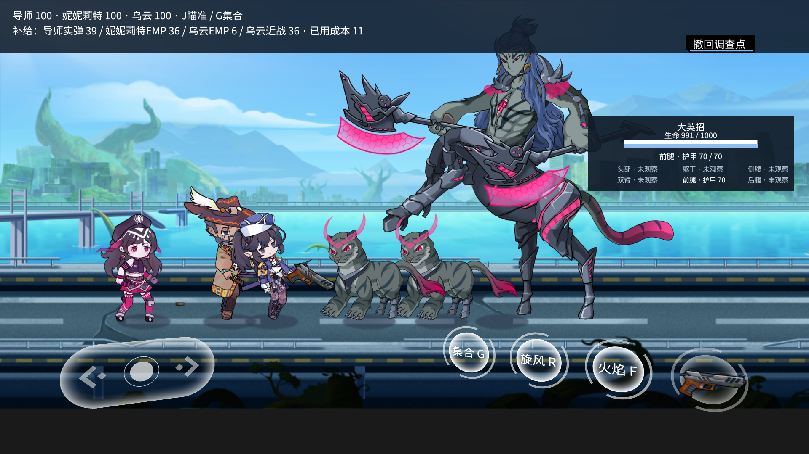
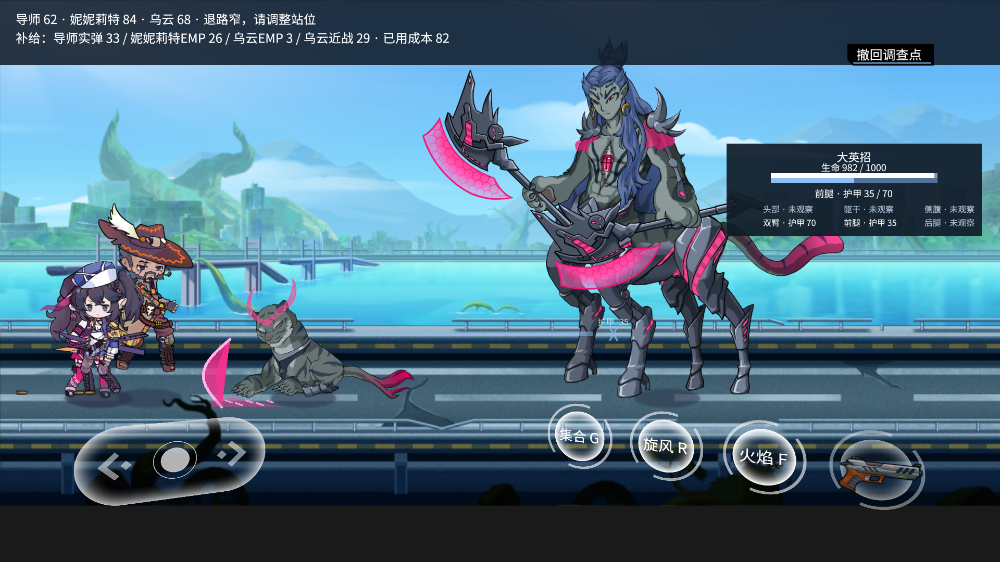
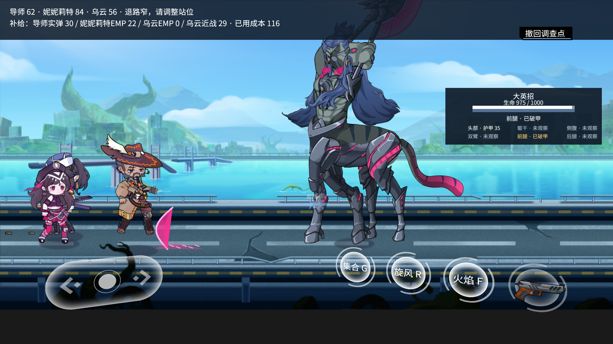
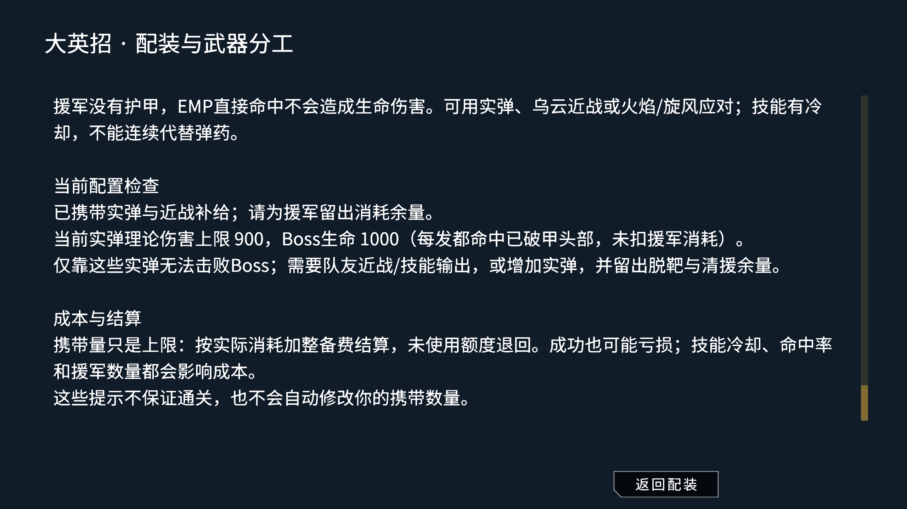

# 阶段记录 · 2026-10-05（进度整理后）

[当前进度](progress.md) · [历史索引](progress-history.md)

本页记录归档后的新增结论。同日此前记录保留于历史分卷，不重复迁写。

## 中英招控制器：首次失败与修复

- 实现：中英招复用小英招生命周期，新增抢夺分段、接触选择、临时缴械和归还接入；修改了小英招共享控制器的可扩展钩子。
- 结果：`Test/MediumYingzhaoCombatNative.lua` 首个420距离夺枪案例报 `Rob outcome 420`，结果为 `FAIL`、`cases=[]`。没有通过的真实抢夺案例，原因尚未定位。
- 证据：游戏工程 `Docs/evidence/2026-10-05/medium-yingzhao-combat-result.json` 及对应过程日志。
- 未完成：持械射击返回 `SHOOTING_NOT_CONNECTED`；AI、公开遭遇、专项学习采集尚未完成。首次失败时尚未重跑共享钩子改动后的小英招回归；后续已通过，见下文。
- 后续定位：四段动画均完整结束，初始冲刺仅移动55.33像素，距目标约364.67像素，超出240接触范围。rob2仅设置一次速度，受地面摩擦衰减；已改为只在rob2持续驱动，并在接近目标或切段时停止。
- 首轮修复回归：中英招双向420/150距离抢夺、900距离扑空、前摇受击取消、拳击及死亡归还通过；420距离实际位移约±250.17像素。测试归还比例由硬编码0.3改为对比原生节点原值，并直接检查真实射击动作门控。小英招共享控制器原生回归通过。
- 扩展原生验证PASS：八个抢夺案例覆盖双向远近距离、超距、起手后远离/绕背和前摇受击取消；另通过拳击、抢夺成功后受击归还、死亡归还。证据 `medium-yingzhao-combat-result.json` / `medium-yingzhao-combat-process.log`；小英招证据 `small-yingzhao-combat-result.json`。持械射击、完整AI、公开遭遇与专项学习数据仍未完成。

## 进度文档整理

- 原进度页3468行、621381字节，按章节边界分卷，同目录保存以保持相对链接；逐字还原检查通过，原正文哈希见历史索引。
- 当前页改为实施优先级、I01–I07状态、未解决问题、代表证据和维护规则。中英招失败、训练长帧、挤团、学习收益及最终验收缺口均保留。
- 历史分卷不再维护“当前状态”；接续工作更新当前页对应行，详细阶段记录独立保存，避免重新累积流水账。

## 战斗性能：边组区间筛选试验撤回

- 尝试在连续8条轮廓边的包围盒粗筛后增加射线区间筛选；20000组射线和60000次距离对照通过，120次真实慢查询的4950次遮挡回调顺序保持。
- 同一捕获数据两轮：原实现0.879745/0.876702秒，试验0.888752/0.905375秒，反而慢约1%–3%。因此已撤回生产修改，不报告性能提升，也未用该方案重复跑整场性能。
- 当前卡顿任务继续开放；后续需处理集中候选与实际物理遮挡开销，不再重复这一无收益方案。

## 瞄准重复计算与训练冷却边界修复

- `HitGeometry`在不可变姿态上复用同一枪口到各边的偏移和交叉积。改变枪口坐标即重算，不保留可变点引用；距离、边界容差及命中优先级不变。固定120次慢查询两轮由0.888065/0.882262秒降至0.835046/0.813426秒；普通姿态查询由0.795413降至0.751451秒，均为宿主Lua查询耗时，不代表整场帧率。
- 20000组射线、60000次距离对照，边界/凹轮廓/移动碰撞及可变枪口坐标回归通过；原生2520顶点/648查询通过。新增`CombatOriginReplay`及对应旧实现，保留比较入口。
- 首轮完整评价暴露`Accepted action absent from legal set`：昂贵查询期间真实时间冷却结束，基础回退重新读取可用性，可能选出原决策动作集合没有的射击。独立用例复现；评价执行器与探索回退现共用原决策合法集合，不能引入未记录动作。复用/陈旧/已消耗/其他角色隔离用例继续通过。
- 工厂部位瞄准已经找到首个Boss接触点，原遮挡回调却再次扫描全部Boss轮廓。新增`aimBlocked`只判定到该接触点前的地形和存活敌人；实际弹丸和近战仍走完整contact。最终原生328条旧/新对照一致，包含左右朝向、远近高度、前方/接触处/后方墙与活敌、死敌。准备姿态移出计时后，遮挡检查累计旧0.027114秒/新0.006510秒；这只是该查询子项。
- 原生完整评价PASS：自然获胜，轨迹和决策来源重建通过，候选未修改；1442战斗帧，P99=21.87毫秒，最大95.71毫秒，7帧超过33毫秒，合法动作查询峰值59.43毫秒。仍有明显长帧，不宣称卡顿解决，不把不同战斗轨迹当确定性同比。
- 证据：`combat-visibility-native-parity`、`combat-visibility-profile`、`flower-aim-occlusion`。探索训练`flower-fallback-mask-training`自然获胜，妮妮莉特148/乌云116次更新、来源重算和持久化通过，旧版本保留、未自动采用。正式HUD `combat-visibility-hud`自然获胜，2342帧、P99=16.67毫秒、最大20.59毫秒、超过33毫秒0帧，34次射击/32次命中/145帧预览。
- 为区分采集开销，新建`CombatTrainingPerformance`，只在内存记录帧时间，不包装几何调用、捕获慢射线或逐帧写文件；近距/野外两场均自然获胜，来源和候选不变核对通过。近距3294帧，P99=16.75毫秒，最大72.30毫秒，2帧超过33毫秒；野外1207帧，P99=20.99毫秒，最大98.03毫秒，10帧超过33毫秒。证明长帧并非仅由重诊断采集造成，任务继续开放。证据`combat-training-performance-result.json/process.log`。
- 本轮文档构建通过，仅保留既有v-producer未入toctree警告；当前页仍为74行。下一步针对完整决策集中开销继续处理，不能把这些局部优化或单场HUD通过当作训练性能验收完成。

## 同枪口候选射线的方向索引

- `HitGeometry`对同一不可变姿态/枪口的重复射线建立32个方向桶，以半周为周期保留反向与epsilon允许的负t接触。第4次查询才构建，短查询仍走原边组；扩展端点并覆盖相邻桶，桶内维持原始边顺序，再执行原有包围盒与精确交点计算。枪口坐标变化立即丢弃方向索引。
- `DirectionalHitGeometry`通过308000条重复射线对照，覆盖方向桶边界、绕回、正反朝向、顶点与近边起点、1e-5至1e6尺度、近共线及长射线。既有20000组凹多边形射线/60000距离、移动形状与原生2520顶点/648查询回归通过。
- 固定120次慢查询：0.803623→0.591443秒，4950次遮挡回调顺序保持；每次新建姿态索引的冷查询0.836685→0.678118秒。普通姿态查询0.723634→0.539319秒。仅证明相同数据的查询收益，保留`CombatDirectionalReplay`及旧实现，不折算为整场FPS提升。
- 不带重诊断的原生近距/野外评价均自然获胜，来源重建及候选不变通过。近距1143帧，P99=26.74毫秒，最大62.60毫秒，6帧超过33毫秒；野外1084帧，P99=23.36毫秒，最大78.63毫秒，10帧超过33毫秒。轨迹不同，不声称总体指标单调改善或卡顿已消除。
- 证据：`combat-direction-native-parity`、`combat-direction-training`。正式HUD `combat-direction-hud`自然获胜：1247帧，P99=16.67毫秒，最大19.04毫秒，超过33毫秒0帧；18次发射、12次命中、90帧预览。训练性能仍未达到完整验收门槛。

## 跳过无法行动时的无效状态采集

- 试验按身体部位包围盒建立方向索引，固定慢查询冷态0.665229→0.647235秒、热态0.561295→0.530412秒，收益仅约3%–6%；已撤回这层复杂度较高的额外索引，保留上一节的轮廓边方向索引。
- `FlowerDecisionTrace.decision`先计算合法动作；为空时明确返回`NO_AVAILABLE_ACTIONS`，不再采集完整特征、轮廓距离或推理策略。评价/正式部署执行器和探索会话均处理该结果；单独累计skipped，不制造动作/学习转移，不降低原有决策轮询频率。
- 独立回归验证不可行动时没有特征/瞄准采集，也不会调用策略；重新出现合法动作后正常恢复。已有决策复用、冷却边界、角色/帧隔离回归通过。原生近距/野外评价与探索学习保存验证通过：近距跳过267次空轮询、131次实际决策，野外跳过139次、35次实际决策；执行记录数量与接受动作数一致，候选不变，来源可重建。近距3053帧，P99=16.67毫秒，最大59.97毫秒，6帧超过33毫秒；野外1260帧，P99=18.37毫秒，最大77.99毫秒，11帧超过33毫秒。仍有长帧，不能宣称完成性能验收。
- 探索训练自然获胜，两人各88次更新，保存和来源重算通过，父版本保留，未自动采用。证据`combat-idle-poll-training`、`flower-idle-poll-learning`。
- 补跑旧`FlowerQDeployment`在战斗前失败：旧已采用档案不满足`Factory.Rules.qCurrent`，返回`ENCOUNTER_CHANGED`；原测试预期`BASE_MODELS_CHANGED`已不适用于这份旧来源。已增加明确诊断并确认失败原因，没有绕过兼容保护或把FAIL改为PASS。当前规则的评价→采用→正式出战仍需新证据；报告`flower-idle-poll-deployment-result.json/process.log`。

## 当前Q规则的采用、部署、回滚与独立进程读取

- 使用明确命名的隔离QA副本，读取候选#7实际保存的来源链和八场四配置评价。当前规则为Q特征7/受击规则2，审查具备采用所需证据；重复不足、野外更多承伤及稳定收益未证实等警告保持，不为通过测试隐藏不利结果，也没有重复跑已有同配置场次。
- `FlowerQCurrentDeployment`通过公开审查组件的四页查看、取消及确认采用，正式工厂任务读取新采用#3一次，真实战斗自然获胜。妮妮莉特30次实际决策（Q 12/基础回退18），乌云29次（Q 11/基础回退18）；战报采用身份、候选不更新、来源重建和保存均通过。通过公开界面回滚到旧采用#2后，其旧规则仍被拒绝部署，基础控制恢复。
- 旧`FlowerQDeployment`来源不满足当前规则的FAIL继续保留，未降低兼容门槛。本次新增用例使用已通过当前规则评价的来源，替代其作为本轮部署证据。
- `FlowerQCurrentCold`在独立进程读回回滚状态、候选#7的新采用历史和胜利战报；公开重新采用为#4后正常关闭，再由另一进程验证当前采用#4、同一模型、规则与来源，并检查回滚保留父版本。两个阶段均PASS。
- 证据：`flower-q-current-deployment`、`flower-q-current-cold-prepare`、`flower-q-current-cold-read`；已查看`flower-q-current-adopted.png`及`flower-q-current-deployment.png`。审查文字和按钮完整可读，正式场景使用统一HUD；战斗截图仍显示近距离挤团，不能据此关闭站位问题。
- 验证采用原生UI事件与明确的QA剧情入口，不是从学院全程OS输入试玩；不改变用户正式存档，不证明候选收益或完整迭代完成。

## 中英招前臂瞄准资源与原生校准

- 原挂枪位置较高，水平发射容易越过普通角色；新增中性 `weapon-aim` 骨骼带动前臂、手和枪一同俯仰，重映射加权附件索引，零偏转保留原动作。派生Spine工程与运行资源已重新导出，桌面原工程哈希不变。
- 14个原动画的2740920个坐标与加骨骼前派生资源对照，最大误差0.0000915527，小于0.05阈值。双向gunidle/shoot完整播放、原抢夺/闪避/取消/拳击/受击及死亡归还回归通过。
- 原生静态瞄准通过；连续shoot初次采用全量角度反馈时，开火点误差约23°，不能沿用。调整为半量反馈后，固定目标在约1/3秒处左右误差分别1.74°、1.59°，完整动作均约1.1秒。已查看双向瞄准截图，手、枪与前臂保持连接。该校准仅覆盖当前距离/高度与动力枪，不等于全距离、全部枪型或移动目标已验收。
- 证据：`medium-yingzhao-aim-result.json`、`medium-yingzhao-aim-geometry.txt`、`medium-yingzhao-aim.png`及本次重新运行的`medium-yingzhao-weapon`/`medium-yingzhao-combat`。控制器尚未接入瞄准或实际弹丸；下一步仍需冻结射击目标、枪口与弹丸方向一致、遮挡/伤害语义、取消及恢复控制，随后补持械AI与公开遭遇。

## 中英招持械实弹、EMP与射击生命周期

- 控制器接入固定目标点的前臂瞄准，原射击动作约1/3秒发射且完整播放1.1秒；枪口实际方向决定弹丸速度，发射后不追踪目标。结束/取消后逐步恢复瞄准骨骼至0。持械且距离250–1200时自动选择射击，近距拳击；完整抢夺后站位与公开遭遇平衡仍待验证。
- 复用教程LightStrip、已有动力枪弹丸和物理弹壳，EMP沿用蓝色弹丸/弹道且不弹壳。`Combat.WeaponProfiles`抽取原工厂数值不变：动力15HP/0AP、EMP0HP/35AP；敌方盗用保持同一武器语义。目标可提供`hitWeapon`处理完整护甲，或`damageArmor`处理AP；没有护甲接口的目标不凭空把EMP换成HP伤害。当前队员完整护甲展示/结算矩阵仍未完成。
- 原生`MediumYingzhaoShootNative`共13例通过：双向300/500/1200距离真实飞行后命中；前摇后移位可躲避；墙体阻挡；提前归还、到期和受击均阻止未发射弹丸；双向EMP只削减QA目标35AP，不减HP、不新增弹壳。另验证持械AI自主射击命中、战斗退出清除在途弹丸和弹壳并归还武器。提前射击/瞬时伤害、动作截断和瞄准残留断言均通过。
- 首轮远距测试被原场景6810位置的队员挡住，接触记录确认物理先命中；保留`medium-yingzhao-shoot-fixture-obstruction.json`，把单目标夹具的其他队员移离弹道后通过。EMP初始弹壳数量断言受到旧弹壳自然到期影响，改为核对是否新增弹壳实例，保留实际寿命行为。
- 主要证据：`medium-yingzhao-shoot-result.json/process.log`。公共训练入口、真实输入、EMP握持视觉审阅、完整敌人战术、缴械/射击的训练数据采集及学习收益仍待补齐。

## 中英招抢夺后退让与公开缴械演练

- 抢枪后在近距主动退开，再转身射击；使用开始/结束距离差避免来回切换，退让有1.2秒上限，并检查前方墙体和脚下地面。没有倒走素材，使用原move朝退让方向行走，开枪前转回目标。
- 双向真实rob流程完成抢夺后，各退开约282单位，在抢夺后约3.7秒启动shoot并真实命中15HP；原枪到期归还。真实墙体及悬空平台边缘均会阻止继续退让，原生用例通过。见`medium-yingzhao-flow-result.json`；此次不是直接给敌人装备枪替代抢夺。
- 基础训练菜单新增“缴械演练”，复用虚拟训练场、统一摇杆/武器/风火按钮与已采用的学员模型。单只原尺寸中英招，360HP；不写示范/Q样本、训练成果或剧情奖励。公开入口→战斗自然获胜→重开→退出→返回原训练通过，持久化表前后不变。原小英招菜单演练回归通过；上次中断留下RUNNING的进程确认结束后才重跑，未将中断记录当通过。
- 公开场证据`disarm-practice-result.json/process.log`及已查看的`disarm-practice-active.png`。该局约9.55秒结束，导师/队员无人受伤，中英招6次rob均未成功：集火持续打断导致机制展示不足，且仍有近距重叠。**不能据此宣称整场战术和平衡完成**，下一步应解决受击压制与抢夺机会，而不是削弱已有取消测试或隐藏这次结果。
- 入口验证为原生UI事件，不是OS操作；专项仍需缴械/武器语义的训练数据、EMP最终持握审阅及完整敌人体系。战斗性能长帧问题继续保留。

## 中英招连续硬直与缴械反馈

- 核对上一场记录：6次rob都在1.833秒首段被中断，而真正抢夺点在起手约2.67秒。小英招共用的1.2秒硬直间隔不适用于这套长动作。仅中英招改为3.8秒重复硬直间隔；首次可打断、真实伤害、武器受击归还及死亡取消均保留，小英招维持1.2秒。
- `MediumYingzhaoPressureNative`原生通过：首次前摇被打断；后续每0.2秒受击时仍逐次扣血，14次伤害期间可完成一次抢夺；持枪后再受击立即归还；3.8秒间隔结束后可再次进入硬直。原八例抢夺/闪避/取消及死亡归还回归通过，未缩短任何原动画。
- 同一公开演练操作回归从6次抢夺失败变为两次成功抢夺，约9.65秒结束；导师和学员仍无人受伤，抢枪后会被队友命中夺回，因此只证明解除永久打断及反制有效，不证明整场压力或敌人持械射击已平衡。前版记录保留`disarm-practice-before-recovery.json`。
- 公共演练显示敌人生命、被缴械者、最长剩余时间与归还提示；导师被缴械时原武器按钮变暗，移动仍可用。测试实际观察到“导师武器被夺”后截图，已查看`disarm-practice-stolen.png`；入口、胜利、重开、返回、存档不变仍通过。证据`medium-yingzhao-pressure`、`medium-yingzhao-combat`、`disarm-practice`。真实输入、全面距离平衡、护甲矩阵与训练数据依旧未完成。

## 剩余长帧归因与瞄准候选复用

- 新增不捕获慢射线/姿态大表的`CombatFrameProfile`，当前近距自然胜利且来源重建通过：合法动作计算单次最高55.55ms，单部位瞄准20.23ms；物理遮挡回调最高0.132ms。耗时仍集中在多部位瞄准候选计算，不能把优化重点仅放在物理射线。
- 试验先查目标部位再提前排除确定遮挡，120次慢查询从1.523降至1.417秒，仅约7%且增加epsilon/遍历复杂度，已撤回。保留简要测量`combat-rejected-occlusion-experiment.json`。
- `PartAim`只缓存不可变姿态轮廓的候选坐标和点在轮廓内的结果；射击位置、朝向、射程、角度排序、真实命中及地形遮挡仍逐次计算。弱引用随旧姿态释放，不跨动画姿态复用。最终采用点对象直接存内外标记，去掉试版多余包装对象。
- 4000组凹多边形、边界、禁用部位、多发射位置和连续新姿态与旧实现逐项对照一致；候选返回值及遮挡回调顺序不变。12组捕获慢姿态各重复10次：热态1.537→1.383秒（约10%）；每轮重建几何/候选缓存冷态1.832→1.837秒（约0.25%波动，不宣称冷态加速）。各项4280次遮挡调用一致。证据`combat-candidate-replay-result.json`与`PartAimCandidateParity.lua`。
- 初版缓存整场无重诊断测试：近距3235帧，P99=16.74ms、最大61.83ms、4帧超过33ms；野外1078帧，P99=34.65ms、最大87.67ms、11帧超过33ms。均自然胜利、候选未更新、真实动作与来源可重建；长帧仍未解决。该次为移除包装对象前的缓存版本，最终版复测另记录，不将其作为完整性能通过。

- 最终版复测近距2802帧，P99=18.06ms、最大64.25ms、6帧超过33ms；两场连跑的野外末段与独立几何验证有短暂CPU重叠，未采用该野外数值作为干净复测。单独重跑野外（期间无并发验证）：1231帧，P99=21.38ms、最大78.06ms、10帧超过33ms。两者自然胜利、真实动作记录/来源重建和候选不变通过。最终证据`combat-candidate-final-pair-result.json`的near项与`combat-candidate-field-result.json/process.log`；不把不同战局之间的帧数/长帧次数差异当作优化收益。结论仍是重复查询微基准改善、整场长帧未解决。

## 射线共享计算与延迟生成接触对象

- `HitGeometry.nearest`现在为同一射线复用方向、长度和边界数据；逐部位相交只保留参数距离与边方向，最终胜出后才生成位置/法线对象。不改变遍历顺序、epsilon、遮挡优先级、内部起点或碰撞规则；公开`segment`仍返回原结构。
- 308000条重复起点/角度桶边界/比例/顶点/近共线射线对照通过；新增12000组复合部位查询逐字段与改动前完全一致，覆盖重复部位、重叠优先级、禁用部位、零长和极短射线；既有静态、凹多边形、移动/形变碰撞回归通过。真实Spine动画2520个采样点、648次瞄准/接触查询对照通过，见`combat-scalar-contact-native-parity.json`。
- 捕获慢姿态每组120次查询：热态1.441→1.281秒，冷态1.869→1.707秒，约减少11%/9%；均4280次地形回调，结果和调用顺序相同。证据`combat-scalar-contact-replay-result.json`、`scalar-contact-parity.txt`；对照源码在`Test/Fixtures/CombatScalarContactBefore/HitGeometry.lua`。
- 无并行测试的原生近距/野外评估均自然胜利，动作与来源重建通过，候选不变。近距3055帧，P99=16.68ms、最大73.18ms、6帧超过33ms；野外1214帧，P99=20.09ms、最大71.17ms、11帧超过33ms。证据`combat-scalar-contact-training-result.json/process.log`。仍存在长帧，不以微基准改善宣称整场卡顿已解决，也不把不同自然战局直接算成FPS提升。

## 相邻射线遮挡提示与逐帧归因

- `HitGeometry.nearest`记住上次命中的轮廓，但每条新射线必须重新对其做原包围盒和精确相交检查；结果只作为保守距离上界，按原顺序遍历候选并保留至少(N+1)×epsilon的平局链余量。部位禁用、移除或重排使提示失效，不复用旧命中结果。
- 新增12000组复合查询和960组epsilon连续平局、部位移除/禁用/重排、包围盒擦边检查，逐字段与前版一致；真实Spine动画648次对照通过。慢姿态回放120查询：热态1.232→0.995秒（约19%），冷态1.651→1.391秒（约16%），各4280次地形回调及结果一致。证据`combat-hint-replay-result.json`、`hint-contact-parity.txt`、`combat-hint-native-parity.json`。
- 原生两场均自然获胜、候选不变、动作与来源重建通过：近距1157帧、P99=21.55ms、最大56.65ms、6帧超过33ms；野外1488帧、P99=25.61ms、最大267.56ms、10帧超过33ms。保留`combat-hint-training-result.json/process.log`；不能因微基准改善忽略267.56ms异常，也不将不同自然战局的数值差直接解释为FPS改善。
- 为区分停顿来源新增`CombatFrameAttribution`，按引擎帧号记录函数累计耗时、调用数、Lua占用及长帧前后邻帧（累计含嵌套，不相加当总CPU）。独立野外运行中267ms未复现；58.83ms长帧前一帧合法动作计算49.58ms，其中五次部位瞄准45.11ms；50.93/49.13ms长帧前一帧分别五次瞄准36.74/35.90ms。另两帧瞄准32.73/28.58ms。每轮有两次options但只有五次solve，说明仅错开两名学员仍不能拆掉单个角色的昂贵部位枚举。
- 该轮通用`combat-frame-attribution-result.json`后来被复测覆盖，已从当时工具输出保留三组四舍五入耗时到`combat-hint-frame-attribution-summary.json`（不是完整原始报告）；新轮完整报告另以功能名称归档。该轮运行结果/候选/来源重建通过；诊断包装有开销，不作为无诊断FPS验收。下一步优先降低单角色完整部位枚举的峰值，267ms异常仍待归因，整体卡顿保持未解决。

## 指定部位瞄准的确定遮挡提前返回

- 瞄准查询向`HitGeometry.nearest`传入目标部位；只有在重新验证的非目标遮挡物位于所有目标轮廓之前，并留足完整epsilon平局链余量时，才提前返回不可达。否则仍执行原序完整相交判断。普通弹丸的三参数调用保留原行为，未减少身体部位、轮廓、射程或命中优先级。
- 12000组指定部位精确接触、960组平局链/禁用/移除/重排/边界、4000组候选瞄准对照通过；真实Spine姿态648次对照通过。捕获慢姿态热态1.001→0.594秒（约41%），冷态1.338→0.909秒（约32%）；地形回调均4280次，顺序与结果一致。证据`requested-contact-parity.txt`、`combat-requested-replay-result.json`、`combat-requested-native-parity.json`。
- 无并行测试的原生两场均自然胜利，候选不变、动作及来源重建通过：近距3052帧，P99=16.68ms、最大55.23ms、4帧超过33ms；野外1527帧，P99=17.92ms、最大62.73ms、3帧超过33ms。`combat-requested-training-result.json/process.log`完整保留；不同自然战局不直接换算为FPS提升。
- 进一步逐帧诊断中，50.77ms长帧前一帧五次瞄准共36.92ms、合法动作计算41.09ms；另外41.95ms长帧对应五次瞄准28.07ms，40.41ms对应十次瞄准24.93ms。见独立命名的`combat-requested-frame-attribution-result.json/process.log`，包含原始相邻帧计数，诊断有包装开销。剩余峰值仍需继续处理，此前267.56ms异常也未归因，不关闭卡顿问题。

## 花妖骨骼探针槽位合并（2026-10-05）

- 将 209 根骨骼的 627 个点附件合并到 209 个槽位；仍保留每根骨骼的三个仿射探针，不降低动画更新频率、不改变命中轮廓。运行资源和 manifest 已同步接入；原资源保留在 `Docs/artwork/flower-probes-packed/baseline/`。
- 原始模型网格对照覆盖 15 个动画、5248980 个坐标，最大误差 0.00683594，低于 0.05 门槛。原生双向、旋转和非均匀父级缩放共 360 个姿态、604800 个坐标，旧新命中轮廓误差为零。
- 200 次交替采样：旧版总计 0.811296 秒，新版 0.614064 秒，均值约 4.06→3.07 ms，减少约 24%。证据 `flower-packed-probes-native-result.json`；只证明采样开销下降，整场训练长帧仍待重新测量，卡顿问题保持未解决。
- 重建方式及资源晋升步骤见游戏工程 `Docs/artwork/flower-probes-packed/README.md`。此前方向桶数量/建表阈值候选对照未提供足够收益，未接入生产；保留 `combat-index-trials-result.json`。

- 接入后实际瞄准/接触回归通过（`flower-packed-combat-parity-result.json`）。两场训练自然胜利、候选未改变、来源可重建：近距 2824 帧，P99 16.67 ms，最大 45.96 ms，2 帧超过 33 ms；野外 1093 帧，P99 22.10 ms，最大 55.64 ms，3 帧超过 33 ms。证据 `flower-packed-training-result.json`。自然战斗时长不同，不以这两场对比宣称整场帧率提升；集中查询及未复现长帧仍待处理。

## 同一射线交点复用（2026-10-05）

- `HitGeometry.nearest` 复用本次射线已验证的提示交点和指定部位预检交点，避免正式遍历再次求交；不跨帧复用，仍按原顺序处理优先级和 epsilon 平局。
- 12000 个指定部位、12000 个普通接触、各 960 个边界/重排/禁用提示，以及 4000 个候选查询精确对照通过（`combat-reuse-parity.txt`）；原生 648 次瞄准/接触回归通过（`combat-reuse-native-result.json`）。
- 固定慢姿态回放，每种模式地形回调均为 4280 次且顺序一致。重复查询总耗时 0.60482→0.57055 秒，约降 5.7%；首次查询 0.91409→0.89878 秒，约降 1.7%。证据 `combat-reuse-replay-result.json`，首次查询收益较小。
- 两场训练自然胜利、候选不变、来源重建通过（`combat-reuse-training-result.json`）：近距 3096 帧，P99 16.67 ms、最大 50.61 ms、3 帧超过 33 ms；野外 1095 帧，P99 19.17 ms、最大 51.09 ms、3 帧超过 33 ms。自然战局不同，不能据此声称整场帧率提升。单角色多部位集中计算仍需处理，卡顿保持未解决。

## 瞄准耗时分解与无收益候选排除（2026-10-05）

- 固定慢姿态的 120 次查询采集：总计 0.98514 秒，其中 22920 次 `nearest` 累计 0.63670 秒，32380 次 `contains` 累计 0.22744 秒，地形查询 4280 次。包装计时本身有开销，此结果用于识别主要计算项，不作为整场帧率指标。证据 `combat-aim-cost-result.json`。
- 64 方向的部位包围盒索引试验：命中、回调顺序及 4000 组候选对照通过，但重复查询 0.57328→0.57549 秒、首次查询 0.88855→0.89578 秒，均未改善。已撤回生产改动；候选保留于 `Test/Fixtures/CombatPartIndexTrial`，证据 `combat-part-index-replay-result.json`。
- 边相交参数延迟计算试验：12960 组指定部位/边界对照通过，重复查询 0.57815→0.56853 秒、首次查询 0.88779→0.88527 秒，收益不足以支撑卡顿改善结论。亦撤回生产改动；候选保留于 `Test/Fixtures/CombatEdgeOrderTrial`，证据 `combat-edge-order-replay-result.json`。
- 当前运行代码与上一轮交点复用版本逐字一致。下一方向应聚焦减少大量候选射线的完整轮廓查询，例如研究同一姿态的可见轮廓查询结构，并保留凹形、遮挡、epsilon 平局与地形回调的精确语义；不继续把候选排序或微小算术调整当成主要解决方案。

## 移除短生命周期轮廓的重复分组（2026-10-05）

- 每个新姿态的边表此前同时构建八边包围盒分组，第四次射线后又使用方向索引。现在保留边表和方向索引，移除预先建立的八边分组，首次几条射线直接遍历边。未简化轮廓、改变相交公式或命中顺序。
- 固定慢姿态回放：重复查询 0.58751→0.57700 秒；首次查询 0.90305→0.85858 秒，约降 4.9%。两种模式地形回调均为 4280 次，位置/顺序一致。证据 `combat-flat-replay-result.json`。
- 另测 600 次新姿态单射线，覆盖真实花妖姿态和不同目标方向：累计 0.37440→0.27599 秒，约降 26.3%。证据 `combat-flat-single-result.json`。这是固定输入的几何查询耗时，不是整场帧率收益。
- 308000 条方向射线、两组各 12000 接触及 960 边界/顺序案例、4000 候选查询、465 静态与 300 形变轨迹、空间几何专项通过；原生 648 次瞄准/接触对照通过。证据 `combat-flat-parity.txt`、`combat-flat-native-result.json`。

- 整场训练回归通过，近距/野外均自然胜利、候选未改变、来源可重建（`combat-flat-training-result.json`）。近距 2824 帧，P99 16.67 ms、最大 51.19 ms、2 帧超过 33 ms；野外 1095 帧，P99 18.98 ms、最大 53.16 ms、3 帧超过 33 ms。固定输入几何查询改善尚未消除整场长帧，继续保留性能未解决状态。

## 保守角度遮挡预判候选（2026-10-05，尚未接入运行代码）

- 更新逐帧归因（`combat-flat-frame-attribution-result.json`）：野外最大 45.96 ms，前帧五部位瞄准合计 33.21 ms、动作选项 36.31 ms，采样 2.98 ms；另一次 40.35 ms 长帧之前瞄准 26.74 ms。计时包装有开销，不替代无采集性能结论。
- 慢姿态每次含 260–288 个互不重复的候选点/角度，排除了缓存相同射线的方向。
- 新候选按角度区间建立保守遮挡证明：只在其他部位的一条边完整覆盖方向区间、且其最远距离仍小于所有目标边的保守最近距离时提前拒绝，否则执行原精确求交；不以抽样不可达代替完整判断。代码仅在 `Test/Fixtures/CombatShadowTrial/`。
- 固定慢姿态回放通过，地形回调仍为 4280 次、顺序/结果不变；重复查询 0.57020→0.46447 秒（约降 18.5%），首次查询 0.83352→0.73029 秒（约降 12.4%）。证据 `combat-shadow-replay-result.json`。
- 171400 条凹形/多尺度/禁用部位/顶点射线，28472 次提前拒绝均未丢失请求部位的实际接触；证据 `combat-shadow-parity.txt`。运行代码尚未采用。接入前仍需处理回调可能修改部位状态时的失效、无效 bounds 的保守降级，以及边界与原生动画/整场训练验证；当前不能宣称卡顿已修复。

## 保守遮挡预判接入与动画验证（2026-10-05）

- 新增 `Combat.AimOcclusion`，由 `PartAim` 在同一轮第 16 个内部候选点之后按需构建，仅拒绝已证明其他部位在前的角度区间；其余继续原精确求交。无跨帧缓存，不改变候选偏好、攻击射程或实际弹丸命中。
- 外部地形回调之后停用本轮证明，防止回调改变部位开关/顺序；不完整包围盒和非有限坐标回退。阻挡边还必须通过平行分母下限检查，射程之外不使用证明。
- 集成固定慢姿态回放，原/新首次查询 0.84869→0.74528 秒（约降 12.2%）、重复查询 0.57190→0.47819 秒（约降 16.4%），地形回调均为 4280 次且位置/顺序一致。证据 `combat-shadow-integration-replay-result.json`。
- 收紧后的证明覆盖 114400 条多尺度凹形射线，15774 次提前拒绝无错误；另 5760 条角度桶边界、顶点、大平移射线，524 次提前拒绝无错误；异常 bounds/禁用阻挡回退及 4000 组候选对照通过。证据 `combat-shadow-integrated-parity.txt`。
- 原生 36 个修改启用状态/排列/异常 bounds 用例，48 次回调与旧实现一致（`combat-shadow-mutation-result.json`）。花妖全部 15 个动画、双向 90 个姿态、900 次部位查询和 580 次地形回调精确对照通过（`combat-shadow-animated-result.json`）。

- 专门构造先建立有效遮挡证明、后由回调禁用阻挡部位的案例通过：1 次建表、26 次提前拒绝、42 次回调与旧实现一致（`combat-shadow-callback.txt`）。
- 无重诊断整场回归通过，候选未改变、来源可重建、两场自然胜利（`combat-shadow-training-result.json`）。近距 3069 帧，P99 19.25 ms、最大 46.35 ms、2 帧超过 33 ms；野外 1092 帧，P99 23.39 ms、最大 59.59 ms、4 帧超过 33 ms。固定回放收益尚未稳定反映为整场长帧改善，需检查新增建表峰值；不能宣称本项解决卡顿。

- **整场评估后撤回自动启用**：新增建表 56 次、累计 117.31 ms、单次最大 4.26 ms；重帧中 2–5 次建表累计 4.47–10.93 ms。证据 `combat-shadow-frame-result.json`（诊断包装有开销；诊断运行时还执行了极短的独立回调校验，不能用其整场帧率作干净验收）。该候选虽固定回放更快，尚未避免重复建表峰值，因此 `Script/Combat/PartAim.lua` 已恢复为上一轮版本；完整候选保存到 `Test/Fixtures/CombatShadowIntegrated/`，`Combat.AimOcclusion` 暂无运行调用。下一步是同姿态/同瞄准起点共享几何预处理，状态变化必须失效，再进行整场复测。

## 共享遮挡表与按需目标下界候选（2026-10-05）

- 第一版一次预处理所有部位的共享方案，固定单部位首次查询 0.84037→0.98629 秒，未采用；证据 `combat-shadow-shared-replay-result.json`，原型保留 `Test/Fixtures/CombatShadowShared/EagerAimOcclusion.lua`。
- 改为共享遮挡边信息、只在请求某个部位时计算其距离下界。同一不可变姿态和起点复用；部位顺序、启用状态、顶点表、bounds/值、起点、射程变化重建；外部回调显式失效。运行 `PartAim` 暂未切换，新入口为 `Test/Fixtures/CombatShadowShared/PartAim.lua`。
- 单部位固定回放：首次 0.85191→0.79701 秒，重复 0.58149→0.30569 秒；重复姿态缓存收益不等于动态战斗收益（`combat-shadow-shared-lazy-replay-result.json`）。
- 更贴近决策的五部位连续查询，60 轮/300 查询，地形回调共 75 次且输出顺序一致；总耗时 0.70159→0.61414 秒（约降 12.5%），单轮最大 14.62→12.34 ms。此回放的地形阻挡为固定判定，不替代实际物理世界验收（`combat-shadow-batch-result.json`）。
- 多尺度、角度边界及共享失效对照通过（`combat-shadow-shared-parity.txt`）；仍需原生动画、逐帧归因及干净整场测试，不能据固定回放判定已解决卡顿。

### 共享方案的真实战斗回放结论：不启用

- 共享版本原生状态变化、全动画与两场训练通过，但未证明整场改善：默认失效版近距/野外最大 46.36/57.92 ms；只读回调版 45.15/58.76 ms。只读版建表累计 78.51 ms、单次最大 2.70 ms；仍存在同帧 5.87–6.36 ms 建表峰值。报告分别为 `combat-shadow-shared-*` 与 `combat-shadow-readonly-*`；均为候选测试，没有替换运行 `PartAim`。
- 已撤回为候选测试临时增加的 `Factory.PartCombat` 只读参数，运行入口恢复原版。共享模块保留供实验，但无游戏调用。
- 新增实际战斗完整瞄准输入采集和按帧回放：`CombatLiveAimCapture.lua`、`CombatLiveAimReplay.lua`。保留 130 个真实查询的姿态、起点、候选偏好与地形返回；同帧相同姿态重建共享引用。采集有复制开销，不作为帧率测试。证据 `combat-live-aim-capture-result.json`、`combat-live-aims.json`。
- 每方案回放 3 次、390 查询、2802 地形回调：原版 0.78239 秒/单帧瞄准最大 27.65 ms；默认共享 0.86886 秒/33.13 ms；只读共享 0.83390 秒/31.33 ms。输出完全一致但候选更慢，因此不接入。证据 `combat-live-aim-replay-result.json`。
- 最初回放因 JSON 数值序列化的严格相等失败，失败报告保留 `combat-live-aim-replay-serialization-failure.json`。历史数值最大差 7.28e-12，改为对采集值使用角度 1e-8/坐标 1e-6 的序列化容差；原版与候选在同一解码输入上的结果仍要求精确相等，并未放宽算法一致性要求。
- 延后至第 64 个候选点才建表也未解决问题：原版 0.78951 秒/最大 28.26 ms，延后版 0.78612 秒/最大 30.83 ms，超过 16 ms 的瞄准批次数 16→20。证据 `combat-live-aim-delayed-result.json`。停止推进此遮挡表方案，后续性能方案优先在真实整场输入上对照，避免局部慢姿态样本误导。

## 精确求交内联复核与 Release 验收补齐（2026-10-05）

- 叉积函数内联的首次真实回放看似改善，但四轮交替运行后总体仅约 1%–3%，不足以作为卡顿改善依据。命中和 934 次/轮地形回调一致；候选保留 `Test/Fixtures/CombatInlineTrial/HitGeometry.lua`，运行代码已恢复。证据 `combat-inline-live-result.json`、`combat-inline-alternating-result.json`。原生整场尚未对该小改动额外验收，因此不采用。
- 核对所有近期性能 runner：使用的是 `/Users/Jin/Workspace/Dora-SSR/build/macosx/arm64/debug/Dora.app`，这些帧时间仅证明 Debug 构建情况，发布构建性能此前未验收。不能据此推定 Release 一定正常或用户卡顿已解决。
- 启动同源 Release 引擎构建，独立配置和输出位于 `/private/tmp/lsd-release-qa-21iw1iqo`。既有 Debug 配置哈希不变、引擎源码工作区干净。直接导入内部 xmake 缓存因只读工具链字段失败，已改用受支持的显式配置选项；日志均保留。构建仍在进行，完成后运行相同真实输入回放、隔离存档训练及原生几何回归。

### 默认 Release 仍未启用引擎 C/C++ 优化

- 同源默认 Release 构建完成，Lua `lvm.c` 的实际编译依赖记录没有 `-O` 参数（Debug 同样没有）；不能仅凭目录中的 release 名称认定已优化。引擎源码保持干净，原 Debug 配置哈希不变。
- 默认 Release 的相同输入回放 390 查询为 0.79461 秒，单帧瞄准最大 27.93 ms，与 Debug 接近（`release-aim-replay-result.json`）。两场训练自然胜利、来源重建/候选不变通过：近距 3112 帧、最大 52.08 ms、4 帧超过 33 ms；野外 1227 帧、最大 51.04 ms、3 帧超过 33 ms（`release-training-performance-result.json`）；原生几何回归通过（`release-combat-parity-result.json`）。
- 已启动显式 `--cxflags=-O3` 的独立 Release 对照构建 `/private/tmp/lsd-optimized-qa-4fzurnxf`，用相同源码和游戏输入验证编译设置影响。尚未完成性能验收，不能宣称修复。尝试外部 target 包装文件因项目相对路径解析失败，未采用；最终直接配置原项目的受支持编译参数，不修改引擎源码。

### 显式优化构建通过性能对照

- `--cxflags=-O3` 独立构建完成，实际 `lvm.c` 编译记录含 `-O3`；源码工作区与原 Debug 配置未改变。证据 `optimized-engine-manifest.json`、`optimized-lua-compile-evidence.txt`。
- 相同 390 瞄准查询、2802 地形回调全部一致：默认 Release 总耗时 0.79461 秒、单帧瞄准最大 27.93 ms；优化版 0.23962 秒、11.42 ms，计算总耗时降低约 70%。证据 `optimized-aim-replay-result.json`。
- 优化构建近距 3117 帧，最大 16.68 ms；野外 1537 帧，最大 17.42 ms；合计 4654 帧无超过 33 ms 的长帧。两场自然胜利，候选未改变、来源可重建（`optimized-training-performance-result.json`）；原生几何回归通过（`optimized-combat-parity-result.json`）。这是本机指定构建/两场景的结论，不替代全游戏和跨平台验收。
- 新增游戏工程 `Tools/build_optimized_runtime.py`，通过真实增量构建验证；自动检查优化参数、二进制哈希、原构建配置与源码一致性，说明见 `Docs/optimized-runtime.md`。后续试玩与候选包需使用有编译证据的优化引擎，不能只凭 Release 名称判断。

- 正式战斗 HUD 追加验收通过：2591 帧、最大 16.68 ms、无超过 33 ms；39 次瞄准按住、165 次预览采样、36 次射击、35 次命中并自然获胜（`optimized-hud-performance-result.json`）。通过的是原生脚本驱动公开控制器，不等于 OS 输入全流程；没有混入截图读回。

## 连续战斗资源释放：定位与六场回归

- 原六场测试在第二场后失败，旧战斗残留1个，对象712→1456。先将全局导师射击/雾云吟唱动作改为弱引用，仍失败；该中间结果保留于 `optimized-six-battle-cycles-weak-actions`。
- 通过Lua注册表回调上值追踪，确认导师弹丸 `Face` 创建函数持续捕获战斗。原生弹丸持有定义，战斗又持有弹丸，形成跨Lua/原生引用循环。外观工厂改为只捕获开火角度/朝向；不改变弹速、伤害、命中或动画。
- `optimized-six-battle-cycles-fixed`：六场自然胜利，来源可重建，内存/存储候选不变，旧战斗全部释放；对象159→153后稳定、回调40稳定。9547帧中2帧>33 ms，最大53.68 ms，故不宣称卡顿完全解决。测试期间游戏Lua指纹不变。
- `Tools/run_combat_qa.py` 提供优化运行器哈希核对、独立QA存档、单进程保护、结果归档及源码指纹核对；运行方法已加入游戏工程 `Docs/optimized-runtime.md`。诊断仅在回收断言失败时执行，不参与战斗帧计时。

## 受击期间保持纵向站位层

- 用户明确偏移指画面纵向的错层站位，用于避免人物重叠。此前按横向镜头理解的固定镜头尝试已撤回，未作为最终方案保留；对应测试证据仅记录该放弃尝试。
- 原因：`Combat.Displacement` 受击时把 `unit.order` 加一、恢复时减回；`PlatformWorld` 的排序会把人物迁移到对应道路层。工厂相邻层相差25像素，因此受击导致了额外纵向跳位。
- 修复：受击、倒下、起身和清理均不改道路层。原物理击退/击飞、动画与恢复流程保留。自然错层应保持角色入场时的固定层，不通过受击临时换层解决遮挡。
- `hit-reaction-stable-lanes/result.json` 原生通过：导师、妮妮莉特、乌云分别处于-1/0/1层（纵向25/0/-25），整个受击恢复过程中order、父层及偏移保持不变；真实横向击退和纵向击飞均超过20像素，清理不换层。仅验证上述三例，不等于全场景视觉验收。
- 资源释放修复后的正式HUD回归 `optimized-hud-after-lifecycle-fix` 自然胜利，22次射击、15次命中、102次预览采样；1602帧有1帧>33ms（最大36.05ms），偶发长帧仍开放。

## 固定站位层与枪口/部位命中联测

- 新增 `CombatLaneShots`：在真实工厂战斗中隔离普通花妖遮挡，使用原尺寸Boss，覆盖导师前/中/后三层及左右射击六例。每例检查真实弹丸出生点与当帧可见枪口一致、完成实际部位命中、射击不换层，并保留伤害事件。
- 初版测试在移动/换层后立即读取骨骼变换，尚未等待场景更新，导致无可见目标；两次失败证据完整保留。增加0.1秒准备等待后，三层和双向六例均通过；没有修改生产瞄准或伤害规则来迎合测试。
- 最终证据 `stable-lane-shots-both-directions/result.json` / `run.json`；测试期间源码不变。该结果覆盖站位层与真实枪口/部位命中，不覆盖所有敌人、友伤或整场平衡；先前偶发长帧问题仍开放。

## 优化构建：剩余长帧归因与缴械演练

- `optimized-remaining-frame-attribution`：近距冻结评价自然获胜，2752帧最大17.05ms，无>33ms；来源重建、候选不变通过。已记录逐帧内存、对象/回调以及关键调用耗时，并保存最慢帧的前后帧，避免将下一帧delta误归因到当前工作。
- 本轮未复现旧长帧，不能解释或关闭此前53.68ms/267.56ms异常。关键单次峰值：部位瞄准3.84ms、轮廓采样3.40ms、Q执行9.62ms、战斗update10.49ms；各项有嵌套，不能相加当总耗时。诊断包装本身也有开销，结果只用于定位。
- `optimized-disarm-performance`：复用公开缴械演练路径，移除截图IO干扰，独立QA存档。入口→实际夺枪→自然胜利→重开→撤离→返回均通过，训练/任务存档未变。468战斗采样帧，最大16.68ms，无>33ms；2次敌人攻击、导师7次命中，约9.8秒结束且导师HP100，压力平衡仍不充分。
- 新增可重复入口 `attribution`、`disarm` 到优化运行验收器。当前证据扩展了场景覆盖，不替代全流程真实输入、整段长稳或完整敌人验收。

## 中英招：抢夺与近身拳击衔接

- 实际公开演练战报显示此前两次抢夺均被命中取回武器，随后再次进入抢夺长前摇，三名队员全部无伤。另确认接近阈值310像素大于拳击命中范围220像素，会在不够近时出拳。
- 改动：抢夺开始后6秒内不由AI重复选抢夺，改用拳击；拳击接近到200像素再起手。持枪射程与退让逻辑不变；主动技能测试入口不受AI选招冷却限制。共用控制器仅向可选接近距离钩子传入目标/距离，小英招默认310范围不变。
- `medium-yingzhao-mixed-pressure`：公开演练自然胜利，选招为抢夺→拳击→抢夺，拳击命中1次，导师HP90。约9.47秒，448帧最大16.69ms，无>33ms；实际夺枪、重开/返回、训练与任务存档未变均通过。仍不是完整难度平衡验收。
- `medium-flow-after-mixed-ai`：左右420起点均完成实际抢夺→退开→持枪射击→原武器归还；`small-combat-after-mixed-ai` 共享控制器回归通过；`medium-pressure-after-mixed-ai` 首次前摇可打断、连续命中不无限重启硬直、命中归还武器和保护到期恢复均通过。
- 后续仍需不同玩家策略下的难度对照、缴械训练数据接入及完整敌人遭遇；本轮未增加生命/伤害或缩短原动画。

## 缴械观测采集与新增资源经济需求

- `Training.DisarmTrace` 接入公开演练，区分已执行动作、拒绝请求、武器被夺/归还事件与来源；过滤重复移动/停止轮询。`Combat.Disarm` 事件在归还状态恢复后发出；PatrolBattle对缴械射击明确返回WEAPON_DISARMED。
- `disarm-trace-final` 原生通过：序列化、实际夺枪与受击归还、拒绝原因、有限动作记录、存档未改及公开导航通过。trace明确trainable=false；示范来源、奖励及持久化尚未完成，不能当成C4.5/Q训练已接通。
- 用户新增原PSD素材、任务净收益可为负的资源管理，以及必须复用原成功/失败结算页。新增resource-economy方案并替换旧game-design限制；成本内核覆盖正/负收益、退回、失败/撤退、被夺枪弹药归属及幂等。正式存档及战斗扣费尚未开启。

## 原设计成功 / 失败结算界面接入

- 成功恢复UI.Settlement原版徽记、飘带、任务/奖励及复盘区域；失败和撤退使用UI.MissionFail原版失败视觉及三类建议。旧MissionResult作为兼容入口，保留againButton/baseButton回调。任务模式清除虚构样例奖励，调整标题避免重叠，长战报支持滚动。
- authored-settlement-scroll原生通过：成功盈利、成功亏损、失败、20行长战报；截图审阅失败正文不再截断。亏损成功仍是成功布局。测试账单只用于显示，未发奖励或改正式存档。
- authored-result-navigation：隔离存档工厂实际开始→撤退→失败专页→返回TrainA通过，连续点两个按钮只导航一次，完成记录只调用一次；成功页为显示夹具。其他任务仍需逐场运行验收。
- 资源内核和界面接口不代表钱包/扣费已开启；未传账单时明确显示尚未接入。

## 行动物资钱包与持久化事务

- 新增Economy.Store：独立版本钱包、单场预算预留、消费批次、原子结算与中断恢复。初始300为试算值，重复初始化不增发；全局尚未启用。事务修订号检查与唯一进行中任务约束防止并发覆盖。
- economy-store-transactions原生PASS：300→预留55→成本11获胜389→文件重开后中断恢复378→耗尽预算的亏损胜利233；重复结算不变。故障触发器在钱包更新后拒绝账本写入，确认双方完整回滚；非法消费批次同样不保存前半部分。
- 文件重开不是进程崩溃测试；待接任务事实共同提交、发射持久化窗口、经济恢复路径、装备配置和训练数据合同。

## 任务与经济共同提交

- Mission.Service支持内部物资配置，开始时任务与预算一次提交；完成时任务战报、任务解锁奖励、钱包与账本一次提交。supplyAttempt连接任务与后续消费来源，任务账本不可绕开服务单独完成。重启恢复沿共同中止路径退回余量。
- mission-economy-atomic-final通过：开始/解锁奖励写入故障注入、双方回滚、重复完成、防重复解锁、持久化账单、文件重开恢复以及无物资配置的旧调用不收费。基础钱包economy-store-after-mission回归通过。
- 尚待真实发射持久化、整备与恢复玩法、全任务启用和独立进程故障测试；此轮没有开启正式任务扣费。

## 独立进程强制退出后的资源恢复

- 新增EconomyRestartNative与run_economy_restart_qa。第一进程完成预算及7发消费写入后被SIGKILL，第二独立PID重启同档；全程只用新建临时QA存档。
- economy-process-kill-recovery通过：准备余额198、已耗16；新进程恢复任务为aborted、退86、余额284，无成功收入/解锁，重复恢复无变化。检查原进程退出-9、恢复进程退出0及脚本指纹不变。
- 此证据替代单纯文件重开对已提交数据恢复的弱证明；未证明尚未提交消费窗口。实际发射、近战、蛊惑友伤与夺枪路径需要统一消费事件，正式扣费仍关闭。

## 导师攻击帧资源计费

- Ground.Mentor接入可选CombatSession，攻击帧持久化消费后才发布弹丸；保存失败/空弹阻止发射。普通战斗尚未创建会话，不自动开启扣费。序号从fire事件恢复，重放不重复生成弹丸。
- economy-mentor-attack-frame：真实攻击动画与弹丸观察通过，故障注入不射击、2弹仅发2枚、额外请求不扣费，合计成本6；小样本提交最大1.332ms。最终序号恢复修正后重复验证。
- 接下来接学员及被夺武器、整备配置，并测密集战斗和长账本同步写入开销。提交后崩溃计作已确认发射，恢复只结束任务，不重放弹丸。

## 学员与敌人夺枪消费

- CombatSession追踪武器原持有者与实际敌人使用者。中英招真实左右两轮夺枪射击扣导师2弹；归还不补弹，第三轮空枪无弹丸/伤害。economy-stolen-weapon通过。
- Training.Arena枪械按empgun记EMP成本，能量检查后提交；近战有效帧消费，挥空也计费。economy-learner-attacks通过：EMP一发成本7、近战一次成本2，耗尽后不再产生攻击效果。
- 普通战斗仍未挂载资源会话；待编队预算、恢复玩法、取消/密集场景及训练合同一起验证后再正式开启。EMP夺枪尚缺运行证据。

## 原图补给配置界面

- Ground.Deployment编队增加武器补给入口；Loadout存档与SupplyLoadout界面已实现，原实弹/EMP枪、箱子及刀素材进入真实原生界面。角色携带量、当前编队预算和超额提示即时刷新，保存与取消分离。
- supply-loadout-layout-fixed通过原生事件与截图检查：修复锚点偏移和点击时按钮缩放；保存数量25、全队预算155、仅导师预算52，取消不覆盖存档。未验证真实鼠标输入/列车入口全流程。
- 仍未连接正式出发预算，界面明确暂不扣费。后续接任务配置传递、会话挂载、恢复玩法及全队密集射击性能。

## 工厂预算到结算账单贯通

- Loadout.forMission建立工厂配置转换；Factory.Battle对带supplyAttempt的任务为全队挂载同一会话，训练禁止使用任务钱包。
- economy-factory-flow-fixture通过保存配置、任务预留、实际导师射击、故障/空弹门禁、撤退账单与余额、重复完成校验。初次STORY_LOCKED保留为证据；仅隔离测试补工厂剧情事实后通过。
- 正式工厂入口仍待恢复玩法/性能验证后传入配置，其他任务尚未覆盖；本轮未声称正式全部启用或全剧情通过。

## 资源记录压力与真实战斗性能

- economy-write-pressure：800消费/200帧，每帧4次；单次最大1.900ms，四次合计最大5.259ms，201采样帧无>33ms，成本2209和余额791正确。存储压力不含战斗。
- economy-real-combat-attached：真实工厂44.401秒、97次全队消费，2544帧最大16.694ms、无>33ms，消费最大6.169ms。初次漏挂会话的测试FAIL保留，修正后增加开场共享会话断言。
- 进程退出后只读核查专用QA数据库：won、成本242、收入100、净亏损142、余额2858，证明真实胜利可亏损；非正式预算平衡结果。后续恢复玩法与正式入口仍需实现。

## 零物资恢复入口

- 补给页新增整理回收小游戏：三类武器归箱，无入场/弹药成本，一轮最多60，仅恢复到默认全队预算145。原图武器与箱子已使用，部分进度保存。
- supply-recovery-job通过零余额、错箱、重复步骤、重开文件、奖励事务故障、任务进行中拒绝和145上限；UI截图审阅通过。完整鼠标输入与任务失败返程尚待验收。
- 后续接正式工厂预算入口、战中弹药提示与失败返回配置，再补其余任务和训练数据合同。

## 工厂正式入口与战中补给提示

- Factory.Expedition准备战斗改为预算确认页，调用真实任务预留后进入战斗；不足可原地整理回收，取消解除探索冻结。普通补给页更新说明工厂会使用配置。
- HUD加入缓存的全队弹药与已用成本，空弹/写入失败提示。economy-public-preparation覆盖零余额拒绝、UI恢复145、确认进入真实战斗、2发消费、HUD归零、撤退专页成本13/余额132和重复结算。
- 正式工厂经济已启用，其他任务和资源训练合同仍未覆盖；共享组件UI事件测试不等于列车至结算真实鼠标操作。

## 空弹不再进入行动选择

- 学员EMP/近战在available阶段使用共享账本判空；导师瞄准和动作也判空，Factory.command返回明确原因。攻击帧持久化检查保留。
- economy-learner-availability与economy-public-empty-gate通过：空弹模型请求拒绝、无重复发射，正式准备/恢复/撤退账单回归。
- 核对训练字段发现supplies表示维生金粉，资源训练必须新增独立版本字段，不能混写；资源敏感策略学习仍待实现。

## 资源观测与账本证据持久化

- 工厂episode新增独立resources版本与决策前后观测，附完整报价/事件/库存且trainable=false。校验重新计算消耗、核对角色观测范围，任务保存时与钱包原账本逐项核对。
- economy-training-evidence-validation通过真实射击/撤退后持久化、成本一致、篡改拒绝；旧Q显式拒绝，旧C4.5不采这类数据。
- 资源学习算法和逐行动成本归因仍未完成；后续补训练预算、奖励与低投入策略对照。

## 消费逐行动归因

- 真实攻击帧将journal step一同写入账本，事件重放核对step；工厂提供版本化归因表，整备/无对应队友行动消费独立列出。
- economy-action-attribution-versioned与纯数据归因测试通过：实际两射击成本4+整备9=13；交错角色与夺枪不串账，错step/角色拒绝。
- 新资源数据仍不可直接进入旧训练算法，后续接版本化资源特征与奖励重建。

## 资源特征投影与奖励基础规则

- ResourceFeatures新增独立弹药/预算档位，随真实决策观测保存并重建校验。economy-resource-feature-projection通过投影持久化与篡改拒绝。
- ResourceReward实现有界整局贡献/成本/时间/终局奖励；resource-learning-contract验证同等胜利节约优势及未折扣胜败界限，不冒充折扣Q训练收益。
- 在线trace绑定、版本化模型和虚拟训练资源尚待接入，资源记录仍trainable=false。

## 在线决策的资源奖励重建

- ResourceTraceReview复用真实在线trace验证，再按combatStep取成本并计算资源奖励；保留原始在线前后状态，不事后拼接。输出仍不自动训练/采用。
- economy-online-resource-trace通过：105消费，两学员36/39决策，成本132+57=189；序列化重建和篡改拒绝，2750帧无>33ms。继续固定原始source供模型学习与复核。

## 首个资源Q候选

- ResourceQ独立v8资源状态/奖励合同，复用持续时间折扣更新内核，先验证完整在线来源再训练。原生resource-q-verified-candidate通过同源确定重建、模型恢复与合法推理、资源状态区分及错误版本/伪造来源拒绝。
- 固定candidate.json与校验清单，未采用。仅单场高预算数据，低预算覆盖和冻结对照仍不足，不宣称收益提高。

## 默认预算下冻结资源Q对照

- 新增显式ResourceTrial执行路径，复用无探索执行器、合法掩码和基础回退，报告标识候选，不更改采用。
- baseline/candidate各65秒，两者均测试撤退、成本121，无收益改善；候选大量未知状态回退（妮138、乌148），Q选择9/6，模型冻结。两轮3781帧无>33ms。
- 默认145预算实弹/近战耗尽，当前策略难以收尾；下一步先修正默认预算/恢复上限并实战获胜验证，再收集资源边界样本。不采用首个候选。

## 默认补给修正与专用结算回归

默认携带调整为导师实弹40、妮妮莉特EMP36、乌云EMP6及近战36；完整编队预留293（整备9），初始300可负担。Loadout.defaults提供统一来源，Recovery上限从该报价计算，避免默认预算变化后零余额回收仍不足出战。每轮回收仍最多60，零余额需五轮归箱至293。已有自定义存档保持原值，补给页新增“恢复默认”；按下只修改当前编辑值，保存或确认后才持久化，取消不覆盖原配置。

`resource-default-victory`使用隔离剧情前提存档、现有部署策略、脚本导师瞄准及真实Mission.Service完成战斗。约47.701秒获胜：导师36发、妮妮莉特32发、乌云EMP6发/近战28次，102笔消费；预留293、成本261、收入100、净收益−161、返还32、余额139。重复finish不重复发放。2741采样帧最大16.698ms，无>33ms，单笔持久化最大7.291ms。这证明新默认配置至少可完成该场，并不证明胜率或资源经济已平衡；乌云EMP已耗尽，当前策略仍亏损，需要继续优化配置、成本收益和资源决策。

成功使用原UI.Settlement，即使净收益为负仍标为完成；失败/撤退使用UI.MissionFail。实战截图发现长成功标题与“出战成员”重叠，现按原标题区域940宽等比缩放，保留原美术结构。`settlement-title-bounds`重新编译XML，验证盈利/亏损成功、失败、长报告滚动及按钮；截图审阅通过。

`supply-loadout-default-reset`验证原图、预算、编队过滤、保存、恢复默认后取消保留旧值；`supply-recovery-default-budget`验证293上限及原故障/恢复约束；`economy-public-rebalanced`验证零余额→五轮回收→正式共享准备→两次真实射击→撤退MissionFail，成本13、余额280、重复结算无二次扣费，资源数据与归因/特征校验通过。以上均为原生引擎与UI事件驱动，不等于真实鼠标或同一新档完整剧情流程。首个资源Q候选仍未采用。

## 逐武器账单与消耗诊断

结算账本新增可选lines明细，按原报价顺序记录角色、武器、携带/已用/余量、单价、整备费、实际成本、返还及他人使用数量；不会把被夺枪消耗重复收费。明细随结果在同一结算事务持久化，旧无lines账单仍可显示原汇总。成功页在原行动收支区域增加滚动明细，失败页在原复盘滚动区展示明细，保留原专用布局与按钮。

验证：EconomyLedger纯逻辑覆盖逐行成本/返还守恒与夺枪归属；`economy-store-breakdown`覆盖事务故障、重复结算和文件重开后明细一致；`settlement-weapon-details`原生验证旧汇总与新明细在成功/失败页可显示、滚动到底部、夺枪消耗标注，截图已审阅；`economy-public-breakdown`正式共享准备与实际两枪撤退验证“导师实弹2×2+整备2=6”，整体仍成本13/余额280。UI事件验证未替代真实鼠标全流程。

新增只读诊断工具Tools/review_resource_spending.py，从固定episode按既有逐步成本和有效贡献汇总，输出resource-spending-review.json并记录源SHA256。该高预算来源总成本251=整备9+逐行动242：妮妮莉特30次计费EMP中27次未观察到有效生命/削甲贡献，对应108成本；乌云6次EMP均未观察到该贡献，对应24成本。导师有14次、近战有8次同类情况，其中包含未完成动作。这里“无有效贡献”不等于“全部落空或浪费”：贡献上限、动作中断及其他效果仍需区分；该诊断不能用于拼接学习转移，也不证明新策略收益。

下一步针对无甲/已破甲、低弹药和低预算状态补在线决策样本，并以固定预算对照验证是否减少无效EMP开火；不修改或自动采用现有模型，也不通过单纯抬高任务奖励掩盖策略问题。

## 2026-10-06：虚拟资源训练内核与隔离验证

CombatSession新增显式virtual构造，用同一Ledger报价、消耗、空弹门禁与结算规则，仅修改内存；正式会话isVirtual=false，训练会话isVirtual=true。工厂战斗只允许training=true且没有supplyAttempt时接入virtualSupplies，并在创建场景前拒绝非法组合。训练结束关闭虚拟账本，模拟结果单列report.virtualEconomy，不写正式report.economy或钱包。证据标记resources.mode=virtual及versions.resourceSimulation=1，CombatStore检查标记一致性，Mission.Service拒绝虚拟资源episode充当正式任务。

FlowerQSession现在允许基础对照显式传入virtualSupplies，继续记录真实在线边界/成本/资源特征；暂时拒绝用旧Q探索/评价入口承接新资源合同。玩家训练界面尚未提供该预算配置，也尚未实现资源Q连续训练来源链、采用或资源C4.5。

`resource-virtual-isolation-final`使用每武器2单位的真实VR战斗，约103.923秒自然战败，模拟成本23；记录12个少量弹药状态和2个空弹状态（按状态字段计数，不是独立局数）。正式钱包余额/修订号/任务账本保持不变，测试将正式begin/consume/settle入口替换为抛错以捕获误调用。来源可通过CombatStore和ResourceTraceReview校验，并生成资源Q候选（妮妮莉特3次更新、乌云2次），不采用。source.json及manifest已固定，样本不足以证明收益。

`resource-virtual-final-source-check`验证保存来源可重建、同源训练一致、缺失或冲突模拟标记拒绝、结束后不能再消费、重复虚拟结算幂等。`economy-public-virtual-isolation-fixed`验证正式准备/消费/失败页仍走持久计费，SQL故障阻止发射，余额280。首次正式回归发现virtual构造函数与实例标记同名，元表回退导致正式会话误入虚拟路径；已改为独立isVirtual布尔字段，保留失败记录economy-public-after-virtual，不把失败计为通过。

下一步接玩家虚拟预算配置和独立资源训练/评价来源链，补无甲与已破甲等状态、多预算冻结对照，再判断能否降低无效开火；现有正式策略仍不变。

## 2026-10-06：玩家资源预算练习入口

花妖自主训练页增加“资源预算练习”。预算面板复用SupplyLoadout和原武器/补给箱图片，虚拟模式按1单位增减，独立编辑副本；确认返回模拟loadout，既不保存正式Loadout，也不打开回收或钱包。开始后在当前选择的花妖场景运行基础策略对照，结束展示模拟成本。玩家取消或中止不会更新正式策略。每轮虚拟练习使用时间与会话序号组成的独立episode标识，降低重启后的记录冲突。

ResourcePracticeStore将基础模型、场景/设置、配置、在线trace、episode与终局作为独立Game0ResourcePractices记录保存。保存前序列化再重建资源证据；同episode同内容幂等，不同内容拒绝覆盖。保存失败保留面板pending，可重试或明确放弃；旧FlowerQ候选/评价/采用表不承接这些资源记录。面板显示最近一条经重建的资源记录，读取失败提示保留原记录。这一步是玩家可用的数据采集入口，不是资源Q连续训练/采用已完成。

`resource-practice-ui`原生UI事件验证预算取消、开始每武器2单位的真实VR战斗、94.928秒自然失败、模拟成本23、独立保存与再次读取、重复保存幂等、篡改消费拒绝。正式钱包余额及修订号、正式配装、旧Q草稿ID保持不变。预算与结果截图已审阅；这仍不是OS鼠标/触摸全程验证。

`resource-practice-persistence`补测事务写入故障、重试、数据库文件重开、来源冲突拒绝，及虚拟数量按1调整/确认时连正式经济表都不会创建。`supply-loadout-after-virtual-ui`验证正式补给页的预算、过滤、存档、取消与恢复默认保持通过。完整练习来源已固定在resource-practice-ui/source.json并记录SHA256。

下一步：独立资源Q累计学习与候选来源链、资源C4.5示范字段、无甲/已破甲场景、冻结对照及显式采用；不能因练习记录已可保存就声称策略已节约资源。

## 2026-10-06：资源Q累计候选与玩家训练按钮

ResourceQ.learn支持显式传入已验证的资源模型，复制恢复后继续逐决策更新，不改调用方原模型。ResourceQStore按独立练习记录ID顺序完整重建，从空模型开始累加，保存不可变候选和对应sourceIds；读取候选重新回放来源并对比全部模型。重复训练同一来源集合返回同一候选，不会再次累计奖励或更新次数。数据库提交同时检查来源内容和记录数量，变化或写入失败不覆盖旧候选。上限32轮/总64MiB，超过或基础模型不同明确拒绝；尚待来源分组选取与更大数据集管理。

玩家页增加“训练资源Q候选”，展示独立候选编号、来源轮数和两名学员更新次数，明确尚未采用。原“采用与回滚”仍管理原花妖策略，不会接收资源候选。读取/训练/保存失败保留来源和旧候选；提示可重试。面板背景随文字高度扩展。

`resource-q-cumulative`用两轮独立真实低预算失败来源：妮妮莉特更新6、乌云4（各2状态）。验证按顺序累计与显式parent续训相同、旧模型不变、重复训练同一候选、写入故障回滚、文件重开后完整重建、来源/候选篡改拒绝，不创建钱包或旧Q草稿表。

`resource-q-player-training`原生UI按钮验证由一轮练习生成独立候选、再次点击不重复更新、旧Q草稿未改、页面明确未采用，截图审阅通过。测试仅证明数据和操作路径，两个失败来源仍不足以评估胜率/成本收益。资源候选试战/多预算对照/正式采用、C4.5资源合同仍未完成。

## 2026-10-06：冻结资源候选试战与独立评价记录

FlowerQSession在虚拟预算下支持evaluate，恢复ResourceQ而不是旧FlowerQ，使用同一无探索执行器；返回执行器实际快照并检查与初始模型一致。资源练习仍为basic，暂不开放资源探索更新。ResourceQTrials将基础对照/候选试战绑定具体不可变候选版本，保存场景、预算、完整来源与执行证据；重新读取重建资源事实，并重放候选选择/未知状态回退。评价不进入练习数据或更新候选，正式钱包不变。

花妖自主训练页增加“资源候选试战”和“资源基础对照”，均先打开独立虚拟预算配置，提示同预算比较与冻结候选。结束保存独立评价，失败保留pending可重试；主动停止不保存为完整评价。当前页面展示评价场数，详细分预算比较页仍待完成。候选基础模型与当前不一致时拒绝启动，不悄悄换基础策略。

`resource-q-frozen-trials`原生顺序运行同一field场景、每武器2单位（预算31）：基础策略95.074秒战败、成本23；资源候选95.049秒战败、成本23。候选两名学员各2次Q选择，妮妮莉特195次、乌云250次未知状态回退尝试，探索0；模型及钱包未变。同预算单次试验未显示改善，不能由微小时间差推出速度收益，也不能给出统计胜率。完整trial JSON与SHA256已保存。

`resource-trial-player-entry`通过UI预算确认、启动资源执行器、主动停止、模型冻结及中止不入完整评价；截图预算说明已审阅。完整两局由训练运行器调用，尚未把完成后的玩家保存重试全部以真实鼠标贯通。`resource-trials-reload`验证冷读取、执行重放及伪造回退动作集合拒绝。

共享Telemetry新增资源算法恢复和严格回退集合校验。首次旧记录回归出现BASE_MASK_MISMATCH：历史记录按旧时机采样动作集合，不满足新合同。已将严格集合一致性仅用于新资源算法，旧记录保留原验证规则；`legacy-q-telemetry-compatible`通过历史11场重新读取、篡改拒绝及保存幂等。失败证据保留，不计为通过。

下一步实现同候选/场景/预算分组的玩家收支对照，补多预算与EMP无甲/已破甲样本；目前不采用资源候选，资源C4.5与正式采用流程仍缺。

## 2026-10-06：玩家资源对照页与稳定重建修复

新增“资源收支对照”入口，先重新校验独立试战记录，再按候选ID、场景、完整运行设置、价格版本及完整武器数量/单价/整备配置分组。相同预算金额但不同配装不会混为同一组；仅报价行顺序不同则视为相同。每组展示胜利/总场次、失败数、含失败的平均成本/用时，以及仅胜利场次的平均成本/用时。双方无胜利或候选胜率较低时明确提示不能仅因省钱判定改善；样本少提示仅观察，不生成自动采用结论。多组分页、长内容滚动，返回恢复训练页。

ResourceQReview纯逻辑验证同金额不同配装分开、报价排序无关、不同候选/场景/规则分开、重复试战拒绝、失败不拉低“成功成本”。`resource-review-stable-rebuild`使用已保存的两场真实试战，通过玩家入口、重建、分组、滚动到底部与返回，截图已审阅。现有数据仍双方0/1胜利、成本23，没有改善证据。

此次冷读取首次偶发RESOURCE_Q_REBUILD_MISMATCH，重跑又通过。排查发现ResourceReward按pairs遍历分量相加，跨Lua哈希顺序可产生浮点舍入差异。已改为固定progress/harm/duration/cost/terminal顺序求和。为兼容已保存v1候选，重建比较仅允许Q值差异≤1e-12×max(1,|期望值|)；元数据、更新次数、状态、动作和来源集合仍严格一致，读取返回原冻结值，不能改写历史试战使用的模型。

`resource-q-ordered-reward`通过累计学习/重开/事务/篡改回归，额外验证1e-15舍入兼容、1e-6值变化和更新次数变化拒绝；纯奖励合同与对照聚合测试通过。`resource-trials-after-ordered-reward`复验旧冻结试战重建及伪造回退集合拒绝。失败记录resource-review-player保留。下一步继续有效状态样本与资源C4.5，不将展示页完成当作候选质量已改善。

## 2026-10-06：资源探索与已知破甲场景

资源训练增加独立场景选择及“资源探索练习”。新增“已知全身破甲”仅允许虚拟物资战斗：场景明确告知各部位护甲已耗尽；正式任务仍通过实际命中反馈获取护甲信息。探索使用记录的随机种子，在当前合法动作中选择，结束后可保存完整在线来源。练习记录需经“训练资源Q候选”汇总生成候选，不自动采用；中途停止不保存为完整练习。

`2026-10-05/resource-exploration-exposed`原生完整战斗通过：seed=1701、epsilon=1、预算81，120.005秒失败，成本81，570次探索决策；570条决策记录含核心已破甲状态，555条含EMP耗尽状态。来源已固定为source.json并记录SHA256；候选可从来源重建，正式钱包余额和修订号未变。这是状态覆盖证据，不是节省资源或胜率提升证据，也未覆盖EMP对原生无甲目标的全部情形。

`2026-10-06/resource-exploration-panel`通过玩家UI事件切换独立资源场景、预算确认、开始和停止探索，检查虚拟破甲状态、中断不保存、旧候选及钱包不变；探索来源重复保存幂等，缺失种子及非法初始模型拒绝。`resource-practice-compatibility`复验原基础练习的保存/恢复合同。输入由原生UI事件驱动，未替代OS鼠标或触摸验收。

同日`settlement-confirmation`及`result-navigation-confirmation`再次通过原成功/失败专页、亏损成功、逐武器明细滚动、真实撤退失败页及返回防重复触发。下一步补资源C4.5合同、多预算多场有效样本和可复现收益；资源候选继续不采用。

## 2026-10-06：资源C4.5模型合同

新增ResourcePolicy，标识flower-resource-c45、特征版本8、资源特征版本1。在既有护甲/距离/站位特征上加入实弹、EMP、近战余量及任务预算类别，仅使用决策时观测。FlowerPolicyFactory共享现有分类器采集/编译/预测逻辑；FlowerPolicy仍只接受原版本6/7，旧采用通道拒绝资源模型。资源训练只读取明确flower-resource-demo上下文中sealed、未截断、origin=demo的合法示范；射击必须实际发射。Q探索和自动战斗记录不会转成示范。

`2026-10-06/resource-policy-contract`原生测试在隔离虚拟战斗中通过示范接口记录12个真实移动/等待动作，采集资源状态并调用引擎C4.5生成模型；另外用明确合成的弹药边界分类数据验证empty/ready影响预测、动作门禁、缺失资源及未来收益字段拒绝。该测试不是人工教学验收，12个样本也未证明攻击策略或资源效率。`flower-policy-factory-regression`通过旧v6来源重建、v7实际示范/学习/保存/重建、空间边界与缺失观测校验。

尚未接入资源人工示范的玩家预算入口、独立来源/候选持久化、资源C4.5试战及采用流程；本次只完成分类器合同和原生训练验证。下一步补玩家示范采集与来源重建，之后再比较同配置下的胜率和成本。完整迭代仍开放。

## 2026-10-06：玩家资源人工示范及独立保存

花妖对练增加“资源示范配置”，复用虚拟预算页和原HUD摇杆、扫动瞄准、射击、等待及刀击。确认后进入独立资源人工示范，页面展示预算/已耗/剩余并明确正式物资不变；再来一轮保留本轮虚拟配装。原无资源训练保持原路径。资源模式暂不开放旧候选学习/试战/采用，避免把资源成果混入旧模型。

新增ResourceDemoStore，记录保存到Game0ResourceDemos，限定虚拟资源、显式示范上下文、实际完整示范及合法状态；Q探索记录拒绝。每名学员最多20轮、每轮8MiB，不自动删除已有来源。读取重验CombatStore及ResourcePolicy，重复episode相同内容幂等、冲突拒绝、事务失败不覆盖。没有完整示范的轮次不保存空记录；主动结束可以保存已完成的人工示范，与Q完整试战的中断处理不同。

`2026-10-06/resource-demo-player-reopen`通过原生UI事件预算确认→资源对练→12个完整移动/等待示范→结束→独立保存→ResourcePolicy原生建模；钱包及旧示范数量未变。验证重复保存、数据库触发器拒写、原记录保留、重试成功、文件重新打开、自动探索上下文拒绝；截图已审阅。初次`resource-demo-player`故障注入未通过：给引擎方法赋值未能可靠阻止写入，改为SQLite触发器；失败证据保留，不计通过。`flower-practice-resource-regression`通过原v6来源和v7实际示范/建模/保存回归。

此轮为UI事件与示范接口验证，不是OS鼠标全流程，也没有把移动/等待样本称作有效攻击策略。资源C4.5的独立候选持久化、玩家学习按钮、试战及收益比较仍待接入；下一步沿这些来源完成候选重建和玩家学习闭环。

## 2026-10-06：资源C4.5玩家学习与候选来源保存

资源人工示范页启用“学习全部示范”和“仅学最近一轮”。ResourcePolicyStore将候选和所用完整示范快照一起写入独立Game0ResourceC45Candidates，每次新候选追加版本；相同完整来源及模型重复学习幂等。保存前及读取时均调用原生分类器从冻结来源重建，核对规则、动作版本、样本数、来源顺序和拟合率；无效来源或被改写规则拒绝。历史示范后续变化不会悄悄改变已保存候选，旧花妖候选表和正式采用表不写入。

FlowerEvidenceFactory共享来源绑定与重建逻辑，原FlowerEvidence仍只管理原v6/v7分类器，ResourcePolicyEvidence使用独立builder身份。资源页展示拟合率不代表胜率、已学动作和未采用提示；旧成果审查及旧候选试战继续隐藏，防止通过旧流程部署资源候选。

`2026-10-06/resource-c45-player`通过预算→原HUD示范→保存→玩家学习按钮→候选重建；重复学习不新增、触发器拒写保留旧版本、重试追加、文件重开、篡改规则拒绝、恢复原内容后可读。真实输入为12个移动/等待示范；测试另复制一份来源并使用新episode ID来检查故障重试和版本保存，因此截图的24样本/2轮不是两场独立真人示范，不用于收益结论。截图已审阅，未学习攻击的提示正常。

`flower-evidence-factory-regression`通过旧v6来源重建及v7实际示范、学习、保存和空间预测回归。文档构建通过，仅既有v-producer未入目录警告。下一步接资源C4.5冻结试战与同配置成本对照、补真实射击/耗尽/破甲状态示范；此轮未声称候选胜率或经济效率提升，正式采用保持不变。

## 2026-10-06：资源C4.5冻结试战与玩家对照

资源示范页启用候选试战、基础试战，复用同一虚拟配装、导师支援、歌谣、场景及原动作/瞄准执行路径。开场重新校验候选来源并冻结规则，试战动作只标model/baseline，context独立为flower-resource-c45-trial，不进入人工示范或Q探索来源。正式钱包与采用表不改。

ResourceC45Trials独立保存完整战斗、冻结候选来源、运行设置、初终生命和评估，最多保留每名学员最近20场。保存先冻结输入，验证资源/护甲/生命账、控制来源及模型来源重建；读取重验。共享FlowerTrialStoreFactory保留原单人/双人合同，旧存储显式拒绝资源试战。中止保留复盘，但比较时排除。

ResourceC45Comparison仅配对同一学员、候选完整来源、场景及伙伴模型/支援设置、版本、初始生命和完整物资报价相同的已结束基础/候选场次。页面显示胜败、成本、用时，明确单组观察不足以采用，失败不能因为少花物资算改善。此页仍是最近匹配的一对，不是多轮胜率统计。

`2026-10-06/resource-c45-trials`两场原生自然终局：标准对练、同预算293，基础获胜20.417秒/成本109；资源候选失败59.118秒/成本148。候选只学过移动/等待，本组无改善，不采用。模型和正式钱包不变、自动动作不进入示范、重复保存幂等、改写控制模型拒绝、旧存储拒绝资源记录均通过。UI为原生事件/示范接口驱动，不是OS输入。

`resource-c45-review-legacy`从上面隔离存档复制后，重建并读取两场冻结记录，验证中止排除、来源篡改拒绝、玩家页面正确显示对照；截图审阅通过。同时校验18条旧单人和9条旧联合试战合同，均通过。完整战斗测试后增加对照页没有再重跑战斗，而是使用已保存实际记录验证展示。下一步补不同弹药/护甲下的真实攻击示范及有效多场收益；资源C4.5尚无正式采用门槛和部署验收，整体迭代继续开放。

## 2026-10-06：真实攻击、耗尽示范与资源覆盖提示

ResourcePolicy采集时统计可学习示范的EMP/近战余量类别及预算状态，玩家页展示充足、少量、耗尽的样本数。只统计通过原完整性门槛的决策起点，不把未来消耗或命中结果当作特征；未装备的EMP不提示必须补充空弹示范。

`2026-10-06/resource-attack-demo-ledger`使用原对练/示范接口、真实敌人和动作：妮妮莉特5次攻击请求产生4次EMP消费，成本19（整备3+弹药16），12个可学习示范=4射击+4后退+4等待；起点EMP充足1/少量3/耗尽8，真实有效削甲70，1个未完成动作排除。乌云6次攻击请求产生4次近战消费，成本5（整备1+使用4），同样12个可学习示范，近战充足1/少量3/耗尽8，预算紧张1/耗尽8，真实有效削甲105，2个未完成动作排除。空弹/近战余量耗尽后请求被拒，既不增加战斗动作记录也不继续扣费。两名学员分别生成并保存资源候选，正式钱包保持不变。

来源从测试返回的隔离QA存档固定至证据目录ninilite-source.json/wuyun-source.json，并记录SHA256。截图审阅通过；未装备提示纯逻辑检查通过。首次测试错误地把4次请求当作4次发射，真实前摇打断导致不足；第二次测试将按键事件ID保存的消费字典当数组遍历导致计数错误；都保留失败证据，最终以真实扣费事件为准，未修改敌人生命/冻结敌人来通过测试。

这些是脚本驱动原示范接口的真实动作证据，不是人工教学质量验收，也不说明候选能省钱获胜。本组没有手动部位瞄准示范，尚缺已破甲目标下的EMP换目标/等待以及多场同配装收益证据。资源训练的基本数据链路已有覆盖，后续继续这部分质量验证，同时推进其余任务的资源结算和敌人/Boss验收。

## 2026-10-06：电梯警戒线正式资源流程

将物资计费从工厂扩展到c0-m01电梯警戒线。编队页出战先打开共用Economy.Preparation预算确认；取消恢复编队且无预留，确认通过Mission.Service在同一事务创建任务和预留物资。仅报价导师实弹与妮妮莉特EMP，不把未出场乌云计入；默认预算229，成功报酬100，失败/撤退无报酬。修复节点仍使用任务原有两次修复次数，未新增物资收费。

Mission.Battle的导师枪在动画attack事件持久扣费后发布弹丸，空弹同时阻止瞄准/请求/动作入口；学员沿用Arena实际EMP扣费，同一会话跨两波不重置物资。HUD显示剩余量，结算复用原成功/失败专页及账本明细。任务结算仍通过Mission.Service原子写入，重复完成不会二次扣费或发奖。Factory.Preparation改为共用预算入口的工厂包装，原回调保持。

`2026-10-06/mission-supply`真实原生路径：预算取消无任务/扣费；两次导师射击加学员射击后撤退成本13、余额300→287，MissionFail显示收支，重复结算余额不变。第二场自然完成两波，9.933秒胜利、成本53、收入100、净收益47、返还176、余额334，成功页截图已审阅。一次短关卡收益不是全局经济平衡证据，也不代表工厂已盈利。

`mission-supply-briefing-cancel`通过实际Formation开始→预算→取消恢复→再次确认→战斗→专用失败结算，未发射即撤退仅扣整备5。取消清除旧预算面板引用。`factory-shared-preparation-regression`通过工厂原低余额回收、预算、真实射击、故障阻止发射与撤退流程。以上均为原生UI事件驱动，未替代同一新档OS输入全流程。其余正式任务资源计费继续开放。

## 2026-10-06：两场地面调查资源接入

c0-m02守住退路与c0-m03能源伏击接入共用正式预算确认。前者仅报价导师实弹/妮妮莉特EMP；乌云在首次救援中的剧情支援攻击不向未编队玩家收费。后者按实际两名学员编队报价。两场初版成功报酬均100，失败/撤退无报酬；预算仍随实际配置变化。金粉维生和风火技能原机制保持，未混作武器弹药成本。

Ground.Mentor/Arena已有真实攻击时扣费逻辑，此次给两场战斗接入同一持久CombatSession。HUD显示物资剩余量，成功/失败专页接收原子结算账单。大饕餮原部位战斗日志新增角色对应的决策起点/结束资源观测和资源特征，结局固定原始账本证据，CombatStore与Mission.Service核对消费一致性。其旧部位观察schema保持3/action2，未伪称已有花妖v8学习合同；EnergyBattle目前仍无同等级完整战斗episode，仅经济账本持久化。

真实地面入口改为Ground.Preparation，选择预算期间保存并冻结场景角色busy/移动输入、暂停探索金粉消耗、隐藏原HUD；取消恢复原状态且不预留，失败可继续修改预算。两个入口取消后清除面板引用，保留探索控制器。

`2026-10-06/ground-supply-formation`正式服务+真实动作：c0-m02导师两发/学员一发，成本13，余额300→287，完整资源战斗证据校验通过；c0-m03导师两发、妮妮莉特一发EMP、乌云一次近战，成本18，余额287→269。均撤退到MissionFail、展示对应账单、重复结算不再次扣费；未测试自然胜利收益。最初ground-supply因测试将未编入乌云传false而违反原formation合同失败，已改nil，保留失败证据。

`ground-supply-entry`使用真实城市场景和交互菜单，在终端附近测试起点打开预算，验证两个入口暂停维生金粉、取消恢复探索、无任务预留/钱包变化。它不是步行抵达或同一新档全剧情测试。剧情门槛由隔离QA夹具显式建立，未作为剧情通过证据。剩余任务资源接入、两场自然胜利/多轮经济平衡、完整真实输入验收仍开放。

## 2026-10-06：遗迹掩护实弹预算与撤离结算

c0-m06引开追兵接入正式物资预算，只报价/预留导师实弹，原存档编队中妮妮莉特和乌云不会被计入。本场导师以外伙伴是被护送对象。共用Preparation将实际出战编队传给Mission.Service，返程入口在预算选择时暂停探索，取消恢复；失败页“重试掩护”改为重新确认预算，不能直接绕过资源预留。

Pursuit接入Ground.Mentor已有攻击帧持久扣费，空弹在公开射击指令层也拒绝。第一次pursuit-supply测试发现最后一发已消耗但动画尚在运行时Unit.start可能仍报告已接受，补了指令层canSpend检查后pursuit-supply-empty-command通过，失败证据保留。HUD与原成功/失败页展示物资账单。

`2026-10-06/pursuit-supply-victory`验证保存全编队但本场仅导师报价、两发实际射击耗尽后撤退成本6、重复结算不二次扣费、重试先开预算且取消不预留、真实返程入口预算取消恢复探索。追加自然胜利：原HUD一次射击、一次完整火光、一次完整烟雾后沿路撤离，20.583秒，四名伙伴各实际行走超过1000并到安全线，成功结算实弹成本4、收入100、净收益96。没有强制击杀/瞬移终点来替代任务目标；入口QA用已完成剧情夹具，不是新档完整故事验收。

烟雾、火光、药品暂仍沿用原冷却/体力机制，没有加入物资报价；所以96是当前实弹计费下的结果，不能当作完整道具成本或全局经济平衡通过。下一步补道具携带与消耗规则、最后三场多阶段任务的共享账本、自然战斗/收益及完整玩家旅程。完整迭代保持开放。

## 2026-10-06 遗迹投掷物资源验证收尾

烟雾/火光携带、释放点持久扣费、保存失败阻止效果、旧配装兼容与零携带量已通过；完整撤离成本18、净收益82。原武器补给回归与六种成功/失败专页复验通过。详见[资源方案](resource-economy.md)末节及对应原生证据；最终三场任务共享资源与全旅程验收仍开放。

## 2026-10-06 学院防卫共享账本

正式走廊入口先确认预算，三个阶段共用导师/妮妮弹药，失败重试重新配装；原结算专页及历史防卫记录显示账单。自然三阶段胜利43.755秒、成本139、净收益−39；步行入口、预算取消、耗尽、撤退和重试取消通过。详见[资源方案](resource-economy.md)及defense-supply、defense-supply-entry-walk证据，早期测试入口错误保留。下一步双子救援与最终撤离。

## 2026-10-06 双子救援与最终撤离资源闭环

两场正式入口预算和多阶段共用弹药已接；最终入口保留机型选择，取消预算返回准备。自然胜利分别成本83/净收益17和成本131/净收益−31，继承余额317→286；入口步行、取消、空弹、撤退与重试取消通过。修复最终场景金粉列表与弹药会话命名冲突，以及首次测试暴露的Formation参数错误。详细证据和验收范围见[资源方案](resource-economy.md)末节。继续经济平衡、资源训练与全旅程，整体未完成。

## 2026-10-06 地面调查自然资源对照

守住退路自然胜利成本83/净收益17；能源伏击仅射击自然战败损失58，加入原风火与集合策略后自然胜利成本42/净收益58。单轮结果已入资源方案，未当作平衡或模型提升结论。补齐两场公开空弹指令拒绝，真实耗尽回归通过。下轮继续多配装/重复收益、资源学习覆盖及全旅程。

## 2026-10-06 能源配装六场对照

默认293预算与精简55预算各两场胜利，实际成本均42、净收益58；23预算低弹药各两场90秒超时，成本19且无收入。证据energy-budget-comparison通过账单、余额和重复结算检查。降低预留不等于降低实际成本，低消耗失败不判为优化。通用补给页任务范围说明同步修正；详见资源方案表格。

## 2026-10-06 配装精调与成功收支预览

正式补给页新增单份调整，保留五份快捷调整；显示按实际成本边界计算的成功净收益范围。四项武器和遗迹三项补给原生回归、截图布局检查通过；训练保持模拟成本不显示任务收入。压缩进度首页长条目，详细证据保留资源方案。

## 2026-10-06 资源部位瞄准证据

真实花妖HUD扫角射击采集15个完整样本，4个根部标签，资源C4.5保存重建和9份EMP/36成本逐攻击对应通过。检测到4次已知无甲根部仍用EMP，属于不良示范，候选未采用。未完整花瓣射击排除学习但保留实际消费；原始episode及审计固定在resource-manual-aim证据。下一步正确换目标/等待示范与冻结对照。

## 2026-10-06 无甲克制示范与冻结试战

补齐16个有弹药但已知根部破甲时后移/等待的真实样本，19个完整样本训练候选，无已知无甲EMP浪费。独立同预算自然试战基础/候选均胜，成本105/81；重读来源和配置一致性通过，不同配置拒绝，候选未采用。比较脚本参数问题已修正并独立复验；继续多轮和未见预算验证。详见资源方案末节。

## 2026-10-06 冻结候选八场与分组复盘

160预算重复两组均胜，候选平均成本82对基础105；未见98预算均胜83对88；50预算双方超时。原生源证据、钱包不变和不污染示范检查通过。玩家训练页新增按完整配置分组的互斥配对统计，失败不按低成本判优；重复记录/基础回合复用防护、独立重读和截图通过。仍不采用，继续未见战况与正式采用门槛。

## 2026-10-07：双子原骨架受击候选（未安装）

原工程来自桌面LSD美术的Q版双子姐姐/妹妹；新增候选位于`/private/tmp/lsd-twins-reaction-candidate-20261006-v1`，包括派生JSON、可编辑Spine工程和二进制导出。原骨架、IK、槽位/皮肤与idle/idle1/fmove保持；受击0.64秒采用小幅躯干回弹和骨盆下沉、脚部IK保持，暂不含倒下/起身。制作工具`Tools/build_twin_reaction_candidate.py`拒绝覆盖已有目录；当前生产Spine与Rescue.Actor均未替换。

第一次预览发生原生崩溃：在AnimationEnd内立即play idle造成Spine applyMixingFrom递归。预览改为事件仅记完成、下一帧一次性恢复idle；不修改引擎。第二次播放检查通过但画面坐标错误导致候选部分裁切，不能作为全视觉通过。第三次修正UI原点并使用唯一截图名，证据`/private/tmp/lsd-twins-reaction-preview-layout-20261006-v1`：两人物正向/镜像各完整播放0.65秒（动画定义0.64），结束次数1，recovery后idle均恢复。0/0.16/0.86秒六人物全幅静帧已审阅，无明显悬浮关节或部件丢失；静帧不代替全周期动作和战斗受击检查。

后续补齐倒下/起身候选、全周期脚部/关节/遮挡验收，再接正式护送人物受击控制并重打包。不能因为受击候选PASS关闭双子全部动作缺口。

### 2026-10-07：修正双子候选导出约束并补全反应候选

进一步回导确认旧受击候选并未保留原IK：`/private/tmp/lsd-twins-legacy-roundtrip-20261007/vika-reactions.json`的constraints为空。来源4.2 JSON的ik根数组被4.3导入丢弃；之前对生成前JSON的骨架一致断言和静帧不足以证明导出工程完整，撤回旧候选“原脚部IK保持”的运行素材结论，原游戏素材未替换。新增倒地候选v1因IK时间轴找不到11约束而被导入拒绝，v2因当前导出省略静止骨骼轨道而失败，两个失败目录保留。

工具改为基于当前运行素材的4.3 JSON、为省略的静止骨骼补新增动作轨道、按constraints中的实际IK组写时间轴，并增加工程回导检查。新候选`/private/tmp/lsd-twins-full-reaction-candidate-20261007-v3`的两名人物导入/二进制导出/JSON回导通过，四组原约束完全一致；保留原fmove/idle/idle1，新增hurt 0.64、fall 0.90、down 1.00、standUp 1.14秒。参考乌云原fall/standUp的受击→触地→缓冲→起身节奏，重新为双子骨架设置动作；倒地释放脚部IK，起身逐步恢复，防止身体倒下但脚被钉住。

当前只完成工程与候选导出，尚未原生播放、落地/关节/遮挡全周期视觉或正式战斗集成验收；不能以导出成功宣称动画质量完成。新预览`Test/TwinsFullReactionCandidateNative.lua`已准备且语法通过，等待现有长稳同一进程结束后运行，避免两个Dora争用。新候选和原素材均未写入生产资源。

新候选补充检查：工程回导的原三个动画按全部轨道/关键帧/属性递归比较一致（仅允许小于0.0001的浮点导出舍入），两人物的四组IK与源文件完全一致，原二进制和来源哈希登记在候选`export-verification.json`。离线FK网格计算发现v3最终倒地姿态存在地面穿透：vika最低Y约−41.84、vivi约−33.88；需先修正落地接触再做原生视觉验收，不能接入生产。此计算只涵盖倒地保持时已释放IK的活跃加权网格，不代表其余关键帧或部分IK混合姿态通过。

### 2026-10-07：双子触地与屈腿/支撑起身候选

V4按实际活跃加权网格修正释放IK阶段的地面接触：在骨架内部调整zong的动画轨道，不移动演员的逻辑位置、不改骨长和权重；倒地55个60Hz样本、起身43个样本及倒地保持端点连续检查通过。V5加入独立的失衡屈腿、手臂反应和起身屈腿支撑关键帧；Spine编辑器导出两人fall各28帧、standUp各36帧的30FPS PNG序列，两人跌落中段/最终保持/起身中段/最终恢复八张静帧已审阅，未见明显部件分离。原生镜像、完整播放和战斗内姿态仍需单独验收。

240Hz离线补采样发现V5关键帧之间仍有至多0.49游戏单位的微小穿透，制作V6保留0.75单位触地余量。候选`/private/tmp/lsd-twins-full-reaction-candidate-20261007-v6`导入、二进制导出、回导原约束/原动画核对通过；`contact-verification-240hz.json`记录每人fall 205、standUp 169、down 241样本，释放IK区间全部最低Y非负，最小余量vika0.266/vivi0.462。此FK检查不支持且不声称覆盖IK部分混合、动态deform或引擎原生视觉；原生预览已指向V6，尚未运行。V3/V4/V5及其失败/不足证据保留，生产资源未改。

PNG序列导出方式参考[Spine官方导出说明](https://en.esotericsoftware.com/spine-export/)与[命令行说明](https://en.esotericsoftware.com/spine-command-line-interface)，实际导出设置、输出与日志均在对应候选目录，CLI成功不替代画面审阅。

### 2026-10-07：双子反应控制候选与原生检查准备

`Test/TwinReactionActorCandidate.lua`为独立候选，不修改生产Rescue.Actor。原生AnimationEnd只记录完成，下一帧转轨；受击完整播放，重复受击合并，重击队列优先，倒地0.90秒→保持0.30秒→起身1.14秒。致命伤在当前受击结束后倒地，倒地中致命伤不重播、不起身、不恢复HP；移动阻塞由调用者停实体，模型继续跟随实际实体坐标，不以动画偏移修改逻辑位置。事件记录最多64项，避免把诊断无限累积带入游戏。

`Test/TwinReactionControllerCandidateNative.lua`已准备且语法通过：四个明确的美术/控制器用例检查重击排队、连续受击合并、倒地中致命伤和受击中致命伤；使用真实Spine完成事件并检查全时长、无反应滑行、死亡不自动起身。它直接调用候选damage，不是敌人自然攻击或合法任务旅程证据；正式接入后仍须在原护送战中验证敌人释放点、护盾全吸收不触发受击、实体停步、结算等待反应结束及保存/重试。

原生预览与这些用例等待现有训练长稳的同一个进程结束再运行；没有并行启动第二个Dora。当前长稳已超过18轮，arena残留0、LuaRefs115/CallRefs201、对象824–825；终态和Lua堆增长来源仍未审阅，不能预记稳定性通过。

### 2026-10-07：真实护送回归与诊断记录内存核对准备

`Test/FreshRescueReactionsCurrentNative.lua`从本轮独立包已完成的第三章防卫合法存档复制分支，经原Start、学院门路、玉到来、公开配装预算进入护送战。原玩法命令获胜/专页/返回与钱包核账保留；新增检查真实敌人未吸收伤害、原生反应全时长、实体停步、全吸收攻击及两采用模型不变。它不直接调用damage或设置HP，不替代同一新档主旅程；尚未运行，也不预记胜利或实际受击通过。

长稳每轮保留一张cycle诊断表，原始Lua堆数据因此包含测试记录自身的增长。准备`Test/TrainingSoakFootprintNative.lua`：仅在当前长稳PASS/至少1800秒后，在相同Lua运行时读取真实报告、保持其余字段，释放cycle诊断数组前后双GC测量；仅用于解释诊断记录占用，不是第二次长稳或全游戏无泄漏证明。语法检查通过，等待现有进程终态后运行。训练当前25轮的对象824–825、LuaRefs115/CallRefs201、旧arena残留0，终态及堆变化解释仍待核对。

### 2026-10-07：训练长稳终态及双子V6原生结果

长稳同一进程终态PASS：1801.04秒/29轮、对象824–825、LuaRefs115/CallRefs201、arena残留0、钱包341及包2757文件/实际模块来源后复核。Lua堆增长17.5996KB，其中新的同Lua运行时只读测量确认cycle诊断数组约7.418KB；余约10.182KB仍需核对，不能把原始增长全部归因测试或宣称全游戏无泄漏。两端80模块无新增，registry只见弱值表4最大整数键2118→3347且条目115保持，该相关性尚未证明因果。具体证据与范围见候选包。

V6原生动作预览`/private/tmp/lsd-twins-full-reaction-native-20261007-v6`通过：两人正向/镜像的hurt约0.65、fall0.90、standUp1.15秒完整播放和恢复。V6控制候选`/private/tmp/lsd-twin-controller-native-20261007-v6`四用例通过：重击排队HP70/受击、倒地、起身各一次；连续受击HP93/两次合并后的完整hurt；倒地中和受击中致命伤均保持down/HP0、不重播倒地或自动起身。测试记录仅用于候选，不是生产护送敌人命中通过。

原生画面复核仍发现V6姐姐的帽子绒球先触地，使身体偏高；不能仅凭“最低网格Y非负”验收自然落地。V7调整腿部支撑方向并让姐姐装饰绒球/发梢收拢，保持原骨架与纹理；导出/原动画和约束检查通过，原生预览正在重跑。生产素材未替换。

### 2026-10-07：双子V8补充动作安装与正式救援接入

V7全时长通过但靴子朝下撑起身体仍不自然。V8将最终腿部朝向改为沿倒地身体方向，保留独立收腿/起身曲线；原生正向/镜像down与起身关键帧复核，帽子/长发和身体更接近地面，仍不据此宣称最终全部视听已验收。`/private/tmp/lsd-twins-full-reaction-native-20261007-v8/result.json`和`/private/tmp/lsd-twin-controller-native-20261007-v8/result.json`均PASS，后者四用例范围与V6相同。240Hz释放IK区间补采样每人fall205/down241/standUp169点，最低Y分别vika0.296/0.750/0.708、vivi0.462/0.750/0.699游戏单位；不证明IK混合及整体动作审美。

已将两人二进制安装到源码Spine目录，原文件及Actor/Battle备份保留在`/private/tmp/lsd-twins-production-backup-20261007-v8`；原图集、纹理及原三动画不改，导出后四约束和原动画核对通过。可编辑派生工程保存到`/Users/Jin/Desktop/LSD/LSD美术/Q版/双子战斗补充动画-20261007`，原作者工程不覆盖。

生产Rescue.Actor接入延迟完成事件转轨、合并受击/重击队列、倒地保持与起身及致命倒地；yu保留原仅扣HP行为。Rescue.Battle停住反应中的物理护送体，模型跟随实际实体，不用显示偏移伪造距离；正式结算等待双子反应结束，并将有界反应事件保存进真实战斗报告。源码语法检查通过。独立包尚未更新；正式敌人自然命中回归`/private/tmp/lsd-fresh-rescue-reactions-native-20261007-v8`运行中，从合法第三章胜果复制独立分支，未注入HP/进度或模型，不预记通过。

正式救援源码回归终态PASS：`/private/tmp/lsd-fresh-rescue-reactions-native-20261007-v8/result.json`。妹妹真实受到blow20、bomb18、swing14，fall完整0.900秒、standUp1.150秒、hurt0.650秒；受击期间实体停步检查通过。姐姐本局只受护盾全吸收攻击，不宣称两人自然受击都覆盖；四候选用例另有双人控制证据。两段护送自然获胜36.85秒，实际成本85/收入100/余额402→417，原Settlement、研发室返回、两采用模型不变；2043帧p95约16.667ms/max16.739ms/超过33ms为0，排除开局2秒，不替代长稳。

新增自然失败用例经原公开配装按钮选择导师1发/学员不携带，不直接设置HP或调用damage。第一次在start异步加载仍ready时误将循环结束，报告FAIL，属于测试等待遗漏；生产无变更。修正等待包含ready后，从原合法第三章胜果重新复制新分支运行，保留失败证据`/private/tmp/lsd-fresh-rescue-reaction-failure-native-20261007-v8`，重跑`...-v8-retry`尚未验收。不将坏配装失败用例混为推荐配装平衡。

自然失败重跑终态PASS：`/private/tmp/lsd-fresh-rescue-reaction-failure-native-20261007-v8-retry/result.json`。公开界面导师1发、学员0弹，未射击/未改HP；敌人28.83秒自然将姐姐打至0，保持down，结算前全部反应结束；原MissionFail、收入0/成本2/余额402→400、未解锁twins-rescued、返回后公开重配装可用且取消不扣款、训练模型保持。只证明合法坏配装失败/恢复，不当作推荐配装难度证据。

该报告有一次原生fall完成事件在0.883秒到达（动画长度0.90秒），旧一帧容差允许立即转轨。新增硬性转轨条件：已收到原生完成事件，且实际累计时长至少为动画长度；报告分别记录nativeElapsed与实际转轨elapsed。四控制用例`/private/tmp/lsd-twin-controller-native-20261007-v8-duration-guard`PASS，正式回归断言同步收紧至0.1ms浮点余量。

新冻结候选`/Users/Jin/Workspace/Dora/LSD-builds/2026-10-07-full-content-twin-duration-candidate`生成，运行1142文件/279684919字节、app2757文件、临时签名核验通过；包含上述时长防护与双子新素材。前一个同日twin-reactions候选没有时长防护，未验收，不作为当前交付。新包隔离正式救援回归运行中；构建成功不等于包运行通过或全内容完成。

硬性时长防护新包胜败终态均PASS：`/private/tmp/lsd-package-rescue-reactions-isolated-20261007-duration`获胜36.97秒/余额417，真实妹妹fall0.900/standUp1.150/hurt0.650；`/private/tmp/lsd-package-rescue-reaction-failure-isolated-20261007-duration`失败28.78秒/余额400，姐姐致命保持down、原MissionFail和返回重配装可用，完整转轨时长最小余量0.018ms。run报告各自packageIsolation.verified=true，116/114个实际模块来自app，2757文件运行后复核、源码不变。自然命中、物理停步、护盾全吸收、专页/钱包/模型均通过；这两份从合法第三章旧旅程复制的分支仍不计为同一全新档三章或真实OS输入。

随后从本轮独立新档第一章真实胜果`fresh-ground-current-1791301970.db`继续第二章公开合作入口，隔离新包回归`/private/tmp/lsd-package-fresh-cooperation-isolated-20261007`运行中。第一章旧包与后续新包的变更边界记录保留，最终冻结包仍需全新全程，不以版本接续替代该门槛。

同一新旅程第二章合作/能源计划新包终态PASS：`/private/tmp/lsd-package-fresh-cooperation-isolated-20261007`。从本轮第一章合法胜果复制，经实际学院/休息室门路与原肖像Yarn、合作计划/能源简报、保存故障回滚与重试、夜光镜一次解锁、乌云训练前置、日志重看及原手机地图，12条剧情记录、钱包402、妮妮莉特采用模型保持。run实际86个模块包内、2757文件后核对、packageIsolation.verified=true。合法当前父档为`/private/tmp/lsd-combat-qa-3rw8itgw/save/fresh-cooperation-current-1791305452.db`，乌云公开训练接续`/private/tmp/lsd-package-fresh-wuyun-isolated-20261007`运行中；仍为脚本UI事件而非OS全程试玩。

同一新旅程乌云训练新包终态PASS：`/private/tmp/lsd-package-fresh-wuyun-isolated-20261007`。从合作合法档，经原学院门路和训练终端，公开切换角色、近中远各六组真实近战/射击/移动示范（共18条）、原C4.5建模、每组三场候选/基准对照、采用保存故障回滚/原按钮重试、双角色切换重载与返回。近战命中事件/完整恢复及妮妮莉特六示范模型字节保持通过，物资402不变；候选和基准均三胜/平均生命93.33，候选动作17次（laser10/melee6/fmove1）/fallback0，平均6.372秒对基准6.289秒。此例证明所教动作部署和保存，不声称候选更优。

实际73个模块包内/2757文件后核对/资源隔离验证通过。当前主旅程合法父档`/private/tmp/lsd-combat-qa-q4w8ekpr/save/fresh-wuyun-current-1791305508.db`，下一步由此继续能源伏击公开入口。正式`/Users/Jin/Workspace/Dora/lsd.db`未使用或改写；引擎仓库本轮状态仍干净。

### 2026-10-07：同一新档第二章能源战两种打法接续

能源战旧保守操作新包终态PASS：`/private/tmp/lsd-package-fresh-energy-isolated-20261007`，从本轮乌云18示范合法档402物资，经原编队卡/出行/夜光镜与能源箱到公开预算293。真实两学员采用模型/三个敌人/导师命中、相机覆盖、协同风火、原胜果保存故障回滚/原按钮重试、实地取回能源与原Yarn、账本/奖励仅一次、辅助机状态/模型保持通过；耗时62.40秒、导师40发耗尽，成本94/收入100/余额408。实际137模块包内/2757文件后核对、packageIsolation.verified=true。

该控制每0.1秒反复集合并在原站位开火，只证明合法低效率完成，不作为推荐操作。正从相同战前乌云档另开合法分支，使用已有`FreshEnergyEfficiencyNative`公开移动/HUD动作：进入480范围、550以内射击、仅学员低血且每4秒才集合，比较实际成本和用时。新包`/private/tmp/lsd-package-fresh-energy-efficiency-isolated-20261007`运行中；后续阿岩入口已明确读取此效率分支，不将两种战果拼成一个存档。

效率能源分支新包PASS：`/private/tmp/lsd-package-fresh-energy-efficiency-isolated-20261007`，同一乌云战前档402/相同预算293/相同两采用模型，使用公开移动进入有效射程及按需集合。自然获胜8.51秒（对低效率打法62.40秒），导师4命中、妮妮莉特5laser/5命中/HP100、乌云6melee/5命中/HP80，两模型fallback0。实际成本42/收入100/余额460（对另一分支408）。这是一组实际不同操作比较，不作为多局统计或自动策略最优证明。实际137个模块包内、2757文件后复核、资源隔离验证通过；原剧情、故障重试、钱包和模型保持全部同验。

当前主旅程父档`/private/tmp/lsd-combat-qa-aqu75wk8/save/fresh-energy-efficiency-1791305797.db`，沿此效率分支继续阿岩公开入场`/private/tmp/lsd-package-fresh-ayan-isolated-20261007`运行中；低效率战果单独保留，不能将两场累加奖励。

本轮能源效率胜果沿新包接续阿岩→李叶娜合作/对打→战后邮件→医疗全部PASS：`/private/tmp/lsd-package-fresh-ayan-isolated-20261007`（92模块）、`/private/tmp/lsd-package-fresh-liyena-current-isolated-20261007`（91）、`/private/tmp/lsd-package-fresh-aftertrial-current-isolated-20261007`（87）、`/private/tmp/lsd-package-fresh-medical-current-isolated-20261007`（82）。各次公开原Start/实体学院门路/原人物与完整Yarn、交互地点限制、保存故障回滚/原入口重试、剧情与角色前置、两真实训练战及攻击有效帧/恢复、邮件明确转发与日志/阅后状态等各自断言通过；钱包460和两采用模型保持。每轮实际模块来自app、2757文件运行后复核、packageIsolation.verified=true，不将UI事件改称OS操作。

当前合法父档`/private/tmp/lsd-combat-qa-o94v8tmm/save/fresh-medical-current-1791306098.db`。该链源于本轮新建旅程第一章及新包第二章，没有切换到之前医疗后的另一旅程。下一步材料正式花妖战→原治疗/过夜/翌日消息，仍需同链实战和正确亏损结算。

材料/治疗接续新包终态PASS：`/private/tmp/lsd-package-fresh-materials-current-isolated-20261007`（182实际模块）、`/private/tmp/lsd-package-fresh-recovery-current-isolated-20261007`（85），各自packageIsolation.verified=true、2757文件后核对且源码不变。两者从本轮能源效率→阿岩→两训练战→邮件→医疗合法档460物资接续，没有使用之前另一旅程的294医疗后档。

材料段实际列车/工厂/夜光镜/沼泽/原蛊惑Yarn、辅助机选型与有限燃料/收集/暂停及状态带入、妮妮莉特真实藤蔓伤害和乌云歌谣解控、花妖部位战/真实两模型同时交战、奖励保存故障回滚/原按钮重试、实地取得砗磲贝/明确通知医师和原日志通过。自然战63.59秒、导师40命中、妮妮莉特35命中/HP90、乌云28命中/HP100，两采用模型fallback0。实际成本287/收入100/净收益−187/余额460→273；仍保留成功与材料/剧情事实，未把亏损变为任务失败。相比旧旅程266成本，本轮真实刀剑能量消耗较多，不锁定历史固定成本作为通过条件。

治疗段18行原治疗演出与两医師动作、地点限制、保存回滚/重试、医师离开、无提前恢复、明确休息过夜、人物恢复、林的7行翌日消息与六份真实补给/故障重试/不重复领取、原调查简报与站台出发/日志回看均通过；钱包273、两训练模型保持。当前主旅程合法父档`/private/tmp/lsd-combat-qa-1_3ajxab/save/fresh-recovery-current-1791306333.db`，下一步遗迹→双子/阿岩→追兵撤离→山谷及狐狸同行。脚本UI事件与新包阶段证据不代替OS全程操作、同版本全新通关或其他结局验收。

### 2026-10-07：本轮新档遗迹→山谷接续

新包本轮治疗后273物资合法档→遗迹/追兵/山谷PASS：`/private/tmp/lsd-package-fresh-ruins-isolated-20261007`。原Start/站台列车/三人编队/遗迹实体路程与信号夜光镜、双子完整41行/真实挡击/完整脉冲及守火动作、双子保存故障回滚/重试、两人实际护送、阿岩找到7行/完整倒下姿态/两人物日记7行/数据回收8行及原5行追兵遭遇全部接续。

公开预算由原110改选4发/6烟雾/2火光，预留62；正常向右推进、按实际敌人距离/危险使用工具与合法调查药品1份。真实撤离28.23秒、导师64生命、四人实际走至安全点，实际1发/2烟雾/2火光，成本32/收入100/退款30/余额273→341。正确成功专页/原出口/唯一胜果/账本清空、两采用模型不变和六份前置补给保留至战前、正常继续进入OuterHeaven通过。147实际模块包内/2757文件后核对/packageIsolation.verified=true；仍是脚本UI驱动。

合法主旅程父档`/private/tmp/lsd-combat-qa-k1dh7lmb/save/fresh-ruins-current-1791306485.db`，源自本轮新建第一章和已接续第二章，不使用旧医疗后另一旅程。下一步山谷苏醒/五活动/过夜狐狸到达及原狐狸同行；不增加狐狸训练。

本轮新档新包山谷→狐狸同行四段均PASS：`/private/tmp/lsd-package-fresh-valley-current-isolated-20261007`、`...fresh-valley-activities-current...`、`...fresh-valley-days-current...`、`...fresh-fox-trail-current...`。实际83/62/85/91个模块包内、各2757文件运行后复核/packageIsolation.verified=true；余额341/两采用模型保持。原山谷苏醒32行/地点门槛/唯一剧情、五实际活动（计时钓鱼、作物生长等）和保存失败回滚/原按钮重试、吊床休息/明确过夜醒来与狐狸到达完整剧情/真实行走、22行原带路剧情/中途食物/夜光镜/实际带路及完整行走循环均按各测试断言通过，不增加狐狸训练、不注入进度/模型/钱包。

狐狸同行合法父档`/private/tmp/lsd-combat-qa-tvx_bmqq/save/fresh-fox-trail-current-1791306765.db`，继续作战集结→工厂原潜入、控制舱、各层路程及屋顶决斗。该新包不继承旧狐狸专用视觉检查为最终全部关节/视听验收；真实OS操作仍另待。

本轮新档作战集结和完整工厂新包PASS：`/private/tmp/lsd-package-fresh-command-current-isolated-20261007`（原9人物+狐狸/28行/10分工/保存回滚与重试/四组实际移动/日志与编队保持），`/private/tmp/lsd-package-fresh-factory-current-isolated-20261007`（249.84秒整段，149个实际模块包内/2757文件后核对/packageIsolation.verified=true）。工厂从本轮狐狸合法档341物资接续，原首波巡逻、潜入、研发控制舱/研究者、留守乌云/第二波巡逻、七层与屋顶决斗、所有原Yarn与保存回滚/原按钮重试贯通；四场真实交战总成本320/收入400、无回收收入、余额421，两采用模型和辅助机状态保持。不能锁定旧旅程325固定成本；实际四次账本为准。

当前合法父档`/private/tmp/lsd-combat-qa-6vfpayve/save/fresh-factory-current-1791306862.db`（来自本轮集结`fresh-command-current-1791306849.db`）。下一步本轮同链第三章防卫→救援→最终撤离→原终章/署名/冷启动继续；不挪用旧医疗后另一旅程的终章记录。

本轮新档第三章/终章/冷启动新包全部PASS：`/private/tmp/lsd-package-fresh-chapter-three-current-isolated-20261007`（116实际模块）、`...fresh-ending-current...`（145）、`...fresh-ending-resume-current...`（70），每轮packageIsolation.verified=true/实际模块包内/2757文件后复核且源码不变。本轮工厂合法胜果421物资→原16行重新上线/学院门路/6行网络警告/公开防卫三阶段获胜→原8行学院损失，成本135/收入100/余额386。救援原玉到来12行/公开预算/两段实际护送/正常返回35.67秒，成本83/收入100/余额403；玉的距离8行/最终简报/公开预算/三段撤离43.75秒，成本127/收入100/余额376；原背叛15行/完整证明/回顾/署名/原标题接续。两采用模型与真实辅助机状态保留，终章唯一。

救援1972帧、最终2506帧，均排除开局2秒、不拍照扰动，p95约16.667ms/max16.680/16.686ms，>33ms为0；仅两场本机短段，不代替切场、长稳或真实OS输入。另进程复制本轮合法终章档再启动，14条真实任务胜果、余额376、模型/辅助机状态、Ending→标题→原受损学院及乌云已离开保持，全表比对无重复奖励/记录。

本轮主旅程终章合法档`/private/tmp/lsd-combat-qa-4hyw2uc0/save/fresh-ending-current-1791307256.db`，冷启动副本`/private/tmp/lsd-combat-qa-13pl3kqc/save/fresh-ending-resume-current-1791307392.db`；上游依次为`fresh-chapter-three-current-1791307162.db`→`fresh-factory-current-1791306862.db`，可沿每份source追溯到本轮新建开场，不拼接旧医疗后另一旅程。第一章在上一包、第二/三章在双子时长包，因此仍不宣称同一冻结版全新全程通过。已定位一条故事结局并不替代用户要求的其他已有结局，持续OS输入、中文IME、视听最终审核与全游戏30分钟长稳仍开放。

## 2026-10-07 可选清障自然胜利与正式 Boss 操作缺口

保留三章和全部已有结局的完整可玩版范围。当前新档主链三章至已定位终章/冷启动余额376，清障另从能源460合法分支公开入口运行，不拼接奖励。清障默认预算293、9.57秒自然胜利、成本63/收入100/余额497，原缴械/返枪/攻击与倒下完整，模型不改/fallback0，成功页/列车返回及资源来源/2757文件后核验通过。证据`/private/tmp/lsd-package-fresh-disarm-isolated-20261007-menu-ready`；之前两次异步player/菜单就绪等待错误保留失败报告，修的是测试等待，不是生产伤害或生命。

大英招从清障497真实胜果公开进入；33.15秒自然失败，导师0发射、40发未用，Boss剩987.4，成本54/收入0/余额443，原失败页、账本与训练episode保存正确。证据`/private/tmp/lsd-package-fresh-big-yingzhao-isolated-20261007`报告FAIL；失败后runner未写最终隔离证明。操作脚本一直移动、未发起瞄准，不将此局作为自然通关或平衡结论。下一步排除实际移动/hold/release控制问题，禁止以注入HP/AP/模型或缩小Boss强行通过。接入矩阵和MVP当前段已更新，不再以历史费用/双子缺动画描述现状。

### 大英招实际手动瞄准重试与受击入口修正

`/private/tmp/lsd-package-fresh-big-yingzhao-manual-window-20261007`：测试控制给实际hold/release留出停步窗口，并增加位置/预警记录；未改生产HP/AP/模型。导师8个shoot动作、实际7发、7次命中，前腿护甲70→0，但34.70秒真实失败，Boss剩974.5、乌云0/妮妮10/导师2，实际成本83/收入0、余额497→414。失败保留；并非通关或平衡完成，runner失败后仍无最终隔离证明。贴边预警期间反复移动和学员持续受击仍是可玩性待办。

代码核对发现Ground.Mentor的射击动作available已拒绝Combat.Displacement.blocked，但mentorAim.canStart未遵守该限制；落地hit/fall/standUp期间可显示瞄准可用却无法开枪。已给瞄准入口加同一受击限制，播放中的长按由现有Aim调度取消，恢复后正常重启，不收费、不改变伤害/击退/生命。已生成新的aim-reaction候选包，2757文件、仍为临时签名/未验收。通过公开入口和自然Boss命中验证禁止瞄准/恢复瞄准/原结果页和返回，测试允许战败且另记naturalWin，不能把该专项PASS写成自然胜利；验证进行中。

受击瞄准专项已终态PASS：`/private/tmp/lsd-package-big-yingzhao-aim-reaction-guard-20261007`，真实落地受击191次拒绝开启，恢复后21次manual release；实际26发消费/26命中，58.94秒仍战败、Boss666，成本146/零收入/余额351，原失败页/训练episode/账本关闭/列车返回正确，采用模型不改。156模块来源/2757文件后校验通过，naturalWin=false，不能把专项PASS称自然通关。新包清障普通射击/夺枪回归正在运行。

普通射击/缴械回归`/private/tmp/lsd-package-fresh-disarm-aim-reaction-regression-20261007`亦PASS：同一合法能源分支公开路线/默认补给、中英招自然胜利、正确成功页与列车返回；实际模块来源及2757文件后复核通过。新限制未阻断正常瞄准/开枪。仍不转移此前三章包证据为本包全程验收。

## 2026-10-07 大英招部位观察反馈

上一受击瞄准专项的真实episode共74次命中：导师17次前腿命中，妮妮12次前腿、乌云8次前腿；EMP实际使前腿70→35→0，后续实弹15、近战20/技能正常造成HP伤害。现有StatusView只显示最后一次命中的部位，其他队友命中切换后玩家看不到已破甲部位，影响“EMP破甲→瞄准同部位实弹输出”的反馈。

为大英招复用原HP/AP素材，新增六部位观察记忆：初始未观察，仅实际Hit事件记录apAfter；命中后显示当前观察护甲，破甲金色标记，其他部位不随之被提前揭露。普通单部位StatusView保持原紧凑模式，不改变教程预览/弹道、HP/AP数值或模型策略。BigYingzhaoLevel随窗口尺寸重定位面板。新候选`2026-10-07-full-content-boss-parts-layout-candidate`包含1142运行文件/279686400字节、完整app2757文件，临时签名/未验收。无尺寸更新的中间parts候选仅制作快照，不作为当前版。

公开路线/正式补给/实际Boss交战测试进行中：逐次对照本局真实hit与六部位观察值、未知保持、真实前腿破甲显示、1366/1920初始画面与实战截图；仍允许战败并单独记录naturalWin，专项PASS不代表自然通关。

## 2026-10-07 大英招已观察部位面板

最新候选`/Users/Jin/Workspace/Dora/LSD-builds/2026-10-07-full-content-boss-parts-readable-candidate/LingShuQiYuan.app`，1142运行资源/279686646字节、app2757文件，仍为临时签名/未发行验收；包含受击瞄准限制与此前双子完整反应。

`/private/tmp/lsd-package-big-yingzhao-parts-readable-20261007`专项PASS：合法清障497分支原公开入口/默认293预算/实际Boss交战，六部位初始未知，6993次观察字段核对均与真实hit事件最后apAfter一致；前腿实际70→35→0，持续金色已破甲，未命中头部仍未知。156模块实际包内来源及2757文件后校验通过；受击限制仍158次正确拒绝，恢复后28次松开。1366×768/1920×1080初始与1920实战原生截图已审阅，深色底板、固定右侧位置、部位标记清晰，不占摇杆/技能区域。

该局72.51秒仍失败，乌云0/妮妮36/导师36，Boss698.75，实际36发消费、35命中，成本194/收入0/余额303，正确失败页、episode、关闭账本、列车返回和两模型保持。naturalWin=false；本项只验证观察反馈/布局/既有控制与结算，不能称通关或平衡完成。

首版透明面板`/private/tmp/lsd-package-big-yingzhao-parts-view-20261007`数据核对6319次通过，但截图文字叠在明亮场景上、位置依附UI根坐标，已修深色背景和正式控制层的像素定位；首版/无尺寸更新版仅历史快照。新截图也显示顶部大面积说明会遮住Boss部分动作，继续修整实际视野与预警撤离，不缩小原模型或取消攻击来通过测试。

共享状态显示回归：`/private/tmp/lsd-package-materials-status-regression-20261007`新可读布局包从已赚得医疗档沿完整沼泽材料公开路线，实际花妖战/原护甲生命反馈/藤蔓解控/病毒/人物伤势/通知及保存故障重试PASS，182模块实际包内来源与2757文件后复核通过；普通单部位状态使用原模式，没有开启大英招观察列表。独立回归分支不移作本包三章连续验收。

## 2026-10-07 集合到位恢复与实战视野

本轮复核上一部位面板专项后继续处理可玩性。发现BigYingzhaoBattle集合覆盖学员update直到固定三秒，Formation.step已经返回到位时仍阻止原模型继续；同时beginMovementAction用时间窗口标记command-gather，恢复后的模型动作可能被错误归类。已将每次冻结的集合计划分别记录到每名学员，到位后立即结束该角色集合覆盖并恢复原模型，未到位继续原物理步行、受击/空中/完整攻击等待，三秒仍为超时边界；后续新G指令建立新计划、独立重置完成标记。采集只将尚未完成计划时的移动标为command-gather，恢复动作保留model来源，不修改模型、不伪造训练贡献。

大英招正式场景战前保留完整提示与255高底板；实战改为125高、角色生命与瞄准/集合简提示，再加真实补给余量/成本，Boss生命与部位在右侧原面板。只对该presentation启用，工厂/清障/训练原顶部显示保持。新候选`2026-10-07-full-content-boss-regroup-trace-candidate`运行资源1142/279687341字节、app2757文件，临时签名/未验收；之前regroup快照在打包后代码复核发现动作记录闭包错误引用self，已改为当前arena a，未用于运行验收。

公开入口/默认补给/真实Boss专项进行中：初始G实际步行到位，两角色在集合三秒到期前恢复自身model动作，并验证采集来源；原HP/AP/攻击/护甲/击退参数均保持。新截图检查255→125顶部变化、两尺寸画面、部位未知/真实破甲及原失败/结算返回；naturalWin继续单独记录，专项成功不是自然通关。

## 2026-10-07 集合到位恢复与实战紧凑说明

最新候选`/Users/Jin/Workspace/Dora/LSD-builds/2026-10-07-full-content-boss-regroup-trace-candidate/LingShuQiYuan.app`：集合学员到位后恢复原模型，不再固定空等三秒；移动采集将实际玩家集合与模型来源区分。大英招战前保留完整提示，实战顶部255→125高，角色生命/操作提示和实际余量/成本保持，右侧生命/部位面板不变。1142资源/279687341字节、app2757文件，临时签名/未发行验收；此前regroup快照未跑正式验收。

`/private/tmp/lsd-package-big-yingzhao-regroup-20261007`专项PASS：合法清障497分支公开入口/默认293预算；初始G冻结计划，乌云1.55秒/妮妮1.75秒到位，实际episode中模型动作分别在集合后1.70秒fmove、1.90秒shoot开始，均早于三秒截止且origin=model。六部位观察、真实破甲、受击瞄准限制、原失败页/episode/账本/列车返回继续通过，156模块来源及2757文件后校验通过；1920实战截图已审阅，顶部缩短后斧头和前摇露出更多，仍有顶部边缘覆盖最高姿态，不称所有尺寸所有动作视野完成。

该局38.92秒仍败，乌云0/妮妮24/导师30，Boss869.8，成本126/零收入/余额371，naturalWin=false。集合恢复修正不代表通关收益提升；原模型较早接近敌人也可能增加承伤，不能恢复空等bug来降低难度。下一对照改用可见技能预警提前集合、导师先保持1100以上射击距离，去掉低HP时无条件反复集合；仍只发原HUD操作，不改生命/模型/护甲/攻击。

### 可见预警撤离对照与贴边集合修正

`/private/tmp/lsd-package-big-yingzhao-visible-retreat-20261007`：保持导师1100以上射击距离，仅队友可见threat时集合，27.28秒仍败；导师100/乌云46/妮妮0、Boss984.25、成本119/收入0/余额378，原失败页/episode/账本正确。检查五次真实G及episode位置发现：导师贴边279–376，标准后方180/360放不下，旧Formation.plan改到前方，妮妮在623–724站位承受实际1100射程冲击波。仅导师安全不足以保护队伍。

已为大英招集合启用keepAway选项，默认其他场景算法保持原样；以可见Boss为主要威胁、隐藏时才用可见近敌，后方宽裕保持180间距，退路窄按可用空间压缩两落点，不自动送到Boss一侧，显示“退路窄，请调整站位”。实际步行、受击和完整攻击等待仍沿原Formation.step；到位恢复模型。窄处压缩会减小角色横向间距，不能称永不重叠；纵向错开和导师站位仍需实机体验。

新包`2026-10-07-full-content-boss-regroup-safe-edge-candidate`1142运行资源/279688118字节、app2757文件、临时签名/未验收。`/private/tmp/lsd-package-big-yingzhao-safe-edge-20261007`正式自然通关测试仍FAIL：35.97秒、Boss947、导师10/妮妮16/乌云0，成本118/收入0/余额379。三次真实G目的地都在冻结时导师的Boss相反侧，其中贴边372.16/Boss1472.59压缩落点乌云298.58、妮妮225，未转向前方；角色/护甲/伤害/模型无注入。156实际包内模块及2757文件后核验通过，证明集合落点修正，不证明整场安全或难度平衡。

QA工具已把结果status检查放在来源/包文件后审计之后，真实失败仍保留packageIsolation证明且runner状态保持FAIL，不再因自然战败跳过校验。以上两次失败的新报告均verified=true，历史未校验报告不追溯补标。集合/部位/受击/紧凑说明/返回专项在新包复验中。

## 2026-10-07 贴边集合落点与回归

当前最新候选`/Users/Jin/Workspace/Dora/LSD-builds/2026-10-07-full-content-boss-regroup-safe-edge-candidate/LingShuQiYuan.app`：大英招集合以可见Boss为主要威胁，空间不足时压缩导师身后落点并提示调整站位，保持到位恢复模型和紧凑实战顶部。1142资源/279688118字节，app2757文件，临时签名/未发行验收。

`/private/tmp/lsd-package-big-yingzhao-safe-edge-regression-20261007`专项PASS：初始G实际到位、两角色约1.70/1.90秒恢复model动作，严格早于首次三秒截止；733次活动集合观察、实际贴边压缩间距5.33（乌云230.33/妮妮225）、“退路窄，请调整站位”原生显示及截图审阅通过。实际部位命中/破甲、受击瞄准、原失败页/episode/账本/列车返回通过，156模块/2757文件后复核。

该局41.17秒仍败、导师0/妮妮52/乌云24、Boss944.8、成本168/收入0/余额329，naturalWin=false；压缩落点不是整场安全保证，也无法保证角色不重叠。截图显示极窄退路时三人仍叠在一起，继续核对实际出场的固定纵向层：此前三层原生测试显式设置order，只能证明换层后枪口/受击正确，不能单凭该测试称所有正式出场已固定错层。

`/private/tmp/lsd-package-formation-default-regression-20261007`原有FormationNative专项PASS：默认模式仍使用原180间距/贴边前方备用点、两人实际间隔182；击飞时不覆盖速度，落地后集合成功。13模块来源/2757文件后核验。该测试使用隔离训练实体与位移夹具，不是正式任务或主线通关。

两次严格自然通关尝试visible-retreat与safe-edge仍FAIL，均在失败前完成资源隔离/后校验，保持失败状态而不跳过审计。工具改进不追溯覆盖历史未经校验报告。

## 2026-10-07 正式出场固定纵向道路

新候选`/Users/Jin/Workspace/Dora/LSD-builds/2026-10-07-full-content-party-lanes-candidate/LingShuQiYuan.app`：共享Arena正式生成角色时固定导师−1、妮妮0、乌云+1道路，保留场景纵向偏移、清除三条道路旧横向偏移；敌人仍使用原0层。大英招动作规划的近似枪口坐标通过角色到场景转换，纳入实际道路偏移；不改移动速度、Boss比例或模型。1142资源/279688620字节、app2757文件，临时签名/未发行验收。

`/private/tmp/lsd-package-big-yingzhao-party-lanes-20261007`专项PASS：合法清障497分支沿公开入口进入默认293预算Boss战；正式三人道路分别Y=+25/0/−25、X全0。3702次层级/父道路检查、901次自然受击/击飞检查、11次导师真实发射与可见枪口位置核对通过；到位恢复模型、2188次部位实际观察、破甲、受击瞄准限制、失败专页/episode/关闭账本/列车返回通过。实际包内模块来源及2757文件后审计通过。

该局41.34秒自然失败，Boss960.55、导师0/妮妮36/乌云24，成本143/零收入/余额354，naturalWin=false；固定错层只改善站位一致性，不能称Boss平衡完成。1920贴边截图已审阅，极窄退路时两名学员仍有部分重叠，顶部最高Boss姿态和下缘影子仍需整体视觉验收。共享入口改动的普通战斗/训练回归正在继续，旧包的三章通关证据不转移为本包验收。

新包共享集合回归：`/private/tmp/lsd-package-formation-party-lanes-20261007`FormationNative专项PASS，13模块包内来源/2757文件后复核通过；原默认间距、受击期间不覆盖速度与落地集合保持。夹具证据仅覆盖集合控制，不替代正式训练和主线通关。

共享正式花妖回归：`/private/tmp/lsd-package-materials-party-lanes-20261007`PASS，从合法医疗460分支沿公开工厂/沼泽材料路线完成花妖、伤势、通知及保存故障重试。战斗62.30秒、成本286/收入100/余额274，原护甲/生命与专用结果/返回保持；182模块来源和2757文件后审计通过。该独立分支不覆盖原主旅程376，也不构成新包三章连续验收。

新包瞄准可达性夹具：`/private/tmp/lsd-package-yingzhao-reachability-party-lanes-20261007`PASS，六站位/两召唤物位置共84次优化与精确射线对照，真实地形遮挡/隐藏Boss/可见召唤物、旧特征投影保持通过；包内来源与2757文件后审计通过。测试使用隔离虚拟战斗及静止位置夹具，不是玩家训练收益或Boss通关证明。

## 2026-10-07 学员实际枪口与道路坐标接入

继续核对发现上一轮仅导师真实枪口被独立检查；大英招学员prepareStudentShot、共享Arena无专用瞄准路径和工厂默认射击仍使用未含道路偏移的owner坐标，Ground/Factory的预瞄也遗漏道路坐标。新增共享Combat.Muzzle：预览把角色局部近似枪口转换到场景，正式发射读取Spine武器插槽实际枪口；病毒转向后也重新读取实际枪口。保留已提交角度、真实攻击点、计费与首个接触规则，不追踪补偿目标。

新候选`/Users/Jin/Workspace/Dora/LSD-builds/2026-10-07-full-content-visible-muzzle-candidate/LingShuQiYuan.app`，1143资源/279688887字节、app2758文件，临时签名/未发行验收。旧2757文件包的通关/回归结果不能替代本包。

首轮`/private/tmp/lsd-package-big-yingzhao-visible-muzzle-20261007`专项PASS，导师14、妮妮22、乌云6次发射，3873层级检查/919自然受击检查，原部位观察/集合恢复/失败页/账本/返回保持；157模块实际包内来源及2758文件后审计通过。学员测试首轮使用共用枪口读取，独立原生插槽坐标复核正在运行；普通战斗回归待齐。该局43.25秒仍自然失败，Boss920.05、成本162/收入0/余额335，naturalWin=false，不构成通关平衡改善证明。

独立枪口复核`/private/tmp/lsd-package-big-yingzhao-visible-muzzle-independent-20261007`PASS：测试直接读取原生Spine武器插槽转换坐标，不调用Combat.Muzzle作预期值。导师15/妮妮22/乌云5发、3567层级/656自然受击检查通过，157模块来源及2758文件后审计通过；39.84秒自然失败，Boss876.55、成本161/收入0/余额336。两局失败均保留，不把伤害差异解释为收益证明。

新枪口包正式清障回归`/private/tmp/lsd-package-disarm-visible-muzzle-20261007`PASS：同链能源460合法分支、公开入口/默认293预算，原夺枪/归还、完整拳击/倒下、正式胜利/保存/返回和模型保持；成本63/收入100/余额497。141模块实际包内来源及2758文件后审计通过。该分支独立于主旅程，不替代本包完整三章验收。

后续平衡核对依据：当前WeaponProfiles导师实弹基础伤害15，默认40发，即使全部命中已破甲头部（1.5倍率）上限900，低于大英招1000生命；EMP仅削甲。默认配装通关因此必须包含队友近战等生命输出，或由玩家明确增加实弹预算。此计算不是调低生命的理由，也不是通关证明；下一步验证公开配装/训练/操作的可复现完成路径，并明确提示输出职责与预算。

新枪口包花妖回归`/private/tmp/lsd-package-materials-visible-muzzle-20261007`FAIL：真实任务120秒行动超时，未获得材料胜利；资源隔离/2758文件后审计已执行。旧道路包花妖胜利不转移到此包。正在保留失败部位/战报/画面并定位射击接入退化，当前新包不能作为可玩版交付。

同包材料诊断复跑`/private/tmp/lsd-package-materials-visible-muzzle-diagnostic-20261007`PASS：未更改生产包、人物/敌人生命、模型或控制方式；原公开路线/轻点开枪操作本次63.52秒获胜，成本288/收入100/余额272，伤势/净化/通知与保存故障重试通过；183模块来源及2758文件后审计通过。前一次120秒超时FAIL仍保留。因此不能将首败单独判定为确定的代码坐标退化，也不能用第二局胜利宣布稳定平衡完成。诊断测试增加失败战报/部位/画面留存，在本次胜局未触发。

当前结论：正式三人枪口/道路一致性已有独立核对；清障/材料任务流程具备新包证据。材料轻点策略一胜一败，需继续正确瞄准、资源配置与可复现完成路径；大英招仍未通关。最终同包三章/多结局、真实持续输入和视听长稳未齐，新候选尚不能作为验收完成版。

## 2026-10-07 当前配装实弹伤害上限

新候选`/Users/Jin/Workspace/Dora/LSD-builds/2026-10-07-full-content-damage-budget-candidate/LingShuQiYuan.app`（1144资源/279689705字节、app2759文件、临时签名/未发行验收）。大英招配装说明现在按当前实弹数量展示全部命中已破甲头部时的理论上限，低于Boss生命时说明需队友输出或增加弹药；始终提示脱靶/援军成本，不自动修改数量、不阻止高风险配置。Boss生命/头部倍率集中为共享规则，战斗与提示读同一值；没有降低生命或增加伤害。

`/private/tmp/lsd-package-damage-budget-advice-20261007`原生专项PASS：正式/虚拟说明打开、40发900→45发1012.5实时更新、减至0、未编入成员排除、预算/数量不自动变化、滚动返回及清理通过；实际包内来源与2759文件后审计通过。2560×1440原生滚动底部画面已审阅，说明可读；本专项不替代全尺寸游戏验收或Boss通关。

材料主动瞄准首轮`/private/tmp/lsd-package-materials-aimed-budget-20261007`专项FAIL（包审计通过）：任务到达保存故障等待态，但先轻点处理小怪导致后续没有真实按住/松开瞄准，不能宣称瞄准验证通过。下一轮使用原HUD后退拉开距离后主动瞄准；不改生命/弹药/所学模型，失败证据保留。

材料拉距两次尝试保留：`/private/tmp/lsd-package-materials-aimed-distance-20261007`12秒后退超时；`/private/tmp/lsd-package-materials-aimed-distance-chant-20261007`加入原歌谣后正常从5320退到4615，但自然失败且没有按住瞄准。后者战报确认导师弹丸velocityX=−2400，射向左侧；远离800自动面敌范围后没有主动转身，测试操作不完整。记录未被PASS覆盖；下一轮在原HUD增加短暂向右移动转身，不更改生产朝向/伤害规则。两次包来源/2759文件后审计通过。

材料主动转身瞄准`/private/tmp/lsd-package-materials-aimed-distance-turn-20261007`自然失败（包来源/2759文件后审计通过）：原HUD歌谣解除3次蛊惑、后退5320→4615、短暂向右转身后完成5次按住/释放；其中4次角度约−27度、velocityY约+1100的弹丸被真实地形阻挡，1次约+3.2度命中Boss。成本145/零收入，导师/乌云倒下，妮妮36。没有修改生命、弹药、模型或射击提交规则；正确触发输入不是可复现通关证明。下一步核对预览地形遮挡与实际发射窗口、拉距后队友掩护，不静默改为保证命中或自动通关。

## 2026-10-07 单一新候选包完整旅程启动

固定`2026-10-07-full-content-damage-budget-candidate`（2759文件）开始重走主旅程，不将之前两个包的分段通关当作本包完成。`/private/tmp/lsd-single-package-opening-20261007`真实标题点击路径等待120秒失败，CUA窗口控制再次30秒超时；真实持续输入门槛仍缺。

改用独立FreshOpeningScriptedNative，经原Title.new、输入框TextInput/Return、女角色选择事件创建全新隔离旅程，openingTitleAndNameOS=false/osInput=false；不预写Config、任务进度、训练模型或HP。运行`/private/tmp/lsd-single-package-opening-scripted-20261007`，正常原开场/教程已进行，后续公开训练/采用/首战仍待终态。事件回放只验证完整系统旅程，不代替OS键鼠/IME验收；原真实点击测试保留。

单包新档首段`/private/tmp/lsd-single-package-opening-scripted-20261007`PASS：原标题新建/姓名与性别选择/完整开场/教程19次实际发射与自然击败/物理出口、学院漫游进训练室、原HUD五次射击一次等待、候选三场3/3胜利与真实采用保存，随后首场正式任务两波获胜/原预算与结果页/学院返回。妮妮C4.5六样本，成本59/收入100/余额300→341。136模块实际包内来源与2759文件后审计通过，资料室真实解锁；openingTitleAndNameOS=false/osInput=false，全部为原界面事件回放。

当前新链DB：`/private/tmp/lsd-combat-qa-cwrvx74a/save/lsd-fresh-opening-academy-qa-1791312898/lsd-journey-1791312898-1.db`。后续从此合法新档复制续走，留存每段源文件和账单；不注入后续进度。冻结包内源码/资源暂不修改，真实持续输入、其余结局与最终视听仍开放。

同包开场冷启动`/private/tmp/lsd-single-package-opening-resume-scripted-20261007`PASS：复制新赚得旅程、原标题继续事件，教程不重复、身份/妮妮六样本采用模型/资料室解锁/账单/余额341保持，包来源/2759文件后审计通过。调查`/private/tmp/lsd-single-package-investigation-20261007`PASS：同一首段源档沿学院原场景与剧情进入车站，不注入前置；后续将从该调查档续走。

已启动同包串行主链：`/private/tmp/lsd-single-package-main-chain-20261007/chain.json`，列车→地面→合作→乌云训练→能源（原策略分支与效率分支，主链采用后者）→阿言/璃夜娜→医疗/材料→遗迹→山谷/狐狸→工厂→第三章→已定位终章/冷启动。每段复制前一真实完成档并独立校验包内来源/2759文件；任一失败立即停止后续，不跳过失败用旧档接续。源码/包在链运行期间保持冻结。该链osInput=false，不替代真实键鼠/其余结局/最终视听与30分钟全游戏长稳。

单包串行链列车段`/private/tmp/lsd-single-package-main-chain-20261007/fresh-train-current`PASS：源为本轮新链调查档，余额341保持，86模块包内来源与2759文件后审计通过。链现继续地面战；后续尚未完成，不能将RUNNING清单当作全章通关。

单包地面战`/private/tmp/lsd-single-package-main-chain-20261007/fresh-ground-current`PASS：同链妮妮六样本实际8次模型动作/命中，回退0；乌云原支援/辅助机/完整动作与任务保存通过，18.09秒自然胜利、成本39/收入100/余额341→402。包来源/2759文件后审计通过；当前链继续合作段，尚未完成第二三章。

单包能源两分支均PASS，来源核对已通过6个完成段。第一种操作62.21秒/成本94/收入100/余额408；另一种8.51秒/成本42/收入100/余额460，均从本轮乌云训练402档合法分支，后续阿言采用后者；原资源/保存/模型保持及2759文件后审计通过。不能将两局奖励合并进一个钱包。

单包主链已核对10个完成段，医疗/工厂出发前置PASS、余额460保持；已将进度入口中的旧三章376跨包旅程明确标注为此前结果，当前同包材料战仍RUNNING。

单包串行链材料战FAIL并已终止，120.00秒、成本293/收入0/余额167；源档实际任务记录c0-m05=failed、钱包167，包来源/2759文件后审计通过。下一步新隔离测试仅复制该实际失败档，使用原整理回收界面补给与已观察破甲部位的手动瞄准；不回滚损失或用旧胜局覆盖。

材料合法重试首次测试`/private/tmp/lsd-single-package-materials-earned-retry-20261007`FAIL，原因是旧首次进场断言误用于已完成factory-encounter的失败存档，未进入预算/再次扣费；包来源/2759文件后审计通过。已修测试保持原完成前置，从同一167失败源档另复制合法重试，生产代码和正式存档未改变。

材料合法回收重试`/private/tmp/lsd-single-package-materials-earned-retry-preserved-story-20261007`自然FAIL，包内来源/2759文件后审计通过：仅复制主链167失败档，原回收UI依次完成三件归箱，+60/+60/+6合计126，将钱包补到293；已完成发现前置保持。随后4次按住瞄准/2次释放（其余被状态取消），真实接触仍有小花/病毒转向分散，Boss躯干AP40仍在，全部补给耗尽120秒超时，第二笔成本293/零收入，最终余额0。原任务失败记录与两笔损失保留；没有修改HP、模型、伤害或钱包。

新失败档`/private/tmp/lsd-combat-qa-wbfjd10x/save/fresh-materials-current-1791314456.db`（准确位置以原报告database字段为准），后续需从该真实零余额状态合法恢复并验证接敌/目标选择，不回滚到460或用旧胜局完成主链。完整三章同包链仍停止于材料战，后续章节未验证。

### 2026-10-07：失败结算完整战报入口与残敌定位

- 保留原MissionFail专用美术、三类建议、资源汇总、重新配置/返回基地，原顶部短战报改为“查看战报”。复用已有UI.DisarmComparison滚动详情窗口展示全部输出/命中评价、失败原因与逐项成本；关闭恢复原结算，结算清理时一并销毁详情窗口。成功页未修改。
- 原报告下移试验未采用：实际截图显示只增加空白。初次详情末尾截图为空，是QA误用ScrollArea.height（值为0），越过合法滚动末尾；改用contentSize.height，并增加合法末尾label.visible核对。未把该测试误操作报告为游戏滚动缺陷。
- 新冻结包：`2026-10-07-full-content-report-panel-candidate`，2759文件，仍为未整体验收候选。专项`/private/tmp/lsd-failure-result-panel-legal-scroll-20261007` PASS：1366/1920画面、真实失败战报首尾、返回与窗口清理、两个结果操作事件；包运行后2759文件复核通过。原UI事件脚本，osInput=false；不等于真实鼠标/滚轮或整场失败→重配装路线。
- 重读上一合法零余额失败旅程的failureJournal：Boss在85.7238秒已被导师击杀，两只原小花妖与召唤怪2/3均已清除，召唤怪1最后生命45.8；Outcome.enemiesRemaining=1。下一步应核查残敌位置/目标选择、伤害补给保留和玩家可见反馈。保留该失败、293成本及余额0，不改为胜利。

### 2026-10-07：零物资恢复与材料战自然获胜

新增清场反馈：Boss倒下后HUD显示最近残敌生命、方向及距离；报告保存实际存活敌人并在失败战报列出。配装说明明确EMP只削甲、召唤怪需要生命伤害、吟唱暂缓乌云攻击。未修改生命、比例、碰撞、模型目标或超时条件。

2759文件新候选`2026-10-07-full-content-flower-cleanup-candidate`接续上一余额0失败档，原回收获得293，原配装调整为导师实弹60/妮妮EMP24/乌云EMP6/乌云近战40（预算289）。材料战61.9526秒自然获胜；实际用49实弹/24妮妮EMP/6乌云EMP/32近战，成本259，收入100，净收益-159，返还30，结余134。真实藤蔓伤、歌谣解除、队伍存活、保存故障回滚/重试、实体材料采集/通知医师、模型不变与解锁唯一通过。保留此前两次失败损耗。

证据`/private/tmp/lsd-materials-zero-recovery-cleanup-20261007`；来源隔离与包后2759文件复核通过，osInput=false。新合法胜档`/private/tmp/lsd-combat-qa-g0uijt99/save/fresh-materials-current-1791315284.db`，父源为上一零余额失败档。本次单次成功不等于稳定通关，前缀为旧候选，不能称同冻结包全三章通过。清场提示最终画面/持续输入仍待核验。

胜利后补充QA残敌移动，仅在方向切换时发送按下/松开，并释放Boss倒下时尚按住的瞄准，避免反复松开中断射击；该测试补充未计入本次运行证据。治疗续测直接读取本次胜档，禁止改接旧460/376档。

治疗/翌日消息续测`/private/tmp/lsd-zero-recovery-won-treatment-20261007` PASS；来自本次胜档，余额134保持，包来源与2759文件后核验通过。原UI回放、osInput=false，不替代真实操作。

### 2026-10-07：低物资旅程接续遗迹与桃源

同`full-content-flower-cleanup-candidate`接续余额134治疗档。`/private/tmp/lsd-low-wallet-ruins-pursuit-20261007` PASS：原公开路线、双子41句与实体护盾/完整反应、双子步行护送、阿岩日记/实体数据回收、保存故障重试、真实四人撤离、正确专用结算及桃源入口。原配装UI按本任务改为4实弹/6烟雾/2火光，预算62；实际1实弹/2烟雾/2火光，成本32/收入100/净收益68/未用退回30，余额134→202。旧任务所保存的60实弹不被自动当作本场的固定携带量，测试按实际当前数量调整，而非假设默认40。未写入钱包、剧情、HP或模型。

`/private/tmp/lsd-earned-valley-20261007` PASS：实际桃源入口/倒下与醒来、原32句初见、饮水/乘骑/喂食等完整演出与伙伴出场约束，余额202保持。五活动与日后狐狸出场前置正在串行验证，终态再更新。

来源审计`/private/tmp/lsd-earned-continuation-lineage-20261007.json`记录原医疗→两次失败→零余额恢复胜利→治疗→遗迹；目前五段来源核对通过、涉及两候选版本，原失败记录保持。不是单一冻结包全三章通过。所有原UI脚本回放osInput=false，包后2759文件校验。

桃源串行三段终态PASS：`/private/tmp/lsd-earned-valley-20261007`、`/private/tmp/lsd-earned-valley-activities-20261007`、`/private/tmp/lsd-earned-valley-days-20261007`。五项实际活动与五奖励唯一、错误回答不奖励、保存失败重试、场景重进保持、完整休息/日后24句/狐狸实际入场、回顾不重复演出与奖励，余额202不变。来源审计扩展到八段通过、两包边界明确；均osInput=false及包后2759文件核验。狐狸动画整体视觉/听验不在这三个逻辑回放的结论内。

狐狸带路与汇报分工接续均PASS：`/private/tmp/lsd-earned-fox-trail-20261007`、`/private/tmp/lsd-earned-command-20261007`，余额202保持。实际狐狸带路/万薇莉同行、食物、实体地点调查与夜光镜、撤离、原28句汇报/分工、回顾不重复和非剧情数据不变通过。最新来源审计10段通过，涉及两冻结候选版本，所有模块来源与包后2759文件核验通过；仍是原UI事件脚本，非OS输入或最终视听。当前合法存档在工厂潜入前置，下一步由该档进入四场正式战斗，保留低物资配装/回收与胜败账单。

### 2026-10-07：工厂四战贯通及失败战报接口修复

`/private/tmp/lsd-earned-factory-low-wallet-20261007` PASS，来源为本轮202物资汇报档，仍使用`full-content-flower-cleanup-candidate`。四场真实战斗成本依次121/47/101/55，总成本324/收入400；预算不足被拦截，原回收两次补入91+21=112，余额202+112+400-324=390。完整隐蔽路线、制服/审问、乌云留守且后续不计其补给、七层/金属门、阶梯与屋顶、原对白和成功结算/返回均通过，采用模型不变。来源审计扩到11段PASS/FAIL真实接续，两版本边界保留；包后2759文件核验。

约251秒的一进程工厂运行采样250个RSS值，峰值435840KB、结束397616KB，无崩溃；资源阶段不同，不据此判定无泄漏，也不替代30分钟全游戏稳定性或帧时间验收。

随后发现上一版失败战报改为延迟弹窗后移除了reportLabel/reportArea，但Mission.Level仍在结算创建与重配装错误中访问它们，会阻断通用失败/撤离结算。修复为保留同一真实详情窗口及其标签/滚动区，关闭时隐藏并挂回原失败页；反复展开不重建或丢失更新。Mission.Level通过setReportText更新错误内容，并用实际contentSize重置滚动区。原专用失败美术/成功页保留。

最新冻结包`2026-10-07-full-content-result-contract-candidate`，2759文件；前两战报中间候选只保留作历史证据，不用于交付。`/private/tmp/lsd-result-contract-layout-20261007` PASS：1366/1920、完整战报首尾、重复展开保留错误内容、返回与清理。`/private/tmp/lsd-result-contract-retry-20261007` PASS：合法开场QA档的预算取消/确认、撤离专页、隔离QA schema读取故障后的重新配装重试、不同新任务尝试、重复点击不重复扣费；该支线不替代主链390存档。两项包内来源与2759文件后核验通过，osInput=false。

本轮战斗和输入由脚本驱动原场景/战斗控制及UI事件，不能称真实键鼠操作。CUA窗口控制再次30秒超时。最新包尚未从主链390重新验证第三章或完整三章，不继承旧候选的整体验收结论。下一步从工厂完成档接入第三章，并补当前冻结版本的正式失败页回归。

### 2026-10-07：第三章、已定位终章及默认App入口

最新`full-content-result-contract-candidate`接续工厂390合法档：`/private/tmp/lsd-earned-chapter-three-20261007` PASS，学院防卫成本135/收入100，余额355，胜利后接续原学院损毁/人物名册；`/private/tmp/lsd-earned-ending-20261007` PASS，双子救援成本83/收入100/余额372，最终撤离成本131/收入100/余额341，原终章15句与完整演出证明、回顾/署名、模型不变均通过。`/private/tmp/lsd-earned-ending-resume-20261007` PASS，冷启动继续余额341、不重复任务奖励、回顾/重看与受损学院状态保持。

救援1958帧、撤离2551帧的节点调度dt采样（排除开场2秒，无截图）p99约16.667毫秒，超过33毫秒为0；不是全程加载、声音、持续真实输入或30分钟长稳验收。引擎Director将Application.deltaTime传入节点调度，Application以当前/上一时间计算dt；未改引擎。

来源审计`/private/tmp/lsd-earned-continuation-lineage-20261007.json`扩到14段、三候选版本，各段实际模块与包后2759文件核验通过。保留材料战两次失败及零余额恢复，主旅程余额341；不是同一冻结包从头全通。

默认App入口检查`/private/tmp/lsd-default-bootstrap-result-contract-20261007` PASS：直接运行打包二进制及包内默认Script/init.lua，外部测试入口未加载，隔离新存档目录进入原标题，核对资源和Test/Docs排除，截图复核；前后2759文件一致。该检查titleOnly=true/osInput=false，只证明默认标题启动，不证明整局操作。包仍是未整体验收候选，未发布、未改正式存档。

下一步核验同一冻结包从新档完整旅程（包含新的材料战合法配置和完整失败页）、可选Boss自然通关与其他既有结局入口、最终同场视听/真实输入和全游戏长稳。保留三章与多结局范围，不能因一条终章可达便关闭全部目标。

### 2026-10-07：单一冻结候选从空白新档串行验证启动

新增Tools/run_full_journey_qa.py：25段串行，固定`full-content-result-contract-candidate`，显式LSD_QA_PARENT_RESULT绑定本轮父报告；逐段核对实际父存档、包内游戏/引擎库模块、包前后文件清单和同一源码快照，任一失败停止并保留实际档。标题继续与能源对照标为分支，能源效率打法从同一乌云训练档另开，不合并分支余额。测试入口独立于包，不注入HP/钱包/剧情/模型。

材料战测试在原配装UI选择60实弹/24妮妮EMP/6乌云EMP/40近战，预算289；使用原按住瞄准/松开发射、歌谣和Boss倒下后的残敌移动。沿用此前单次获胜的配置，仍需本轮实际验证，不保证通关。未改游戏默认数量、生命或超时。

证据目录`/private/tmp/lsd-frozen-full-journey-20261007`，当前正在开场/训练/首战，终态未出。进程会话39282持续运行，后续接续应先读取chain.json及确认该会话，再等待同一进程，不能因无输出重启。此链仍是脚本驱动，osInput=false；不替代真实输入/视听/30分钟全游戏稳定性或多结局验收。

单冻结串行链前两段PASS，余额341，当前调查段。原生首段/标题继续终态与来源核对已保存至新链各段目录；会话39282仍运行。后续应等待同一运行，不重启或改用旧旅程。
